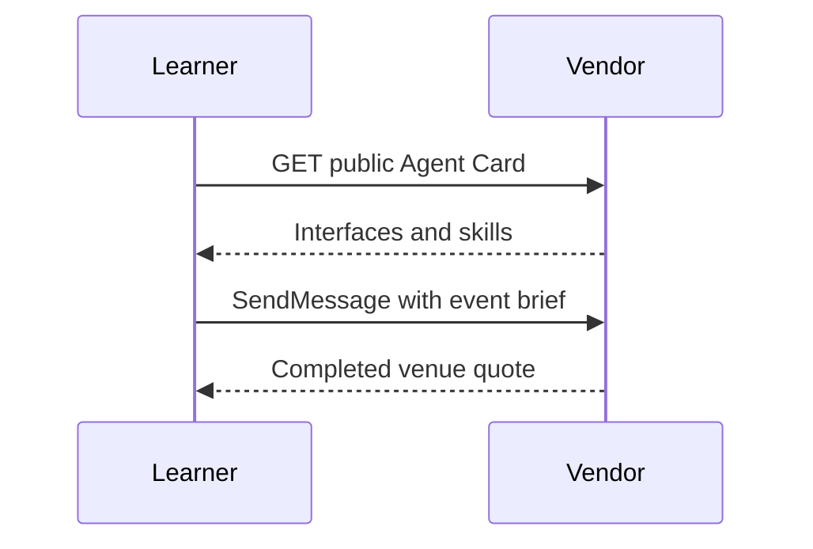

**Network and Concierge version 00:** what's new — setup and orientation.

# Module 00: Setup and orientation
> After this module you can discover a vendor.

**Time:** ~90 min · **Level:** Beginner · **LLM needed:** No for examples and grading · **Agents running:** in-process; optional local network: uv run python scripts/network.py up --module 00
**Spec sections:** [Specification](https://a2a-protocol.org/v1.0.1/specification/) · [a2a.proto](https://github.com/a2aproject/A2A/blob/v1.0.1/specification/a2a.proto)

## Prerequisites

Python functions and dictionaries, plus the preceding module in [the learning path](../../LEARNING_PATH.md). New terms appear in [the glossary](../../docs/GLOSSARY.md).

## Learning objectives

- Discover a vendor
- Run an offline example
- Distinguish A2A from MCP

## The big idea

A2A gives independently operated agents a shared contract. A vendor can change its internal code without changing how Maplewood discovers its skills or requests a quote. HTTP is a request and response exchange; JSON is the text format used for structured values. Start with a ready-made deterministic agent so that networking and model behavior do not become tangled.

**Analogy:** A business directory tells you who offers a service without revealing how they run their office.

Read the [feature companion](../../docs/FEATURE_DEEP_DIVES.md) for field semantics, failure cases and
the connection to the final deployment.

## How it works



Under the hood: Discovery is a normal HTTP GET. The returned JSON describes the agent; sending work is a separate request. The first demo runs on loopback without credentials. The in-process examples make the same exchanges without opening a port.

## On the wire

Executed by the course authoring tool through the same recording transport as scripts/wiretap.py. Credentials are redacted. Pure local transformations have no HTTP exchanges and an empty exchange file; their result is separate. gRPC captures are explicitly service-boundary protobuf roundtrips, not network packets.

- [discover: exchanges](wire/01_discover.jsonl) and [result](wire/01_discover.result.json).
- [data: exchanges](wire/02_data.jsonl) and [result](wire/02_data.result.json).
- [jsonrpc: exchanges](wire/03_jsonrpc.jsonl) and [result](wire/03_jsonrpc.result.json).

## Key APIs at a glance

| SDK API or labeled course helper | Spec operation or object | What it does | When to use it |
|---|---|---|---|
| AgentCard | Discovery document | Read supported interfaces and skills | Before sending work |
| httpx.AsyncClient.get | HTTP discovery | Fetch the configured card URL | First manual client |

## Walkthrough

### 01: discover

Discover a vendor.

> **Predict, then run:** Write the expected result and whether this operation creates, continues or inspects work.

```console
uv run python modules/00_setup/examples/01_discover.py
```

Captured output (generated values vary):

```json
{
  "result_type": "dict",
  "complete_result": "wire/01_discover.result.json"
}
```
### 02: data

Run an offline example.

> **Predict, then run:** Write the expected result and whether this operation creates, continues or inspects work.

```console
uv run python modules/00_setup/examples/02_data.py
```

Captured output (generated values vary):

```json
{
  "title": "Maplewood gathering 1",
  "guests": 40,
  "date": "2027-06-01",
  "budget_cents": 720000,
  "dietary": {
    "vegan": 8,
    "standard": 32
  },
  "rooms": 20,
  "needs": [
    "venues",
    "catering",
    "av",
    "travel",
    "print"
  ]
}
```
### 03: jsonrpc

Distinguish A2A from MCP.

> **Predict, then run:** Write the expected result and whether this operation creates, continues or inspects work.

```console
uv run python modules/00_setup/examples/03_jsonrpc.py
```

Captured output (generated values vary):

```json
{
  "result": {
    "task": {
      "status": {
        "state": "TASK_STATE_COMPLETED",
        "message": {
          "role": "ROLE_AGENT",
          "parts": [
            {
              "text": "Quote ready; no money has been spent."
            }
          ]
        }
      },
      "artifacts": [
        {
          "artifactId": "quote",
          "name": "quote",
          "parts": [
            {
              "data": {
                "guests": 40.0,
                "vendor": "venues",
                "approved": false,
                "selection": "room-1",
                "total_cents": 80000.0,
                "currency": "USD"
              },
              "mediaType": "application/json"
            }
          ]
        }
      ],
      "history": [
        {
          "role": "ROLE_USER",
          "parts": [
            {
              "data": {
                "dietary": {
                  "standard": 30.0,
                  "vegan": 10.0
                },
                "guests": 40.0,
                "budget_cents": 1000000.0,
                "date": "2027-06-01"
              },
              "mediaType": "application/json"
            }
          ]
        },
        {
          "role": "ROLE_AGENT",
          "parts": [
            {
              "text": "venues: checking the brief"
            }
          ]
        }
      ],
      "metadata": {
        "brief": {
          "guests": 40.0,
          "dietary": {
            "standard": 30.0,
            "vegan": 10.0
          },
          "budget_cents": 1000000.0,
          "date": "2027-06-01"
        }
      }
    }
  },
  "jsonrpc": "2.0"
}
```

## Try it in the Inspector and the Control Room

Start the network in another terminal. Run uv run streamlit run control_room/app.py, select a vendor, inspect its card and send a brief. The Inspector is now a standalone binary; use [its official installation guide](https://github.com/a2aproject/a2a-inspector).

## Real-world use case

Maplewood's new planner discovers Granite's available service before sending its first offsite request.

Run:

```console
uv run python modules/00_setup/use_case/run.py
```

Selected observed fields (see [the complete captured result](wire/01_discover.result.json) for the full output):

```json
{
  "name": "Granite Hall Venues",
  "protocolBinding": "JSONRPC",
  "protocolVersion": "1.0"
}
```

A real deployment retains this boundary while substituting its own approved inventory, identity provider and operating policy.

## Common bugs

| Observed behavior | Cause | Fix and related practice |
|---|---|---|
| Connection refused | Vendor process is stopped | Start network.py in a second terminal; [practice 00-02](../../gym/tasks/00/00-02_fix/task.md) |
| Port already in use | Another network owns the fixed port | Run network.py down for that supervisor and retry; [practice 00-02](../../gym/tasks/00/00-02_fix/task.md) |
| Gym reports no attempt | gym start was skipped | Create the workspace attempt before checking; [practice 00-02](../../gym/tasks/00/00-02_fix/task.md) |
| Local service exposed to the LAN | Wildcard address selected | Use 127.0.0.1 for unauthenticated demos; [practice 00-02](../../gym/tasks/00/00-02_fix/task.md) |

## Practice

| ID | Type | Level | Concept |
|---|---|---|---|
| [00-01](../../gym/tasks/00/00-01_build/task.md) | build | medium | Select the loopback vendor URL |
| [00-02](../../gym/tasks/00/00-02_fix/task.md) | fix | easy | Repair: select the loopback vendor url |
| [00-03](../../gym/tasks/00/00-03_predict/task.md) | predict | easy | Predict the first experiment's observable result |
| [00-04](../../gym/tasks/00/00-04_trace/task.md) | trace | medium | Identify the captured transport boundaries |
| [00-05](../../gym/tasks/00/00-05_conformance/task.md) | conformance | hard | Enforce the contract across edge cases |
| [00-06](../../gym/tasks/00/00-06_design/task.md) | design | hard | Design a partner contract and failure policy |

## Quiz

1. Which command installs the locked Python environment?
<details><summary>Answer</summary>Run uv sync from the repository root; later offline runs reuse the installed dependencies.</details>

2. Does reading a card create a task?
<details><summary>Answer</summary>No. Discovery describes the service; SendMessage requests work.</details>

3. Why can Tier 1 run without model keys?
<details><summary>Answer</summary>Its inventory checks and quotes are deterministic Python.</details>

4. What does 127.0.0.1 mean?
<details><summary>Answer</summary>The local computer's loopback interface, reachable only from that computer.</details>

5. Where should you edit a gym attempt?
<details><summary>Answer</summary>In workspace after gym start, leaving the trusted task tests unchanged.</details>

6. Is the kitchen inventory lookup A2A or MCP?
<details><summary>Answer</summary>An internal tool lookup belongs to MCP; delegation to the independent caterer belongs to A2A.</details>

## Key takeaways

- Run uv sync from the repository root; later offline runs reuse the installed dependencies.
- No. Discovery describes the service; SendMessage requests work.
- Its inventory checks and quotes are deterministic Python.
- The local computer's loopback interface, reachable only from that computer.
- In workspace after gym start, leaving the trusted task tests unchanged.

## Go deeper

[Specification](https://a2a-protocol.org/v1.0.1/specification/) · [Protobuf](https://github.com/a2aproject/A2A/blob/v1.0.1/specification/a2a.proto) · [Official SDK](https://github.com/a2aproject/a2a-python/tree/v1.3.0)

## Next: Module 01

Use [the learning path](../../LEARNING_PATH.md) to continue or choose a capstone.
