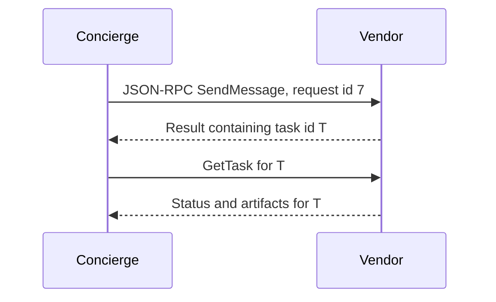

**Network and Concierge version 01:** what's new — how a2a works.

# Module 01: How A2A works
> After this module you can read a json-rpc envelope.

**Time:** ~90 min · **Level:** Beginner · **LLM needed:** No for examples and grading · **Agents running:** in-process; optional local network: uv run python scripts/network.py up --module 01
**Spec sections:** [Specification](https://a2a-protocol.org/v1.0.1/specification/) · [a2a.proto](https://github.com/a2aproject/A2A/blob/v1.0.1/specification/a2a.proto)

## Prerequisites

Python functions and dictionaries, plus the preceding module in [the learning path](../../LEARNING_PATH.md). New terms appear in [the glossary](../../docs/GLOSSARY.md).

## Learning objectives

- Read a JSON-RPC envelope
- Identify task and context IDs
- Explain the three bindings

## The big idea

A message is a communication; a task is tracked work; an artifact is its deliverable. A context groups related interactions, like a project folder. JSON-RPC adds a method name, parameters and request ID to a JSON envelope. Its request ID correlates the response and is different from messageId and task ID. A server may return a direct Message or a Task.

**Analogy:** A work order tracks progress, while the finished estimate is a separate deliverable.

Read the [feature companion](../../docs/FEATURE_DEEP_DIVES.md) for field semantics, failure cases and
the connection to the final deployment.

## How it works



Under the hood: JSON-RPC wraps the operation and its parameters. The RPC id belongs to one exchange; the task id belongs to the work across exchanges. A context groups related interactions. The same semantics can be encoded through HTTP+JSON or protobuf/gRPC.

## On the wire

Executed by the course authoring tool through the same recording transport as scripts/wiretap.py. Credentials are redacted. Pure local transformations have no HTTP exchanges and an empty exchange file; their result is separate. gRPC captures are explicitly service-boundary protobuf roundtrips, not network packets.

- [jsonrpc: exchanges](wire/01_jsonrpc.jsonl) and [result](wire/01_jsonrpc.result.json).
- [parts: exchanges](wire/02_parts.jsonl) and [result](wire/02_parts.result.json).
- [rejected: exchanges](wire/03_rejected.jsonl) and [result](wire/03_rejected.result.json).

## Key APIs at a glance

| SDK API or labeled course helper | Spec operation or object | What it does | When to use it |
|---|---|---|---|
| Message | Communication | Carries role, parts and correlation fields | Send a brief |
| Task | Tracked work | Carries status, history and artifacts | Poll or continue work |

## Walkthrough

### Inspect one envelope without an A2A SDK

Run uv run python modules/01_how_a2a_works/examples/04_manual_envelope.py.
The [small server](../../common/manual_server.py) handles one operation with
ordinary Python dictionaries. Its [actual capture](wire/manual.jsonl) shows the
same SendMessage envelope used by the official SDK.

> **Predict, then run:** Which identifier comes back unchanged: the JSON-RPC id,
> messageId or task id? The RPC id correlates the response. The server creates
> a separate task id for the work.

This microscope has no network listener and implements only SendMessage. It is
not a complete A2A server. Module 03 introduces the SDK's full route handlers,
which enforce the remaining lifecycle and capability contracts.

### 01: jsonrpc

Read a JSON-RPC envelope.

> **Predict, then run:** Write the expected result and whether this operation creates, continues or inspects work.

```console
uv run python modules/01_how_a2a_works/examples/01_jsonrpc.py
```

Captured output (generated values vary):

```json
{
  "result": {
    "task": {
      "status": {
        "state": "TASK_STATE_COMPLETED",
        "message": {
          "role": "ROLE_AGENT",
          "parts": [
            {
              "text": "Quote ready; no money has been spent."
            }
          ]
        }
      },
      "artifacts": [
        {
          "artifactId": "quote",
          "name": "quote",
          "parts": [
            {
              "data": {
                "guests": 40.0,
                "vendor": "venues",
                "approved": false,
                "selection": "room-1",
                "total_cents": 80000.0,
                "currency": "USD"
              },
              "mediaType": "application/json"
            }
          ]
        }
      ],
      "history": [
        {
          "role": "ROLE_USER",
          "parts": [
            {
              "data": {
                "dietary": {
                  "standard": 30.0,
                  "vegan": 10.0
                },
                "guests": 40.0,
                "budget_cents": 1000000.0,
                "date": "2027-06-01"
              },
              "mediaType": "application/json"
            }
          ]
        },
        {
          "role": "ROLE_AGENT",
          "parts": [
            {
              "text": "venues: checking the brief"
            }
          ]
        }
      ],
      "metadata": {
        "brief": {
          "guests": 40.0,
          "dietary": {
            "standard": 30.0,
            "vegan": 10.0
          },
          "budget_cents": 1000000.0,
          "date": "2027-06-01"
        }
      }
    }
  },
  "jsonrpc": "2.0"
}
```
### 02: parts

Identify task and context IDs.

> **Predict, then run:** Write the expected result and whether this operation creates, continues or inspects work.

```console
uv run python modules/01_how_a2a_works/examples/02_parts.py
```

Captured output (generated values vary):

```json
[
  {
    "text": "Floor plan"
  },
  {
    "raw": "c3ludGhldGljIGZsb29yIHBsYW4=",
    "filename": "plan.txt",
    "mediaType": "text/plain"
  },
  {
    "url": "https://maplewood.example/plan",
    "mediaType": "text/plain"
  },
  {
    "data": {
      "total_cents": 96000.0
    },
    "mediaType": "application/json"
  }
]
```
### 03: rejected

Explain the three bindings.

> **Predict, then run:** Write the expected result and whether this operation creates, continues or inspects work.

```console
uv run python modules/01_how_a2a_works/examples/03_rejected.py
```

Captured output (generated values vary):

```json
{
  "task": {
    "status": {
      "state": "TASK_STATE_REJECTED",
      "message": {
        "role": "ROLE_AGENT",
        "parts": [
          {
            "text": "No available room has sufficient capacity."
          }
        ]
      }
    },
    "history": [
      {
        "role": "ROLE_USER",
        "parts": [
          {
            "data": {
              "guests": 900.0
            },
            "mediaType": "application/json"
          }
        ]
      },
      {
        "role": "ROLE_AGENT",
        "parts": [
          {
            "text": "venues: checking the brief"
          }
        ]
      }
    ],
    "metadata": {
      "brief": {
        "guests": 900.0
      }
    }
  }
}
```

## Try it in the Inspector and the Control Room

Start the network in another terminal. Run uv run streamlit run control_room/app.py, select a vendor, inspect its card and send a brief. The Inspector is now a standalone binary; use [its official installation guide](https://github.com/a2aproject/a2a-inspector).

## Real-world use case

Maplewood compares an RPC exchange ID with the vendor's longer-lived work-order ID while requesting a venue quote.

Run:

```console
uv run python modules/01_how_a2a_works/use_case/run.py
```

Selected observed fields (see [the complete captured result](wire/01_jsonrpc.result.json) for the full output):

```json
{
  "state": "TASK_STATE_COMPLETED",
  "name": "quote",
  "vendor": "venues",
  "total_cents": 80000.0,
  "currency": "USD"
}
```

A real deployment retains this boundary while substituting its own approved inventory, identity provider and operating policy.

## Common bugs

| Observed behavior | Cause | Fix and related practice |
|---|---|---|
| Invalid params | Message fields placed directly in params | Nest the message under params.message; [practice 01-02](../../gym/tasks/01/01-02_fix/task.md) |
| Response matched to the wrong request | Task id used as RPC id | Track exchange and work identifiers separately; [practice 01-02](../../gym/tasks/01/01-02_fix/task.md) |
| Quote text mistaken for task status | Reading prose instead of typed fields | Read status.state and artifacts; [practice 01-02](../../gym/tasks/01/01-02_fix/task.md) |
| GetTask returns not found | Message id supplied as task id | Use the task id returned by the server; [practice 01-02](../../gym/tasks/01/01-02_fix/task.md) |

## Practice

| ID | Type | Level | Concept |
|---|---|---|---|
| [01-01](../../gym/tasks/01/01-01_build/task.md) | build | medium | Construct a SendMessage envelope |
| [01-02](../../gym/tasks/01/01-02_fix/task.md) | fix | easy | Repair: construct a sendmessage envelope |
| [01-03](../../gym/tasks/01/01-03_predict/task.md) | predict | easy | Predict the first experiment's observable result |
| [01-04](../../gym/tasks/01/01-04_trace/task.md) | trace | medium | Identify the captured transport boundaries |
| [01-05](../../gym/tasks/01/01-05_conformance/task.md) | conformance | hard | Enforce the contract across edge cases |
| [01-06](../../gym/tasks/01/01-06_design/task.md) | design | hard | Design a partner contract and failure policy |

## Quiz

1. Which ID matches an RPC response to its request?
<details><summary>Answer</summary>The top-level JSON-RPC id, not messageId or task id.</details>

2. Where does SendMessage's message go?
<details><summary>Answer</summary>Inside params.message in a JSON-RPC request.</details>

3. Must every response create a task?
<details><summary>Answer</summary>No. An agent may reply with a direct Message when tracked work is unnecessary.</details>

4. What does contextId group?
<details><summary>Answer</summary>Related interactions; it does not authorize access to other tasks.</details>

5. Is an artifact the same as a status message?
<details><summary>Answer</summary>No. Artifacts are deliverables, while status messages explain progress or missing input.</details>

6. Why compare three bindings?
<details><summary>Answer</summary>To recognize the same operations despite different HTTP paths, envelopes and protobuf encoding.</details>

## Key takeaways

- The top-level JSON-RPC id, not messageId or task id.
- Inside params.message in a JSON-RPC request.
- No. An agent may reply with a direct Message when tracked work is unnecessary.
- Related interactions; it does not authorize access to other tasks.
- No. Artifacts are deliverables, while status messages explain progress or missing input.

## Go deeper

[Specification](https://a2a-protocol.org/v1.0.1/specification/) · [Protobuf](https://github.com/a2aproject/A2A/blob/v1.0.1/specification/a2a.proto) · [Official SDK](https://github.com/a2aproject/a2a-python/tree/v1.3.0)

## Next: Module 02

Use [the learning path](../../LEARNING_PATH.md) to continue or choose a capstone.
