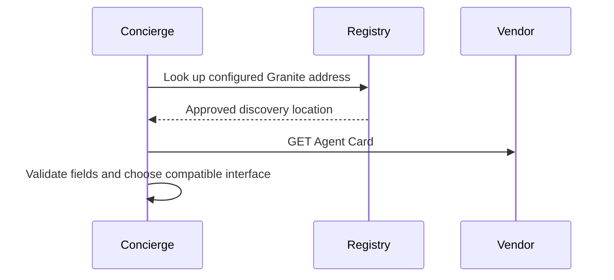

**Network and Concierge version 02:** what's new — agent cards and discovery.

# Module 02: Agent Cards and discovery
> After this module you can validate a card against protobuf.

**Time:** ~90 min · **Level:** Beginner · **LLM needed:** No for examples and grading · **Agents running:** in-process; optional local network: uv run python scripts/network.py up --module 02
**Spec sections:** [Specification](https://a2a-protocol.org/v1.0.1/specification/) · [a2a.proto](https://github.com/a2aproject/A2A/blob/v1.0.1/specification/a2a.proto)

## Prerequisites

Python functions and dictionaries, plus the preceding module in [the learning path](../../LEARNING_PATH.md). New terms appear in [the glossary](../../docs/GLOSSARY.md).

## Learning objectives

- Validate a card against protobuf
- Select a supported interface
- Build a local registry

## The big idea

An Agent Card describes identity, ordered interfaces, capabilities, input and output media types, skills and security requirements. Discovery does not establish trust. A registry is a directory of configured locations, not permission to contact every URL it returns. A skill description is untrusted descriptive text, not an instruction to the Concierge.

**Analogy:** Read a vendor's business card, then check that it came from the vendor you trust.

Read the [feature companion](../../docs/FEATURE_DEEP_DIVES.md) for field semantics, failure cases and
the connection to the final deployment.

## How it works



Under the hood: The registry supplies candidate locations. Card parsing checks structure; operator policy checks trust. Select the URL, binding, protocol version and tenant from the same interface. A provider description, skill text or signature from an unknown key cannot grant authority.

## On the wire

Executed by the course authoring tool through the same recording transport as scripts/wiretap.py. Credentials are redacted. Pure local transformations have no HTTP exchanges and an empty exchange file; their result is separate. gRPC captures are explicitly service-boundary protobuf roundtrips, not network packets.

- [discover: exchanges](wire/01_discover.jsonl) and [result](wire/01_discover.result.json).
- [validate_card: exchanges](wire/02_validate_card.jsonl) and [result](wire/02_validate_card.result.json).
- [registry: exchanges](wire/03_registry.jsonl) and [result](wire/03_registry.result.json).

## Key APIs at a glance

| SDK API or labeled course helper | Spec operation or object | What it does | When to use it |
|---|---|---|---|
| AgentCard | Discovery contract | Describes identity, interfaces and skills | Validate discovered cards |
| google.protobuf.json_format.ParseDict | ProtoJSON conversion | Rejects malformed field shapes | Validate authored examples |

## Walkthrough

### 01: discover

Validate a card against protobuf.

> **Predict, then run:** Write the expected result and whether this operation creates, continues or inspects work.

```console
uv run python modules/02_agent_cards/examples/01_discover.py
```

Captured output (generated values vary):

```json
{
  "result_type": "dict",
  "complete_result": "wire/01_discover.result.json"
}
```
### 02: validate card

Select a supported interface.

> **Predict, then run:** Write the expected result and whether this operation creates, continues or inspects work.

```console
uv run python modules/02_agent_cards/examples/02_validate_card.py
```

Captured output (generated values vary):

```json
{
  "result_type": "dict",
  "complete_result": "wire/02_validate_card.result.json"
}
```
### 03: registry

Build a local registry.

> **Predict, then run:** Write the expected result and whether this operation creates, continues or inspects work.

```console
uv run python modules/02_agent_cards/examples/03_registry.py
```

Captured output (generated values vary):

```json
{
  "venues": [
    {
      "url": "http://127.0.0.1:8100/rpc",
      "protocolBinding": "JSONRPC",
      "protocolVersion": "1.0"
    },
    {
      "url": "http://127.0.0.1:8100",
      "protocolBinding": "HTTP+JSON",
      "protocolVersion": "1.0"
    }
  ]
}
```

## Try it in the Inspector and the Control Room

Start the network in another terminal. Run uv run streamlit run control_room/app.py, select a vendor, inspect its card and send a brief. The Inspector is now a standalone binary; use [its official installation guide](https://github.com/a2aproject/a2a-inspector).

## Real-world use case

Maplewood onboards Granite into a configured directory and inspects the card before selecting its interface.

Run:

```console
uv run python modules/02_agent_cards/use_case/run.py
```

Selected observed fields (see [the complete captured result](wire/01_discover.result.json) for the full output):

```json
{
  "name": "Granite Hall Venues",
  "protocolBinding": "JSONRPC",
  "protocolVersion": "1.0"
}
```

A real deployment retains this boundary while substituting its own approved inventory, identity provider and operating policy.

## Common bugs

| Observed behavior | Cause | Fix and related practice |
|---|---|---|
| Unsupported binding error | First interface selected without checking support | Choose a compatible complete interface; [practice 02-02](../../gym/tasks/02/02-02_fix/task.md) |
| Credentials reach an unexpected host | Card URL treated as authority | Use configured destinations and separate trust policy; [practice 02-02](../../gym/tasks/02/02-02_fix/task.md) |
| Required field missing | Card authored without validating structure | Parse against the current AgentCard type; [practice 02-25](../../gym/tasks/02/02-25_discovery_validate/task.md) |
| Client calls an unadvertised operation | Capabilities ignored | Check the advertised capability before choosing the operation; [practice 02-22](../../gym/tasks/02/02-22_discovery_capabilities/task.md) |

## Practice

| ID | Type | Level | Concept |
|---|---|---|---|
| [02-01](../../gym/tasks/02/02-01_build/task.md) | build | medium | Select a compatible advertised interface |
| [02-02](../../gym/tasks/02/02-02_fix/task.md) | fix | easy | Repair: select a compatible advertised interface |
| [02-03](../../gym/tasks/02/02-03_predict/task.md) | predict | easy | Predict the first experiment's observable result |
| [02-04](../../gym/tasks/02/02-04_trace/task.md) | trace | medium | Identify the captured transport boundaries |
| [02-05](../../gym/tasks/02/02-05_conformance/task.md) | conformance | hard | Enforce the contract across edge cases |
| [02-06](../../gym/tasks/02/02-06_design/task.md) | design | hard | Design a partner contract and failure policy |

### Full boundary exercises

- [02-20: Discover binding preference order](../../gym/tasks/02/02-20_discovery_interfaces/task.md)
- [02-21: Select Granite's quote contract](../../gym/tasks/02/02-21_discovery_skill/task.md)
- [02-22: Read capability defaults](../../gym/tasks/02/02-22_discovery_capabilities/task.md)
- [02-23: Choose an advertised input representation](../../gym/tasks/02/02-23_discovery_media/task.md)
- [02-24: Resolve a named security requirement](../../gym/tasks/02/02-24_discovery_security/task.md)
- [02-25: Validate discovered ProtoJSON](../../gym/tasks/02/02-25_discovery_validate/task.md)

These tasks execute actual SDK routes, workflows, cryptographic checks or independent
database connections offline. Each starter must fail and each reference solution must pass.

## Quiz

1. Does a valid protobuf card establish trust?
<details><summary>Answer</summary>No. Parsing checks structure; configured identity and key policy establish trust.</details>

2. Which version belongs to the wire interface?
<details><summary>Answer</summary>supportedInterfaces[].protocolVersion; the card's version describes the agent product.</details>

3. May a registry entry redirect credentials anywhere?
<details><summary>Answer</summary>No. Only operator-approved destinations receive credentials.</details>

4. Can a skill override default media modes?
<details><summary>Answer</summary>A skill can refine its supported input and output modes.</details>

5. What does an absent streaming capability mean?
<details><summary>Answer</summary>Do not assume the agent supports streaming operations.</details>

6. What happens when no binding is compatible?
<details><summary>Answer</summary>Fail clearly or choose another approved agent; do not combine fields from incompatible interfaces.</details>

## Key takeaways

- No. Parsing checks structure; configured identity and key policy establish trust.
- supportedInterfaces[].protocolVersion; the card's version describes the agent product.
- No. Only operator-approved destinations receive credentials.
- A skill can refine its supported input and output modes.
- Do not assume the agent supports streaming operations.

## Go deeper

[Specification](https://a2a-protocol.org/v1.0.1/specification/) · [Protobuf](https://github.com/a2aproject/A2A/blob/v1.0.1/specification/a2a.proto) · [Official SDK](https://github.com/a2aproject/a2a-python/tree/v1.3.0)

## Next: Module 03

Use [the learning path](../../LEARNING_PATH.md) to continue or choose a capstone.
