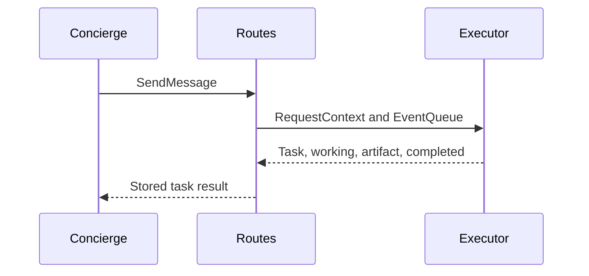

**Network and Concierge version 03:** what's new — your first a2a server.

# Module 03: Your first A2A server
> After this module you can compose sdk routes.

**Time:** ~90 min · **Level:** Beginner · **LLM needed:** No for examples and grading · **Agents running:** in-process; optional local network: uv run python scripts/network.py up --module 03
**Spec sections:** [Specification](https://a2a-protocol.org/v1.0.1/specification/) · [a2a.proto](https://github.com/a2aproject/A2A/blob/v1.0.1/specification/a2a.proto)

## Prerequisites

Python functions and dictionaries, plus the preceding module in [the learning path](../../LEARNING_PATH.md). New terms appear in [the glossary](../../docs/GLOSSARY.md).

## Learning objectives

- Compose SDK routes
- Emit a valid task stream
- Reject an impossible booking

## The big idea

The executor performs business work. The SDK handles routing, serialization, task storage and subscribers. An async function cooperatively yields while waiting rather than blocking other work. A new task starts with a Task event. Thereafter it produces status and artifact updates. A one-message response is a separate pattern and cannot be mixed with task events. The current SDK owns snapshots when resuming stored tasks.

**Analogy:** A reception desk routes work orders; the estimator does the work and reports progress.

Read the [feature companion](../../docs/FEATURE_DEEP_DIVES.md) for field semantics, failure cases and
the connection to the final deployment.

## How it works



Under the hood: Route factories adapt transport messages to the handler. The executor emits one new Task followed by updates. When work resumes, the SDK already owns the snapshot. A direct Message response is the alternative pattern, not an extra event after a task stream.

## On the wire

Executed by the course authoring tool through the same recording transport as scripts/wiretap.py. Credentials are redacted. Pure local transformations have no HTTP exchanges and an empty exchange file; their result is separate. gRPC captures are explicitly service-boundary protobuf roundtrips, not network packets.

- [rest: exchanges](wire/01_rest.jsonl) and [result](wire/01_rest.result.json).
- [stream: exchanges](wire/02_stream.jsonl) and [result](wire/02_stream.result.json).
- [rejected: exchanges](wire/03_rejected.jsonl) and [result](wire/03_rejected.result.json).

## Key APIs at a glance

| SDK API or labeled course helper | Spec operation or object | What it does | When to use it |
|---|---|---|---|
| a2a.server.agent_execution.AgentExecutor | Execution boundary | Implements execute and cancel | Wrap vendor work |
| a2a.server.routes.create_rest_routes | HTTP+JSON binding | Adds routes to a normal ASGI app | Expose the handler |

## Walkthrough

### 01: rest

Compose SDK routes.

> **Predict, then run:** Write the expected result and whether this operation creates, continues or inspects work.

```console
uv run python modules/03_first_server/examples/01_rest.py
```

Captured output (generated values vary):

```json
{
  "task": {
    "status": {
      "state": "TASK_STATE_COMPLETED",
      "message": {
        "role": "ROLE_AGENT",
        "parts": [
          {
            "text": "Quote ready; no money has been spent."
          }
        ]
      }
    },
    "artifacts": [
      {
        "artifactId": "quote",
        "name": "quote",
        "parts": [
          {
            "data": {
              "guests": 40.0,
              "vendor": "venues",
              "approved": false,
              "selection": "room-1",
              "total_cents": 80000.0,
              "currency": "USD"
            },
            "mediaType": "application/json"
          }
        ]
      }
    ],
    "history": [
      {
        "role": "ROLE_USER",
        "parts": [
          {
            "data": {
              "dietary": {
                "standard": 30.0,
                "vegan": 10.0
              },
              "guests": 40.0,
              "budget_cents": 1000000.0,
              "date": "2027-06-01"
            },
            "mediaType": "application/json"
          }
        ]
      },
      {
        "role": "ROLE_AGENT",
        "parts": [
          {
            "text": "venues: checking the brief"
          }
        ]
      }
    ],
    "metadata": {
      "brief": {
        "guests": 40.0,
        "dietary": {
          "standard": 30.0,
          "vegan": 10.0
        },
        "budget_cents": 1000000.0,
        "date": "2027-06-01"
      }
    }
  }
}
```
### 02: stream

Emit a valid task stream.

> **Predict, then run:** Write the expected result and whether this operation creates, continues or inspects work.

```console
uv run python modules/03_first_server/examples/02_stream.py
```

Captured output (generated values vary):

```json
{
  "result_type": "list",
  "complete_result": "wire/02_stream.result.json"
}
```
### 03: rejected

Reject an impossible booking.

> **Predict, then run:** Write the expected result and whether this operation creates, continues or inspects work.

```console
uv run python modules/03_first_server/examples/03_rejected.py
```

Captured output (generated values vary):

```json
{
  "task": {
    "status": {
      "state": "TASK_STATE_REJECTED",
      "message": {
        "role": "ROLE_AGENT",
        "parts": [
          {
            "text": "No available room has sufficient capacity."
          }
        ]
      }
    },
    "history": [
      {
        "role": "ROLE_USER",
        "parts": [
          {
            "data": {
              "guests": 900.0
            },
            "mediaType": "application/json"
          }
        ]
      },
      {
        "role": "ROLE_AGENT",
        "parts": [
          {
            "text": "venues: checking the brief"
          }
        ]
      }
    ],
    "metadata": {
      "brief": {
        "guests": 900.0
      }
    }
  }
}
```

## Try it in the Inspector and the Control Room

Start the network in another terminal. Run uv run streamlit run control_room/app.py, select a vendor, inspect its card and send a brief. The Inspector is now a standalone binary; use [its official installation guide](https://github.com/a2aproject/a2a-inspector).

## Real-world use case

Granite exposes its venue inventory through an SDK handler and returns a tracked quote with an explicit final status.

Run:

```console
uv run python modules/03_first_server/use_case/run.py
```

Selected observed fields (see [the complete captured result](wire/01_rest.result.json) for the full output):

```json
{
  "state": "TASK_STATE_COMPLETED",
  "name": "quote",
  "vendor": "venues",
  "total_cents": 80000.0,
  "currency": "USD"
}
```

A real deployment retains this boundary while substituting its own approved inventory, identity provider and operating policy.

## Common bugs

| Observed behavior | Cause | Fix and related practice |
|---|---|---|
| Task stays working | Executor returned without final or paused update | Emit a valid final or interrupted state; [practice 03-02](../../gym/tasks/03/03-02_fix/task.md) |
| Invalid event sequence | Direct reply mixed with task updates | Choose one streaming pattern; [practice 03-02](../../gym/tasks/03/03-02_fix/task.md) |
| Resumption conflicts with stored task | Executor reintroduces the Task snapshot | Emit updates for the existing task; [practice 03-02](../../gym/tasks/03/03-02_fix/task.md) |
| Business rejection becomes an HTTP crash | Inventory failure not translated | Emit TASK_STATE_REJECTED for impossible work; [practice 03-02](../../gym/tasks/03/03-02_fix/task.md) |

## Practice

| ID | Type | Level | Concept |
|---|---|---|---|
| [03-01](../../gym/tasks/03/03-01_build/task.md) | build | medium | Order a task lifecycle stream |
| [03-02](../../gym/tasks/03/03-02_fix/task.md) | fix | easy | Repair: order a task lifecycle stream |
| [03-03](../../gym/tasks/03/03-03_predict/task.md) | predict | easy | Predict the first experiment's observable result |
| [03-04](../../gym/tasks/03/03-04_trace/task.md) | trace | medium | Identify the captured transport boundaries |
| [03-05](../../gym/tasks/03/03-05_conformance/task.md) | conformance | hard | Enforce the contract across edge cases |
| [03-06](../../gym/tasks/03/03-06_design/task.md) | design | hard | Design a partner contract and failure policy |

### Full boundary exercises

- [03-40: Inspect the hand-built server: send](../../gym/tasks/03/03-40_manual_send/task.md)
- [03-41: Inspect the hand-built server: get](../../gym/tasks/03/03-41_manual_get/task.md)
- [03-42: Inspect the hand-built server: missing](../../gym/tasks/03/03-42_manual_missing/task.md)
- [03-43: Inspect the hand-built server: parse](../../gym/tasks/03/03-43_manual_parse/task.md)
- [03-44: Inspect the hand-built server: method](../../gym/tasks/03/03-44_manual_method/task.md)
- [03-45: Inspect the hand-built server: rejected](../../gym/tasks/03/03-45_manual_rejected/task.md)

These tasks execute actual SDK routes, workflows, cryptographic checks or independent
database connections offline. Each starter must fail and each reference solution must pass.

## Quiz

1. What does execute receive?
<details><summary>Answer</summary>The request context and event queue used to publish task events.</details>

2. Who stores the task snapshot?
<details><summary>Answer</summary>The SDK handler and its configured task store.</details>

3. Can an executor mix a direct Message with task updates?
<details><summary>Answer</summary>No. Choose one of the mutually exclusive response patterns.</details>

4. What must happen before execute returns?
<details><summary>Answer</summary>Tracked work must reach a terminal or paused state.</details>

5. Should a resumed task emit its original Task again?
<details><summary>Answer</summary>No. Continue with updates; the SDK owns the resumed snapshot.</details>

6. Why first build a server without the SDK?
<details><summary>Answer</summary>To see routing and envelope mechanics before the SDK manages the full protocol.</details>

## Key takeaways

- The request context and event queue used to publish task events.
- The SDK handler and its configured task store.
- No. Choose one of the mutually exclusive response patterns.
- Tracked work must reach a terminal or paused state.
- No. Continue with updates; the SDK owns the resumed snapshot.

## Go deeper

[Specification](https://a2a-protocol.org/v1.0.1/specification/) · [Protobuf](https://github.com/a2aproject/A2A/blob/v1.0.1/specification/a2a.proto) · [Official SDK](https://github.com/a2aproject/a2a-python/tree/v1.3.0)

## Next: Module 04

Use [the learning path](../../LEARNING_PATH.md) to continue or choose a capstone.

## Build the two-operation microscope

Run `uv run python modules/03_first_server/examples/04_manual_get.py`. Read
[the actual SendMessage/GetTask capture](wire/04_manual_get.jsonl). Predict which
ID changes between the exchanges and which task ID remains stable. The complete
SDK server used in later examples adds the remaining operations and security.
