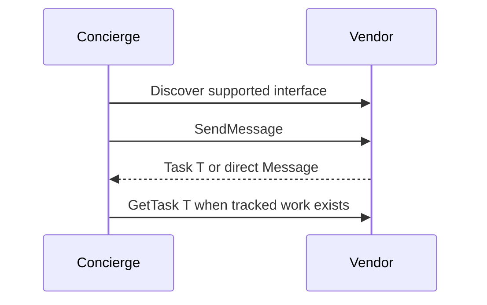

**Network and Concierge version 04:** what's new — your first a2a client.

# Module 04: Your first A2A client
> After this module you can create an sdk client.

**Time:** ~90 min · **Level:** Beginner · **LLM needed:** No for examples and grading · **Agents running:** in-process; optional local network: uv run python scripts/network.py up --module 04
**Spec sections:** [Specification](https://a2a-protocol.org/v1.0.1/specification/) · [a2a.proto](https://github.com/a2aproject/A2A/blob/v1.0.1/specification/a2a.proto)

## Prerequisites

Python functions and dictionaries, plus the preceding module in [the learning path](../../LEARNING_PATH.md). New terms appear in [the glossary](../../docs/GLOSSARY.md).

## Learning objectives

- Create an SDK client
- Handle protocol errors
- Separate safe retries from side effects

## The big idea

The client reads the card and selects an interface it understands. It sends A2A-Version: 1.0 and authenticates in headers. A timeout means the caller did not see a result; it does not prove that work was not performed. Retrying a purchase blindly can duplicate spending. Message IDs identify messages, but the protocol does not grant universal exactly-once execution.

**Analogy:** A lost phone connection does not mean a vendor tore up your order.

Read the [feature companion](../../docs/FEATURE_DEEP_DIVES.md) for field semantics, failure cases and
the connection to the final deployment.

## How it works



Under the hood: An SDK client selects a binding from the card. Manual httpx clients must construct the same wire contract themselves. Always distinguish task results from direct messages. A timeout is an unknown outcome, so only retry operations whose business effects can be reconciled.

## On the wire

Executed by the course authoring tool through the same recording transport as scripts/wiretap.py. Credentials are redacted. Pure local transformations have no HTTP exchanges and an empty exchange file; their result is separate. gRPC captures are explicitly service-boundary protobuf roundtrips, not network packets.

- [sdk_client: exchanges](wire/01_sdk_client.jsonl) and [result](wire/01_sdk_client.result.json).
- [rest: exchanges](wire/02_rest.jsonl) and [result](wire/02_rest.result.json).
- [errors: exchanges](wire/03_errors.jsonl) and [result](wire/03_errors.result.json).

## Key APIs at a glance

| SDK API or labeled course helper | Spec operation or object | What it does | When to use it |
|---|---|---|---|
| a2a.client.create_client | Client construction | Selects an advertised transport | Use the official client |
| a2a.client.ClientConfig | Client configuration | Controls client transport behavior | Supply the in-process HTTP client |

## Walkthrough

### 01: sdk client

Create an SDK client.

> **Predict, then run:** Write the expected result and whether this operation creates, continues or inspects work.

```console
uv run python modules/04_first_client/examples/01_sdk_client.py
```

Captured output (generated values vary):

```json
[
  {
    "task": {
      "status": {
        "state": "TASK_STATE_COMPLETED",
        "message": {
          "role": "ROLE_AGENT",
          "parts": [
            {
              "text": "Quote ready; no money has been spent."
            }
          ]
        }
      },
      "artifacts": [
        {
          "artifactId": "quote",
          "name": "quote",
          "parts": [
            {
              "data": {
                "guests": 40.0,
                "vendor": "venues",
                "approved": false,
                "selection": "room-1",
                "total_cents": 80000.0,
                "currency": "USD"
              },
              "mediaType": "application/json"
            }
          ]
        }
      ],
      "history": [
        {
          "role": "ROLE_USER",
          "parts": [
            {
              "data": {
                "dietary": {
                  "standard": 30.0,
                  "vegan": 10.0
                },
                "guests": 40.0,
                "budget_cents": 1000000.0,
                "date": "2027-06-01"
              },
              "mediaType": "application/json"
            }
          ]
        },
        {
          "role": "ROLE_AGENT",
          "parts": [
            {
              "text": "venues: checking the brief"
            }
          ]
        }
      ],
      "metadata": {
        "brief": {
          "guests": 40.0,
          "dietary": {
            "standard": 30.0,
            "vegan": 10.0
          },
          "budget_cents": 1000000.0,
          "date": "2027-06-01"
        }
      }
    }
  }
]
```
### 02: rest

Handle protocol errors.

> **Predict, then run:** Write the expected result and whether this operation creates, continues or inspects work.

```console
uv run python modules/04_first_client/examples/02_rest.py
```

Captured output (generated values vary):

```json
{
  "task": {
    "status": {
      "state": "TASK_STATE_COMPLETED",
      "message": {
        "role": "ROLE_AGENT",
        "parts": [
          {
            "text": "Quote ready; no money has been spent."
          }
        ]
      }
    },
    "artifacts": [
      {
        "artifactId": "quote",
        "name": "quote",
        "parts": [
          {
            "data": {
              "guests": 40.0,
              "vendor": "venues",
              "approved": false,
              "selection": "room-1",
              "total_cents": 80000.0,
              "currency": "USD"
            },
            "mediaType": "application/json"
          }
        ]
      }
    ],
    "history": [
      {
        "role": "ROLE_USER",
        "parts": [
          {
            "data": {
              "dietary": {
                "standard": 30.0,
                "vegan": 10.0
              },
              "guests": 40.0,
              "budget_cents": 1000000.0,
              "date": "2027-06-01"
            },
            "mediaType": "application/json"
          }
        ]
      },
      {
        "role": "ROLE_AGENT",
        "parts": [
          {
            "text": "venues: checking the brief"
          }
        ]
      }
    ],
    "metadata": {
      "brief": {
        "guests": 40.0,
        "dietary": {
          "standard": 30.0,
          "vegan": 10.0
        },
        "budget_cents": 1000000.0,
        "date": "2027-06-01"
      }
    }
  }
}
```
### 03: errors

Separate safe retries from side effects.

> **Predict, then run:** Write the expected result and whether this operation creates, continues or inspects work.

```console
uv run python modules/04_first_client/examples/03_errors.py
```

Captured output (generated values vary):

```json
{
  "error": {
    "code": 404,
    "status": "NOT_FOUND",
    "message": "Task not found",
    "details": [
      {
        "@type": "type.googleapis.com/google.rpc.ErrorInfo",
        "reason": "TASK_NOT_FOUND",
        "domain": "a2a-protocol.org",
        "metadata": {}
      }
    ]
  }
}
```

## Try it in the Inspector and the Control Room

Start the network in another terminal. Run uv run streamlit run control_room/app.py, select a vendor, inspect its card and send a brief. The Inspector is now a standalone binary; use [its official installation guide](https://github.com/a2aproject/a2a-inspector).

## Real-world use case

Maplewood replaces its manual HTTP caller with the official client while preserving the same quote contract.

Run:

```console
uv run python modules/04_first_client/use_case/run.py
```

Selected observed fields (see [the complete captured result](wire/01_sdk_client.result.json) for the full output):

```json
{
  "state": "TASK_STATE_COMPLETED",
  "name": "quote",
  "vendor": "venues",
  "total_cents": 80000.0,
  "currency": "USD"
}
```

A real deployment retains this boundary while substituting its own approved inventory, identity provider and operating policy.

## Common bugs

| Observed behavior | Cause | Fix and related practice |
|---|---|---|
| KeyError reading task | Server returned a direct Message | Branch on the response payload type; [practice 04-02](../../gym/tasks/04/04-02_fix/task.md) |
| Duplicate business effect after timeout | Blind retry of a side effect | Use application idempotency and reconciliation; [practice 04-02](../../gym/tasks/04/04-02_fix/task.md) |
| Unknown task at fallback | Original task ID sent to another server | Resume only on the original vendor; [practice 04-02](../../gym/tasks/04/04-02_fix/task.md) |
| Version not supported | Wrong interface version selected | Use its advertised protocol version; [practice 04-02](../../gym/tasks/04/04-02_fix/task.md) |

## Practice

| ID | Type | Level | Concept |
|---|---|---|---|
| [04-01](../../gym/tasks/04/04-01_build/task.md) | build | medium | Classify a response payload |
| [04-02](../../gym/tasks/04/04-02_fix/task.md) | fix | easy | Repair: classify a response payload |
| [04-03](../../gym/tasks/04/04-03_predict/task.md) | predict | easy | Predict the first experiment's observable result |
| [04-04](../../gym/tasks/04/04-04_trace/task.md) | trace | medium | Identify the captured transport boundaries |
| [04-05](../../gym/tasks/04/04-05_conformance/task.md) | conformance | hard | Enforce the contract across edge cases |
| [04-06](../../gym/tasks/04/04-06_design/task.md) | design | hard | Design a partner contract and failure policy |

### Full boundary exercises

- [04-20: Send a raw JSON-RPC quote request](../../gym/tasks/04/04-20_client_rpc/task.md)
- [04-21: Send the same brief over HTTP+JSON](../../gym/tasks/04/04-21_client_rest/task.md)
- [04-22: Choose a binding with the official client](../../gym/tasks/04/04-22_client_sdk/task.md)
- [04-23: Poll the work order you created](../../gym/tasks/04/04-23_client_poll/task.md)
- [04-24: Handle an unknown task without retrying](../../gym/tasks/04/04-24_client_missing/task.md)
- [04-25: Separate exchange and work-order identities](../../gym/tasks/04/04-25_client_correlation/task.md)

These tasks execute actual SDK routes, workflows, cryptographic checks or independent
database connections offline. Each starter must fail and each reference solution must pass.

## Quiz

1. What should a client do with a direct Message result?
<details><summary>Answer</summary>Read the message; do not invent a task ID and poll it.</details>

2. Does a timeout prove the vendor did nothing?
<details><summary>Answer</summary>No. The request may have committed before its response was lost.</details>

3. Which header selects the current protocol?
<details><summary>Answer</summary>A2A-Version: 1.0 for these pinned interfaces.</details>

4. Can an interrupted task move to a backup server?
<details><summary>Answer</summary>No. Its identity and state belong to the original server.</details>

5. When is retrying a quote reasonable?
<details><summary>Answer</summary>When it is a read-only operation under a bounded deadline and retry policy.</details>

6. What should TaskNotFound change in the UI?
<details><summary>Answer</summary>Show that the referenced work cannot be retrieved; do not report a successful quote.</details>

## Key takeaways

- Read the message; do not invent a task ID and poll it.
- No. The request may have committed before its response was lost.
- A2A-Version: 1.0 for these pinned interfaces.
- No. Its identity and state belong to the original server.
- When it is a read-only operation under a bounded deadline and retry policy.

## Go deeper

[Specification](https://a2a-protocol.org/v1.0.1/specification/) · [Protobuf](https://github.com/a2aproject/A2A/blob/v1.0.1/specification/a2a.proto) · [Official SDK](https://github.com/a2aproject/a2a-python/tree/v1.3.0)

## Next: Module 05

Use [the learning path](../../LEARNING_PATH.md) to continue or choose a capstone.
