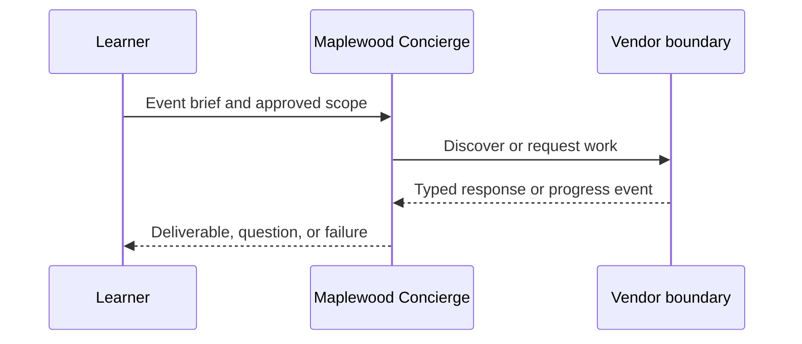

**Network and Concierge version 05:** what's new — the task lifecycle in depth.

# Module 05: The task lifecycle in depth
> After this module you can resume a paused catering task.

**Time:** ~90 min · **Level:** Beginner · **LLM needed:** No for examples and grading · **Agents running:** in-process; optional local network: uv run python scripts/network.py up --module 05
**Spec sections:** [Specification](https://a2a-protocol.org/v1.0.1/specification/) · [a2a.proto](https://github.com/a2aproject/A2A/blob/v1.0.1/specification/a2a.proto)

## Prerequisites

Python functions and dictionaries, plus the preceding module in [the learning path](../../LEARNING_PATH.md). New terms appear in [the glossary](../../docs/GLOSSARY.md).

## Learning objectives

- Resume a paused catering task
- Cancel unfinished work
- Distinguish interrupted from terminal states

## The big idea

Submitted and working are active states. Input-required and auth-required interrupt work without ending the task. Completed, failed, canceled and rejected are terminal: create a new task for new work after these states. Keep task and context IDs when answering a request for missing input. The wire uses uppercase protobuf enum names. TASK_STATE_UNSPECIFIED is a sentinel, not a useful success state.

**Analogy:** A work order awaiting dietary counts stays open; a completed quote is filed.

Read the [feature companion](../../docs/FEATURE_DEEP_DIVES.md) for field semantics, failure cases and
the connection to the final deployment.

## How it works



Under the hood: No. Cancellation changes task execution; a compensating business operation releases a hold. Compare that behavior with the captured requests and responses below.

## On the wire

Executed by the course authoring tool through the same recording transport as scripts/wiretap.py. Credentials are redacted. Pure local transformations have no HTTP exchanges and an empty exchange file; their result is separate. gRPC captures are explicitly service-boundary protobuf roundtrips, not network packets.

- [pause: exchanges](wire/01_pause.jsonl) and [result](wire/01_pause.result.json).
- [resume: exchanges](wire/02_resume.jsonl) and [result](wire/02_resume.result.json).
- [cancel: exchanges](wire/03_cancel.jsonl) and [result](wire/03_cancel.result.json).

## Key APIs at a glance

| SDK API | Spec operation or object | What it does | When to use it |
|---|---|---|---|
| a2a.types | Protobuf objects | Defines wire-compatible values | Every protocol boundary |
| create_jsonrpc_routes | JSON-RPC binding | Mounts operations | Serving JSON-RPC |
| create_rest_routes | HTTP+JSON binding | Mounts HTTP routes | Serving HTTP+JSON |
| create_client | Client operations | Selects an advertised interface | Calling vendors |
| MessageToDict | ProtoJSON | Converts protobuf into JSON values | Inspecting traffic |

## Walkthrough

### 01: pause

Resume a paused catering task.

> **Predict, then run:** Write the expected result and whether this operation creates, continues or inspects work.

```console
uv run python modules/05_task_lifecycle/examples/01_pause.py
```

Captured output (generated values vary):

```json
{
  "status": {
    "state": "TASK_STATE_INPUT_REQUIRED",
    "message": {
      "role": "ROLE_AGENT",
      "parts": [
        {
          "text": "How many guests need each dietary option?"
        }
      ]
    }
  },
  "history": [
    {
      "role": "ROLE_USER",
      "parts": [
        {
          "data": {
            "guests": 40.0
          },
          "mediaType": "application/json"
        }
      ]
    },
    {
      "role": "ROLE_AGENT",
      "parts": [
        {
          "text": "catering: checking the brief"
        }
      ]
    }
  ],
  "metadata": {
    "brief": {
      "guests": 40.0
    }
  }
}
```
### 02: resume

Cancel unfinished work.

> **Predict, then run:** Write the expected result and whether this operation creates, continues or inspects work.

```console
uv run python modules/05_task_lifecycle/examples/02_resume.py
```

Captured output (generated values vary):

```json
{
  "result_type": "dict",
  "complete_result": "wire/02_resume.result.json"
}
```
### 03: cancel

Distinguish interrupted from terminal states.

> **Predict, then run:** Write the expected result and whether this operation creates, continues or inspects work.

```console
uv run python modules/05_task_lifecycle/examples/03_cancel.py
```

Captured output (generated values vary):

```json
{
  "status": {
    "state": "TASK_STATE_CANCELED",
    "message": {
      "role": "ROLE_AGENT",
      "parts": [
        {
          "text": "Work canceled. No booking was made."
        }
      ]
    }
  },
  "history": [
    {
      "role": "ROLE_USER",
      "parts": [
        {
          "data": {
            "guests": 40.0
          },
          "mediaType": "application/json"
        }
      ]
    },
    {
      "role": "ROLE_AGENT",
      "parts": [
        {
          "text": "catering: checking the brief"
        }
      ]
    },
    {
      "role": "ROLE_AGENT",
      "parts": [
        {
          "text": "How many guests need each dietary option?"
        }
      ]
    }
  ],
  "metadata": {
    "brief": {
      "guests": 40.0
    }
  }
}
```

## Try it in the Inspector and the Control Room

Start the network in another terminal. Run uv run streamlit run control_room/app.py, select a vendor, inspect its card and send a brief. The Inspector is now a standalone binary; use [its official installation guide](https://github.com/a2aproject/a2a-inspector).

## Real-world use case

Maplewood needs quotes for a 40-person offsite. Run uv run python modules/05_task_lifecycle/use_case/run.py. The result applies this module's first experiment to shared synthetic data. A real team substitutes validated inventory and its identity system while retaining the A2A boundary.

## Common bugs

| Observed behavior | Cause | Fix |
|---|---|---|
| HTTP 401 | Missing vendor credential | Obtain the vendor token outside A2A and send a header |
| Version not supported | Missing or wrong A2A-Version | Select the card interface and send version 1.0 |
| Task remains interrupted | Required input is missing | Preserve IDs and answer the missing-input request |
| Edge-case assertion fails | Happy path was hard-coded | Work through [Fix task](../../gym/tasks/05/05-02_fix/task.md) |

## Practice

| ID | Type | Level | Concept |
|---|---|---|---|
| [05-01](../../gym/tasks/05/05-01_build/task.md) | build | medium | Distinguish terminal from interrupted states |
| [05-02](../../gym/tasks/05/05-02_fix/task.md) | fix | easy | Repair: distinguish terminal from interrupted states |
| [05-03](../../gym/tasks/05/05-03_predict/task.md) | predict | easy | Predict the first experiment's observable result |
| [05-04](../../gym/tasks/05/05-04_trace/task.md) | trace | medium | Identify the captured transport boundaries |
| [05-05](../../gym/tasks/05/05-05_conformance/task.md) | conformance | hard | Enforce the contract across edge cases |
| [05-06](../../gym/tasks/05/05-06_design/task.md) | design | hard | Design a partner contract and failure policy |

### Full boundary exercises

- [05-07: Resume Saffron without losing its work order](../../gym/tasks/05/05-07_resume/task.md)
- [05-20: Continue Saffron's stored work order](../../gym/tasks/05/05-20_lifecycle_resume/task.md)
- [05-21: Cancel paused catering work](../../gym/tasks/05/05-21_lifecycle_cancel/task.md)
- [05-22: Request bounded task history](../../gym/tasks/05/05-22_lifecycle_history/task.md)
- [05-23: Page through owner-scoped tasks](../../gym/tasks/05/05-23_lifecycle_list/task.md)
- [05-24: Pause for out-of-band authorization](../../gym/tasks/05/05-24_lifecycle_auth/task.md)
- [05-25: Reject an impossible catering request](../../gym/tasks/05/05-25_lifecycle_rejected/task.md)

These tasks execute actual SDK routes, workflows, cryptographic checks or independent
database connections offline. Each starter must fail and each reference solution must pass.

## Quiz

1. What does the vendor own?
<details><summary>Answer</summary>Its execution, inventory, task IDs, context scope and authorization policy.</details>

2. How would you demonstrate: resume a paused catering task?
<details><summary>Answer</summary>Run example 01 and identify the exact output field or event that proves the result.</details>

3. Does a signed card grant access?
<details><summary>Answer</summary>No. A trusted signature checks integrity and identity; authorization is enforced separately.</details>

4. Why use a scripted model in graded tasks?
<details><summary>Answer</summary>Repeatable decisions isolate protocol behavior and cost no API tokens.</details>

5. What if an artifact asks for credentials?
<details><summary>Answer</summary>Treat it as untrusted data. Never forward user tokens or expand the allow-list.</details>

6. Which edge case should you test?
<details><summary>Answer</summary>Use the negative cases in this module's Fix task; explain why the broken implementation accepts or mishandles them.</details>

## Key takeaways

- Read typed fields instead of inferring behavior from prose.
- Separate transport concerns from business work.
- Predict before running.
- Test successful and rejected inputs.
- Treat every remote peer as a trust boundary.

## Go deeper

[Specification](https://a2a-protocol.org/v1.0.1/specification/) · [Protobuf](https://github.com/a2aproject/A2A/blob/v1.0.1/specification/a2a.proto) · [Official SDK](https://github.com/a2aproject/a2a-python/tree/v1.3.0)

## Next: Module 06

Use [the learning path](../../LEARNING_PATH.md) to continue or choose a capstone.
