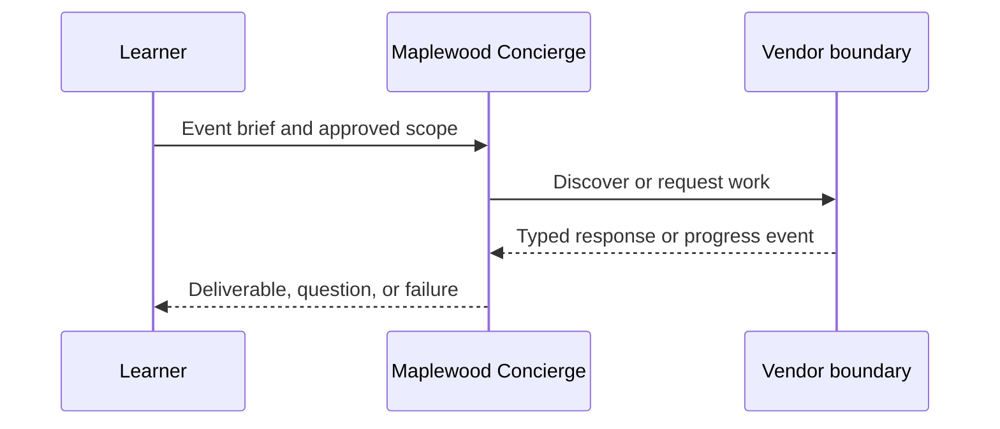

**Network and Concierge version 06:** what's new — parts and artifacts.

# Module 06: Parts and artifacts
> After this module you can construct all four part alternatives.

**Time:** ~90 min · **Level:** Beginner · **LLM needed:** No for examples and grading · **Agents running:** in-process; optional local network: uv run python scripts/network.py up --module 06
**Spec sections:** [Specification](https://a2a-protocol.org/v1.0.1/specification/) · [a2a.proto](https://github.com/a2aproject/A2A/blob/v1.0.1/specification/a2a.proto)

## Prerequisites

Python functions and dictionaries, plus the preceding module in [the learning path](../../LEARNING_PATH.md). New terms appear in [the glossary](../../docs/GLOSSARY.md).

## Learning objectives

- Construct all four part alternatives
- Validate a quote
- Block unsafe file destinations

## The big idea

A Part contains exactly one of text, raw bytes, a URL or structured data. Protobuf encodes raw bytes as base64 in JSON. A data Part holds a JSON value; integer-valued numbers may round-trip as floating point. Validate quantities and money at the boundary. Files referenced by URL need a separate safe fetching policy. Artifacts collect one or more parts into a named deliverable.

**Analogy:** An envelope can contain a note, an attachment, or a reference to an approved document.

Read the [feature companion](../../docs/FEATURE_DEEP_DIVES.md) for field semantics, failure cases and
the connection to the final deployment.

## How it works



Under the hood: Yes. Multiple Parts can represent different forms of the same deliverable. Compare that behavior with the captured requests and responses below.

## On the wire

Executed by the course authoring tool through the same recording transport as scripts/wiretap.py. Credentials are redacted. Pure local transformations have no HTTP exchanges and an empty exchange file; their result is separate. gRPC captures are explicitly service-boundary protobuf roundtrips, not network packets.

- [parts: exchanges](wire/01_parts.jsonl) and [result](wire/01_parts.result.json).
- [rest: exchanges](wire/02_rest.jsonl) and [result](wire/02_rest.result.json).
- [ssrf: exchanges](wire/03_ssrf.jsonl) and [result](wire/03_ssrf.result.json).

## Key APIs at a glance

| SDK API | Spec operation or object | What it does | When to use it |
|---|---|---|---|
| a2a.types | Protobuf objects | Defines wire-compatible values | Every protocol boundary |
| create_jsonrpc_routes | JSON-RPC binding | Mounts operations | Serving JSON-RPC |
| create_rest_routes | HTTP+JSON binding | Mounts HTTP routes | Serving HTTP+JSON |
| create_client | Client operations | Selects an advertised interface | Calling vendors |
| MessageToDict | ProtoJSON | Converts protobuf into JSON values | Inspecting traffic |

## Walkthrough

### 01: parts

Construct all four part alternatives.

> **Predict, then run:** Write the expected result and whether this operation creates, continues or inspects work.

```console
uv run python modules/06_parts_artifacts/examples/01_parts.py
```

Captured output (generated values vary):

```json
[
  {
    "text": "Floor plan"
  },
  {
    "raw": "c3ludGhldGljIGZsb29yIHBsYW4=",
    "filename": "plan.txt",
    "mediaType": "text/plain"
  },
  {
    "url": "https://maplewood.example/plan",
    "mediaType": "text/plain"
  },
  {
    "data": {
      "total_cents": 96000.0
    },
    "mediaType": "application/json"
  }
]
```
### 02: rest

Validate a quote.

> **Predict, then run:** Write the expected result and whether this operation creates, continues or inspects work.

```console
uv run python modules/06_parts_artifacts/examples/02_rest.py
```

Captured output (generated values vary):

```json
{
  "task": {
    "status": {
      "state": "TASK_STATE_COMPLETED",
      "message": {
        "role": "ROLE_AGENT",
        "parts": [
          {
            "text": "Quote ready; no money has been spent."
          }
        ]
      }
    },
    "artifacts": [
      {
        "artifactId": "quote",
        "name": "quote",
        "parts": [
          {
            "data": {
              "guests": 40.0,
              "vendor": "venues",
              "approved": false,
              "selection": "room-1",
              "total_cents": 80000.0,
              "currency": "USD"
            },
            "mediaType": "application/json"
          }
        ]
      }
    ],
    "history": [
      {
        "role": "ROLE_USER",
        "parts": [
          {
            "data": {
              "dietary": {
                "standard": 30.0,
                "vegan": 10.0
              },
              "guests": 40.0,
              "budget_cents": 1000000.0,
              "date": "2027-06-01"
            },
            "mediaType": "application/json"
          }
        ]
      },
      {
        "role": "ROLE_AGENT",
        "parts": [
          {
            "text": "venues: checking the brief"
          }
        ]
      }
    ],
    "metadata": {
      "brief": {
        "guests": 40.0,
        "dietary": {
          "standard": 30.0,
          "vegan": 10.0
        },
        "budget_cents": 1000000.0,
        "date": "2027-06-01"
      }
    }
  }
}
```
### 03: ssrf

Block unsafe file destinations.

> **Predict, then run:** Write the expected result and whether this operation creates, continues or inspects work.

```console
uv run python modules/06_parts_artifacts/examples/03_ssrf.py
```

Captured output (generated values vary):

```json
{
  "blocked": [
    "https://127.0.0.1/private",
    "https://169.254.169.254/latest"
  ]
}
```

## Try it in the Inspector and the Control Room

Start the network in another terminal. Run uv run streamlit run control_room/app.py, select a vendor, inspect its card and send a brief. The Inspector is now a standalone binary; use [its official installation guide](https://github.com/a2aproject/a2a-inspector).

## Real-world use case

Maplewood needs quotes for a 40-person offsite. Run uv run python modules/06_parts_artifacts/use_case/run.py. The result applies this module's first experiment to shared synthetic data. A real team substitutes validated inventory and its identity system while retaining the A2A boundary.

## Common bugs

| Observed behavior | Cause | Fix |
|---|---|---|
| HTTP 401 | Missing vendor credential | Obtain the vendor token outside A2A and send a header |
| Version not supported | Missing or wrong A2A-Version | Select the card interface and send version 1.0 |
| Task remains interrupted | Required input is missing | Preserve IDs and answer the missing-input request |
| Edge-case assertion fails | Happy path was hard-coded | Work through [Fix task](../../gym/tasks/06/06-02_fix/task.md) |

## Practice

| ID | Type | Level | Concept |
|---|---|---|---|
| [06-01](../../gym/tasks/06/06-01_build/task.md) | build | medium | Preserve binary files using ProtoJSON |
| [06-02](../../gym/tasks/06/06-02_fix/task.md) | fix | easy | Repair: preserve binary files using protojson |
| [06-03](../../gym/tasks/06/06-03_predict/task.md) | predict | easy | Predict the first experiment's observable result |
| [06-04](../../gym/tasks/06/06-04_trace/task.md) | trace | medium | Identify the captured transport boundaries |
| [06-05](../../gym/tasks/06/06-05_conformance/task.md) | conformance | hard | Enforce the contract across edge cases |
| [06-06](../../gym/tasks/06/06-06_design/task.md) | design | hard | Design a partner contract and failure policy |

### Full boundary exercises

- [06-20: Receive Granite's real image artifact](../../gym/tasks/06/06-20_parts_floor_plan/task.md)
- [06-21: Read and validate a structured quote](../../gym/tasks/06/06-21_parts_data/task.md)
- [06-22: Keep independent deliverables separate](../../gym/tasks/06/06-22_parts_artifact_ids/task.md)
- [06-23: Attach inline artwork as a raw Part](../../gym/tasks/06/06-23_parts_raw_input/task.md)
- [06-24: Negotiate supported file media types](../../gym/tasks/06/06-24_parts_unsupported/task.md)
- [06-25: Receive Saffron's data and PDF together](../../gym/tasks/06/06-25_parts_multi_part/task.md)

These tasks execute actual SDK routes, workflows, cryptographic checks or independent
database connections offline. Each starter must fail and each reference solution must pass.

## Quiz

1. What does the vendor own?
<details><summary>Answer</summary>Its execution, inventory, task IDs, context scope and authorization policy.</details>

2. How would you demonstrate: construct all four part alternatives?
<details><summary>Answer</summary>Run example 01 and identify the exact output field or event that proves the result.</details>

3. Does a signed card grant access?
<details><summary>Answer</summary>No. A trusted signature checks integrity and identity; authorization is enforced separately.</details>

4. Why use a scripted model in graded tasks?
<details><summary>Answer</summary>Repeatable decisions isolate protocol behavior and cost no API tokens.</details>

5. What if an artifact asks for credentials?
<details><summary>Answer</summary>Treat it as untrusted data. Never forward user tokens or expand the allow-list.</details>

6. Which edge case should you test?
<details><summary>Answer</summary>Use the negative cases in this module's Fix task; explain why the broken implementation accepts or mishandles them.</details>

## Key takeaways

- Read typed fields instead of inferring behavior from prose.
- Separate transport concerns from business work.
- Predict before running.
- Test successful and rejected inputs.
- Treat every remote peer as a trust boundary.

## Go deeper

[Specification](https://a2a-protocol.org/v1.0.1/specification/) · [Protobuf](https://github.com/a2aproject/A2A/blob/v1.0.1/specification/a2a.proto) · [Official SDK](https://github.com/a2aproject/a2a-python/tree/v1.3.0)

## Next: Module 07

Use [the learning path](../../LEARNING_PATH.md) to continue or choose a capstone.

## Real vendor files

Run `uv run python modules/06_parts_artifacts/examples/04_vendor_files.py` to receive
a valid PDF quote and SVG floor plan. The PDF and structured quote share an artifact
with multiple Parts. Predict the ProtoJSON base64 representation before reading
[the captured exchange](wire/04_vendor_files.jsonl). Never execute received artwork.
