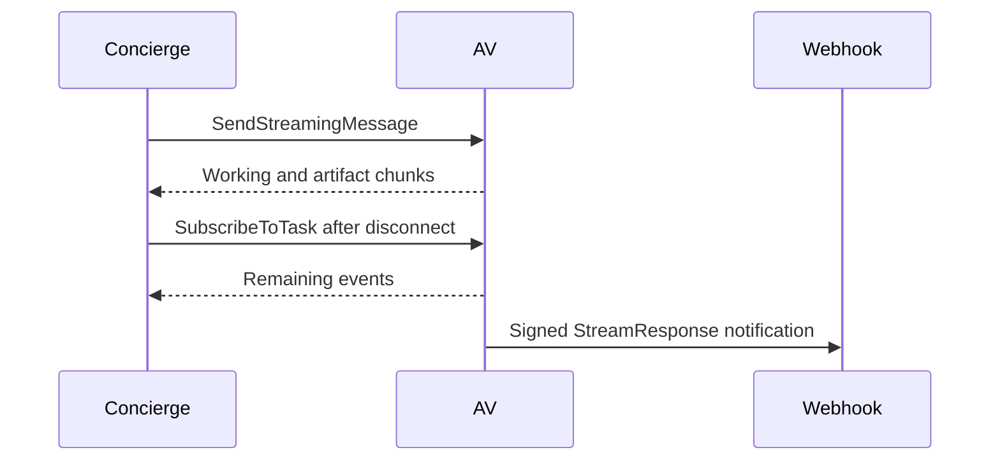

**Network and Concierge version 07:** what's new — streaming and push notifications.

# Module 07: Streaming and push notifications
> After this module you can read sse frames.

**Time:** ~90 min · **Level:** Beginner · **LLM needed:** No for examples and grading · **Agents running:** in-process; optional local network: uv run python scripts/network.py up --module 07
**Spec sections:** [Specification](https://a2a-protocol.org/v1.0.1/specification/) · [a2a.proto](https://github.com/a2aproject/A2A/blob/v1.0.1/specification/a2a.proto)

## Prerequisites

Python functions and dictionaries, plus the preceding module in [the learning path](../../LEARNING_PATH.md). New terms appear in [the glossary](../../docs/GLOSSARY.md).

## Learning objectives

- Read SSE frames
- Assemble artifact chunks
- Verify a push delivery

## The big idea

Server-Sent Events (SSE) keep an HTTP response open and separate events with blank lines. A chunk updates one artifact by ID: append means add to existing content, and lastChunk ends that artifact. It does not finish the task. A webhook reverses the connection: the vendor calls your receiver later. Authenticate deliveries and tolerate retries. Reconnecting with SubscribeToTask does not promise replay of every missed event.

**Analogy:** Streaming is watching a progress board; a webhook is a callback when you are away.

Read the [feature companion](../../docs/FEATURE_DEEP_DIVES.md) for field semantics, failure cases and
the connection to the final deployment.

## How it works



Under the hood: SSE frames contain status or artifact updates, not arbitrary model tokens. Append chunks by artifact ID and use lastChunk to finish an artifact. Subscription resumes observation of work; it does not start another task. Push delivery has independent authentication, retries and deduplication.

## On the wire

Executed by the course authoring tool through the same recording transport as scripts/wiretap.py. Credentials are redacted. Pure local transformations have no HTTP exchanges and an empty exchange file; their result is separate. gRPC captures are explicitly service-boundary protobuf roundtrips, not network packets.

- [stream: exchanges](wire/01_stream.jsonl) and [result](wire/01_stream.result.json).
- [chunks: exchanges](wire/02_chunks.jsonl) and [result](wire/02_chunks.result.json).
- [push: exchanges](wire/03_push.jsonl) and [result](wire/03_push.result.json).

## Key APIs at a glance

| SDK API or labeled course helper | Spec operation or object | What it does | When to use it |
|---|---|---|---|
| TaskArtifactUpdateEvent | Artifact stream update | Carries append and last_chunk flags | Assemble streamed deliverables |
| TaskPushNotificationConfig | Push subscription | Configures a callback for one task | Receive asynchronous notifications |

## Walkthrough

### 01: stream

Read SSE frames.

> **Predict, then run:** Write the expected result and whether this operation creates, continues or inspects work.

```console
uv run python modules/07_streaming_push/examples/01_stream.py
```

Captured output (generated values vary):

```json
{
  "result_type": "list",
  "complete_result": "wire/01_stream.result.json"
}
```
### 02: chunks

Assemble artifact chunks.

> **Predict, then run:** Write the expected result and whether this operation creates, continues or inspects work.

```console
uv run python modules/07_streaming_push/examples/02_chunks.py
```

Captured output (generated values vary):

```json
{
  "result_type": "list",
  "complete_result": "wire/02_chunks.result.json"
}
```
### 03: push

Verify a push delivery.

> **Predict, then run:** Write the expected result and whether this operation creates, continues or inspects work.

```console
uv run python modules/07_streaming_push/examples/03_push.py
```

Captured output (generated values vary):

```json
{
  "result_type": "dict",
  "complete_result": "wire/03_push.result.json"
}
```

## Try it in the Inspector and the Control Room

Start the network in another terminal. Run uv run streamlit run control_room/app.py, select a vendor, inspect its card and send a brief. The Inspector is now a standalone binary; use [its official installation guide](https://github.com/a2aproject/a2a-inspector).

## Real-world use case

Brightline reports setup progress as it prepares the AV plan, allowing Maplewood to display chunks before completion.

Run:

```console
uv run python modules/07_streaming_push/use_case/run.py
```

Selected observed fields (see [the complete captured result](wire/01_stream.result.json) for the full output):

```json
{
  "state": "TASK_STATE_SUBMITTED",
  "name": "setup-plan",
  "vendor": "av",
  "total_cents": 28000.0,
  "currency": "USD"
}
```

A real deployment retains this boundary while substituting its own approved inventory, identity provider and operating policy.

## Common bugs

| Observed behavior | Cause | Fix and related practice |
|---|---|---|
| Only the last text chunk remains | Append flag ignored | Accumulate by artifact ID; [practice 07-07](../../gym/tasks/07/07-07_chunks/task.md) |
| Viewer waits forever for a finished artifact | lastChunk missing | Mark the final artifact chunk; [practice 07-22](../../gym/tasks/07/07-22_stream_flags/task.md) |
| Duplicate effects after lost acknowledgement | Receiver lacks durable deduplication | Use a signed delivery ID and inbox; [practice 07-31](../../gym/tasks/07/07-31_push_delivery/task.md) |
| Private webhook URL accepted | Destination validator bypassed | Allow only approved callback endpoints; [practice 07-30](../../gym/tasks/07/07-30_push_ssrf/task.md) |

## Practice

| ID | Type | Level | Concept |
|---|---|---|---|
| [07-01](../../gym/tasks/07/07-01_build/task.md) | build | medium | Assemble artifact chunks by artifact ID |
| [07-02](../../gym/tasks/07/07-02_fix/task.md) | fix | easy | Repair: assemble artifact chunks by artifact id |
| [07-03](../../gym/tasks/07/07-03_predict/task.md) | predict | easy | Predict the first experiment's observable result |
| [07-04](../../gym/tasks/07/07-04_trace/task.md) | trace | medium | Identify the captured transport boundaries |
| [07-05](../../gym/tasks/07/07-05_conformance/task.md) | conformance | hard | Enforce the contract across edge cases |
| [07-06](../../gym/tasks/07/07-06_design/task.md) | design | hard | Design a partner contract and failure policy |

### Full boundary exercises

- [07-07: Finish Brightline's streamed artifact](../../gym/tasks/07/07-07_chunks/task.md)
- [07-20: Read state transitions from a real stream](../../gym/tasks/07/07-20_stream_status/task.md)
- [07-21: Assemble an AV artifact across chunks](../../gym/tasks/07/07-21_stream_chunks/task.md)
- [07-22: Audit AV chunk termination](../../gym/tasks/07/07-22_stream_flags/task.md)
- [07-23: Keep task identity across all event variants](../../gym/tasks/07/07-23_stream_identity/task.md)
- [07-24: Separate the final data artifact from progress](../../gym/tasks/07/07-24_stream_quote/task.md)
- [07-25: Reconcile streamed chunks with stored state](../../gym/tasks/07/07-25_stream_snapshot/task.md)
- [07-26: Register an approved callback](../../gym/tasks/07/07-26_push_create/task.md)
- [07-27: Retrieve one callback configuration](../../gym/tasks/07/07-27_push_get/task.md)
- [07-28: Inspect all task callback registrations](../../gym/tasks/07/07-28_push_list/task.md)
- [07-29: Remove a callback without canceling work](../../gym/tasks/07/07-29_push_delete/task.md)
- [07-30: Reject a metadata-service callback](../../gym/tasks/07/07-30_push_ssrf/task.md)
- [07-31: Deliver completion through an authenticated outbox](../../gym/tasks/07/07-31_push_delivery/task.md)

These tasks execute actual SDK routes, workflows, cryptographic checks or independent
database connections offline. Each starter must fail and each reference solution must pass.

## Quiz

1. What identifies chunks of the same artifact?
<details><summary>Answer</summary>The artifact ID within its task.</details>

2. What does append=true mean?
<details><summary>Answer</summary>Append the new Parts to the existing artifact instead of replacing it.</details>

3. Does lastChunk mean the task completed?
<details><summary>Answer</summary>No. It finishes that artifact; task completion is a separate status event.</details>

4. What operation follows a dropped stream?
<details><summary>Answer</summary>SubscribeToTask for the existing active task when supported.</details>

5. Why authenticate a webhook before deduplicating it?
<details><summary>Answer</summary>An attacker must not poison the inbox with an unauthenticated delivery ID.</details>

6. Is exactly-once delivery promised?
<details><summary>Answer</summary>No. Durable receivers deduplicate at-least-once delivery attempts.</details>

## Key takeaways

- The artifact ID within its task.
- Append the new Parts to the existing artifact instead of replacing it.
- No. It finishes that artifact; task completion is a separate status event.
- SubscribeToTask for the existing active task when supported.
- An attacker must not poison the inbox with an unauthenticated delivery ID.

## Go deeper

[Specification](https://a2a-protocol.org/v1.0.1/specification/) · [Protobuf](https://github.com/a2aproject/A2A/blob/v1.0.1/specification/a2a.proto) · [Official SDK](https://github.com/a2aproject/a2a-python/tree/v1.3.0)

## Next: Module 08

Use [the learning path](../../LEARNING_PATH.md) to continue or choose a capstone.
