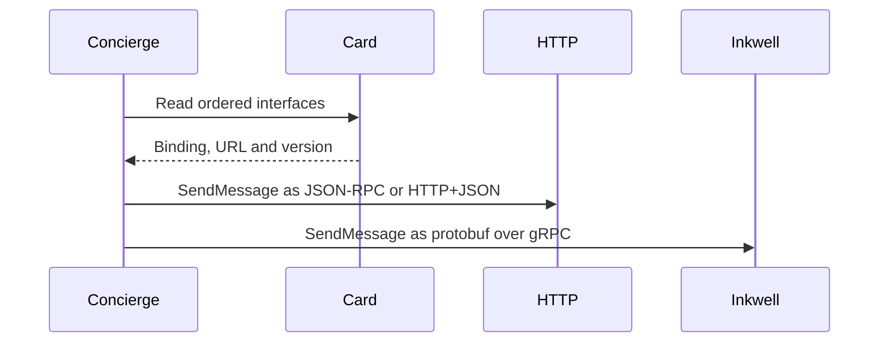

**Network and Concierge version 08:** what's new — protocol bindings.

# Module 08: Protocol bindings
> After this module you can compare equivalent calls.

**Time:** ~90 min · **Level:** Beginner · **LLM needed:** No for examples and grading · **Agents running:** in-process; optional local network: uv run python scripts/network.py up --module 08
**Spec sections:** [Specification](https://a2a-protocol.org/v1.0.1/specification/) · [a2a.proto](https://github.com/a2aproject/A2A/blob/v1.0.1/specification/a2a.proto)

## Prerequisites

Python functions and dictionaries, plus the preceding module in [the learning path](../../LEARNING_PATH.md). New terms appear in [the glossary](../../docs/GLOSSARY.md).

## Learning objectives

- Compare equivalent calls
- Decode protobuf messages
- Respect advertised interfaces

## The big idea

JSON-RPC, HTTP+JSON and gRPC map the same abstract operations onto different transports. ProtoJSON gives the JSON forms of protobuf messages. gRPC uses generated stubs and binary protobuf over HTTP/2. The offline service harness serializes and deserializes protobuf and calls the real SDK servicer; it does not test HTTP/2 framing. Select the advertised interface, not a URL guessed from another binding.

**Analogy:** Three delivery services carry the same work order in different packaging.

Read the [feature companion](../../docs/FEATURE_DEEP_DIVES.md) for field semantics, failure cases and
the connection to the final deployment.

## How it works



Under the hood: The protobuf service names define the common operation vocabulary. JSON-RPC wraps an operation in an envelope; HTTP+JSON maps it to an HTTP route; gRPC uses typed RPC methods. Inkwell's HTTP listener serves discovery only. Its task operations must go through gRPC.

## On the wire

Executed by the course authoring tool through the same recording transport as scripts/wiretap.py. Credentials are redacted. Pure local transformations have no HTTP exchanges and an empty exchange file; their result is separate. gRPC captures are explicitly service-boundary protobuf roundtrips, not network packets.

- [jsonrpc: exchanges](wire/01_jsonrpc.jsonl) and [result](wire/01_jsonrpc.result.json).
- [rest: exchanges](wire/02_rest.jsonl) and [result](wire/02_rest.result.json).
- [grpc: exchanges](wire/03_grpc.jsonl) and [result](wire/03_grpc.result.json).

## Key APIs at a glance

| SDK API or labeled course helper | Spec operation or object | What it does | When to use it |
|---|---|---|---|
| a2a.types.a2a_pb2_grpc.A2AServiceStub | gRPC service client | Calls typed A2A operations | Talk to Inkwell |
| a2a.server.request_handlers.grpc_handler.GrpcHandler | gRPC adapter | Maps protobuf RPCs to the handler | Serve the same task contract |

## Walkthrough

### 01: jsonrpc

Compare equivalent calls.

> **Predict, then run:** Write the expected result and whether this operation creates, continues or inspects work.

```console
uv run python modules/08_bindings/examples/01_jsonrpc.py
```

Captured output (generated values vary):

```json
{
  "result": {
    "task": {
      "status": {
        "state": "TASK_STATE_COMPLETED",
        "message": {
          "role": "ROLE_AGENT",
          "parts": [
            {
              "text": "Quote ready; no money has been spent."
            }
          ]
        }
      },
      "artifacts": [
        {
          "artifactId": "quote",
          "name": "quote",
          "parts": [
            {
              "data": {
                "guests": 40.0,
                "vendor": "venues",
                "approved": false,
                "selection": "room-1",
                "total_cents": 80000.0,
                "currency": "USD"
              },
              "mediaType": "application/json"
            }
          ]
        }
      ],
      "history": [
        {
          "role": "ROLE_USER",
          "parts": [
            {
              "data": {
                "dietary": {
                  "standard": 30.0,
                  "vegan": 10.0
                },
                "guests": 40.0,
                "budget_cents": 1000000.0,
                "date": "2027-06-01"
              },
              "mediaType": "application/json"
            }
          ]
        },
        {
          "role": "ROLE_AGENT",
          "parts": [
            {
              "text": "venues: checking the brief"
            }
          ]
        }
      ],
      "metadata": {
        "brief": {
          "guests": 40.0,
          "dietary": {
            "standard": 30.0,
            "vegan": 10.0
          },
          "budget_cents": 1000000.0,
          "date": "2027-06-01"
        }
      }
    }
  },
  "jsonrpc": "2.0"
}
```
### 02: rest

Decode protobuf messages.

> **Predict, then run:** Write the expected result and whether this operation creates, continues or inspects work.

```console
uv run python modules/08_bindings/examples/02_rest.py
```

Captured output (generated values vary):

```json
{
  "task": {
    "status": {
      "state": "TASK_STATE_COMPLETED",
      "message": {
        "role": "ROLE_AGENT",
        "parts": [
          {
            "text": "Quote ready; no money has been spent."
          }
        ]
      }
    },
    "artifacts": [
      {
        "artifactId": "quote",
        "name": "quote",
        "parts": [
          {
            "data": {
              "guests": 40.0,
              "vendor": "venues",
              "approved": false,
              "selection": "room-1",
              "total_cents": 80000.0,
              "currency": "USD"
            },
            "mediaType": "application/json"
          }
        ]
      }
    ],
    "history": [
      {
        "role": "ROLE_USER",
        "parts": [
          {
            "data": {
              "dietary": {
                "standard": 30.0,
                "vegan": 10.0
              },
              "guests": 40.0,
              "budget_cents": 1000000.0,
              "date": "2027-06-01"
            },
            "mediaType": "application/json"
          }
        ]
      },
      {
        "role": "ROLE_AGENT",
        "parts": [
          {
            "text": "venues: checking the brief"
          }
        ]
      }
    ],
    "metadata": {
      "brief": {
        "guests": 40.0,
        "dietary": {
          "standard": 30.0,
          "vegan": 10.0
        },
        "budget_cents": 1000000.0,
        "date": "2027-06-01"
      }
    }
  }
}
```
### 03: grpc

Respect advertised interfaces.

> **Predict, then run:** Write the expected result and whether this operation creates, continues or inspects work.

```console
uv run python modules/08_bindings/examples/03_grpc.py
```

Captured output (generated values vary):

```json
{
  "task": {
    "status": {
      "state": "TASK_STATE_COMPLETED",
      "message": {
        "role": "ROLE_AGENT",
        "parts": [
          {
            "text": "Quote ready; no money has been spent."
          }
        ]
      }
    },
    "artifacts": [
      {
        "artifactId": "quote",
        "name": "quote",
        "parts": [
          {
            "data": {
              "vendor": "print",
              "guests": 40.0,
              "approved": false,
              "selection": "badge",
              "total_cents": 10000.0,
              "currency": "USD"
            },
            "mediaType": "application/json"
          }
        ]
      }
    ],
    "history": [
      {
        "role": "ROLE_USER",
        "parts": [
          {
            "data": {
              "dietary": {
                "standard": 30.0,
                "vegan": 10.0
              },
              "guests": 40.0,
              "budget_cents": 1000000.0,
              "date": "2027-06-01"
            },
            "mediaType": "application/json"
          }
        ]
      },
      {
        "role": "ROLE_AGENT",
        "parts": [
          {
            "text": "print: checking the brief"
          }
        ]
      }
    ],
    "metadata": {
      "brief": {
        "guests": 40.0,
        "dietary": {
          "standard": 30.0,
          "vegan": 10.0
        },
        "budget_cents": 1000000.0,
        "date": "2027-06-01"
      }
    }
  }
}
```

## Try it in the Inspector and the Control Room

Start the network in another terminal. Run uv run streamlit run control_room/app.py, select a vendor, inspect its card and send a brief. The Inspector is now a standalone binary; use [its official installation guide](https://github.com/a2aproject/a2a-inspector).

## Real-world use case

Maplewood compares binding representations before connecting its HTTP vendors to the gRPC-only print service.

Run:

```console
uv run python modules/08_bindings/use_case/run.py
```

Selected observed fields (see [the complete captured result](wire/01_jsonrpc.result.json) for the full output):

```json
{
  "state": "TASK_STATE_COMPLETED",
  "name": "quote",
  "vendor": "venues",
  "total_cents": 80000.0,
  "currency": "USD"
}
```

A real deployment retains this boundary while substituting its own approved inventory, identity provider and operating policy.

## Common bugs

| Observed behavior | Cause | Fix and related practice |
|---|---|---|
| HTTP 404 from Inkwell | HTTP used for a gRPC-only task endpoint | Use its GRPC interface; [practice 08-07](../../gym/tasks/08/08-07_binding/task.md) |
| Wrong port receives protobuf traffic | Discovery port confused with gRPC port | Use the configured gRPC target; [practice 08-02](../../gym/tasks/08/08-02_fix/task.md) |
| Version error on one binding | Version omitted or inconsistent | Carry the advertised version in headers or metadata; [practice 08-45](../../gym/tasks/08/08-45_grpc_version/task.md) |
| Same operation returns different business data | Adapters implement divergent business rules | Compare semantic results using shared fixtures; [practice 08-02](../../gym/tasks/08/08-02_fix/task.md) |

## Practice

| ID | Type | Level | Concept |
|---|---|---|---|
| [08-01](../../gym/tasks/08/08-01_build/task.md) | build | medium | Map core operations to HTTP routes |
| [08-02](../../gym/tasks/08/08-02_fix/task.md) | fix | easy | Repair: map core operations to http routes |
| [08-03](../../gym/tasks/08/08-03_predict/task.md) | predict | easy | Predict the first experiment's observable result |
| [08-04](../../gym/tasks/08/08-04_trace/task.md) | trace | medium | Identify the captured transport boundaries |
| [08-05](../../gym/tasks/08/08-05_conformance/task.md) | conformance | hard | Enforce the contract across edge cases |
| [08-06](../../gym/tasks/08/08-06_design/task.md) | design | hard | Design a partner contract and failure policy |

### Full boundary exercises

- [08-07: Connect the Concierge to a gRPC-only printer](../../gym/tasks/08/08-07_binding/task.md)
- [08-40: Send a protobuf request to Inkwell](../../gym/tasks/08/08-40_grpc_send/task.md)
- [08-41: Call GetTask over gRPC](../../gym/tasks/08/08-41_grpc_get/task.md)
- [08-42: Call CancelTask over gRPC](../../gym/tasks/08/08-42_grpc_cancel/task.md)
- [08-43: List tasks through protobuf](../../gym/tasks/08/08-43_grpc_list/task.md)
- [08-44: Inspect the gRPC stream union](../../gym/tasks/08/08-44_grpc_stream/task.md)
- [08-45: Read advertised gRPC protocol compatibility](../../gym/tasks/08/08-45_grpc_version/task.md)

These tasks execute actual SDK routes, workflows, cryptographic checks or independent
database connections offline. Each starter must fail and each reference solution must pass.

## Quiz

1. Does changing binding change task meaning?
<details><summary>Answer</summary>No. It changes transport representation, not the lifecycle contract.</details>

2. Where are operation names defined?
<details><summary>Answer</summary>The normative a2a.proto service definition.</details>

3. Does Inkwell's discovery HTTP port accept SendMessage?
<details><summary>Answer</summary>No. Its advertised task binding is gRPC only.</details>

4. How does gRPC carry credentials and trace context?
<details><summary>Answer</summary>In request metadata, or client identity through mTLS where configured.</details>

5. Is a service-boundary capture a network packet trace?
<details><summary>Answer</summary>No. It proves protobuf serialization and handler behavior; socket tests prove network interoperability separately.</details>

6. What should a client do with unsupported bindings?
<details><summary>Answer</summary>Choose another compatible advertised interface or fail clearly.</details>

## Key takeaways

- No. It changes transport representation, not the lifecycle contract.
- The normative a2a.proto service definition.
- No. Its advertised task binding is gRPC only.
- In request metadata, or client identity through mTLS where configured.
- No. It proves protobuf serialization and handler behavior; socket tests prove network interoperability separately.

## Go deeper

[Specification](https://a2a-protocol.org/v1.0.1/specification/) · [Protobuf](https://github.com/a2aproject/A2A/blob/v1.0.1/specification/a2a.proto) · [Official SDK](https://github.com/a2aproject/a2a-python/tree/v1.3.0)

## Next: Module 09

Use [the learning path](../../LEARNING_PATH.md) to continue or choose a capstone.

## Connected integration lab

Continue with [the tested integration walkthrough](../../docs/INTEGRATION_LABS.md), including actual commands, expected behavior, security boundaries and current limitations.
