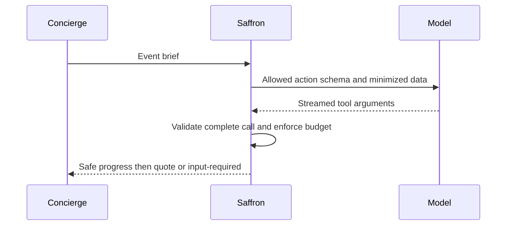

**Network and Concierge version 09:** what's new — putting an llm behind a server.

# Module 09: Putting an LLM behind a server
> After this module you can replace model output with a script.

**Time:** ~90 min · **Level:** Intermediate · **LLM needed:** No for examples and grading · **Agents running:** in-process; optional local network: uv run python scripts/network.py up --module 09
**Spec sections:** [Specification](https://a2a-protocol.org/v1.0.1/specification/) · [a2a.proto](https://github.com/a2aproject/A2A/blob/v1.0.1/specification/a2a.proto)

## Prerequisites

Python functions and dictionaries, plus the preceding module in [the learning path](../../LEARNING_PATH.md). New terms appear in [the glossary](../../docs/GLOSSARY.md).

## Learning objectives

- Replace model output with a script
- Validate tool choices
- Bound model work

## The big idea

A language model predicts output from context; it is not the protocol and should not calculate binding prices. A tool call asks application code to run a named function with validated arguments. The course first scripts model decisions, making failures repeatable and free. Provider configuration lives in one helper. Every tool loop has a step limit and every business action has validation.

**Analogy:** A junior estimator suggests an action; the office's checked procedures decide what may happen.

Read the [feature companion](../../docs/FEATURE_DEEP_DIVES.md) for field semantics, failure cases and
the connection to the final deployment.

## How it works



Under the hood: Provider chunks are untrusted partial arguments until the response ends and schema validation succeeds. Only an allowed complete call reaches application tools. Progress reports contain frame counts rather than private reasoning. Code still enforces required dietary counts and kitchen limits.

## On the wire

Executed by the course authoring tool through the same recording transport as scripts/wiretap.py. Credentials are redacted. Pure local transformations have no HTTP exchanges and an empty exchange file; their result is separate. gRPC captures are explicitly service-boundary protobuf roundtrips, not network packets.

- [fake_llm: exchanges](wire/01_fake_llm.jsonl) and [result](wire/01_fake_llm.result.json).
- [tool_call: exchanges](wire/02_tool_call.jsonl) and [result](wire/02_tool_call.result.json).
- [tool_budget: exchanges](wire/03_tool_budget.jsonl) and [result](wire/03_tool_budget.result.json).

## Key APIs at a glance

| SDK API or labeled course helper | Spec operation or object | What it does | When to use it |
|---|---|---|---|
| common.llm.Model.tool_decide (course) | Bounded model decision | Validates provider-native tool streams | Choose an allowed action |
| TaskStatusUpdateEvent | Safe progress | Reports work without exposing reasoning | Connect model work to A2A status |

## Walkthrough

### 01: fake llm

Replace model output with a script.

> **Predict, then run:** Write the expected result and whether this operation creates, continues or inspects work.

```console
uv run python modules/09_llm_server/examples/01_fake_llm.py
```

Captured output (generated values vary):

```json
{
  "state": "TASK_STATE_COMPLETED",
  "quote": {
    "vendor": "catering",
    "selection": "garden",
    "currency": "USD",
    "total_cents": 96000,
    "guests": 40,
    "approved": false
  }
}
```
### 02: tool call

Validate tool choices.

> **Predict, then run:** Write the expected result and whether this operation creates, continues or inspects work.

```console
uv run python modules/09_llm_server/examples/02_tool_call.py
```

Captured output (generated values vary):

```json
{
  "state": "TASK_STATE_COMPLETED",
  "quote": {
    "vendor": "catering",
    "selection": "garden",
    "currency": "USD",
    "total_cents": 96000,
    "guests": 40,
    "approved": false
  }
}
```
### 03: tool budget

Bound model work.

> **Predict, then run:** Write the expected result and whether this operation creates, continues or inspects work.

```console
uv run python modules/09_llm_server/examples/03_tool_budget.py
```

Captured output (generated values vary):

```json
{
  "rejected": "Model exceeded the three-step tool budget."
}
```

## Try it in the Inspector and the Control Room

Start the network in another terminal. Run uv run streamlit run control_room/app.py, select a vendor, inspect its card and send a brief. The Inspector is now a standalone binary; use [its official installation guide](https://github.com/a2aproject/a2a-inspector).

## Real-world use case

Saffron uses a repeatable scripted decision to rehearse the exact tool boundary later used by the live model.

Run:

```console
uv run python modules/09_llm_server/use_case/run.py
```

Selected observed fields (see [the complete captured result](wire/01_fake_llm.result.json) for the full output):

```json
{
  "state": "TASK_STATE_COMPLETED",
  "vendor": "catering",
  "currency": "USD",
  "total_cents": 96000
}
```

A real deployment retains this boundary while substituting its own approved inventory, identity provider and operating policy.

## Common bugs

| Observed behavior | Cause | Fix and related practice |
|---|---|---|
| Malformed tool arguments execute | Partial stream treated as a call | Validate only after final provider completion; [practice 09-44](../../gym/tasks/09/09-44_native_model_truncated/task.md) |
| Unexpected tool runs | Model output trusted without an allow-list | Reject unknown tool names; [practice 09-45](../../gym/tasks/09/09-45_native_model_unsafe/task.md) |
| Task costs grow without bound | No token, byte or time limits | Enforce shared decision budgets; [practice 09-02](../../gym/tasks/09/09-02_fix/task.md) |
| Missing-input quote appears | Model decision bypasses business validation | Enforce required inputs in code; [practice 09-01](../../gym/tasks/09/09-01_build/task.md) |

## Practice

| ID | Type | Level | Concept |
|---|---|---|---|
| [09-01](../../gym/tasks/09/09-01_build/task.md) | build | medium | Validate model-selected tool names |
| [09-02](../../gym/tasks/09/09-02_fix/task.md) | fix | easy | Repair: validate model-selected tool names |
| [09-03](../../gym/tasks/09/09-03_predict/task.md) | predict | easy | Predict the first experiment's observable result |
| [09-04](../../gym/tasks/09/09-04_trace/task.md) | trace | medium | Identify the captured transport boundaries |
| [09-05](../../gym/tasks/09/09-05_conformance/task.md) | conformance | hard | Enforce the contract across edge cases |
| [09-06](../../gym/tasks/09/09-06_design/task.md) | design | hard | Design a partner contract and failure policy |

### Full boundary exercises

- [09-40: Validate native tool frames: ollama](../../gym/tasks/09/09-40_native_model_ollama/task.md)
- [09-41: Validate native tool frames: openai](../../gym/tasks/09/09-41_native_model_openai/task.md)
- [09-42: Validate native tool frames: anthropic](../../gym/tasks/09/09-42_native_model_anthropic/task.md)
- [09-43: Validate native tool frames: gemini](../../gym/tasks/09/09-43_native_model_gemini/task.md)
- [09-44: Validate native tool frames: truncated](../../gym/tasks/09/09-44_native_model_truncated/task.md)
- [09-45: Validate native tool frames: unsafe](../../gym/tasks/09/09-45_native_model_unsafe/task.md)

These tasks execute actual SDK routes, workflows, cryptographic checks or independent
database connections offline. Each starter must fail and each reference solution must pass.

## Quiz

1. May a partial JSON tool argument execute?
<details><summary>Answer</summary>No. Wait for a complete, valid tool call.</details>

2. Who calculates the quote amount?
<details><summary>Answer</summary>Deterministic business code, not model arithmetic.</details>

3. What if the model chooses an unknown tool?
<details><summary>Answer</summary>Reject the decision before any tool executes.</details>

4. How do graded tasks avoid provider cost and randomness?
<details><summary>Answer</summary>They use scripted decisions and captured provider framing.</details>

5. Does model-selected quote_menu bypass missing dietary counts?
<details><summary>Answer</summary>No. Application validation still pauses the task.</details>

6. What may be streamed as progress?
<details><summary>Answer</summary>Safe operational updates; never private reasoning or incomplete executable arguments.</details>

## Key takeaways

- No. Wait for a complete, valid tool call.
- Deterministic business code, not model arithmetic.
- Reject the decision before any tool executes.
- They use scripted decisions and captured provider framing.
- No. Application validation still pauses the task.

## Go deeper

[Specification](https://a2a-protocol.org/v1.0.1/specification/) · [Protobuf](https://github.com/a2aproject/A2A/blob/v1.0.1/specification/a2a.proto) · [Official SDK](https://github.com/a2aproject/a2a-python/tree/v1.3.0)

## Next: Module 10

Use [the learning path](../../LEARNING_PATH.md) to continue or choose a capstone.
