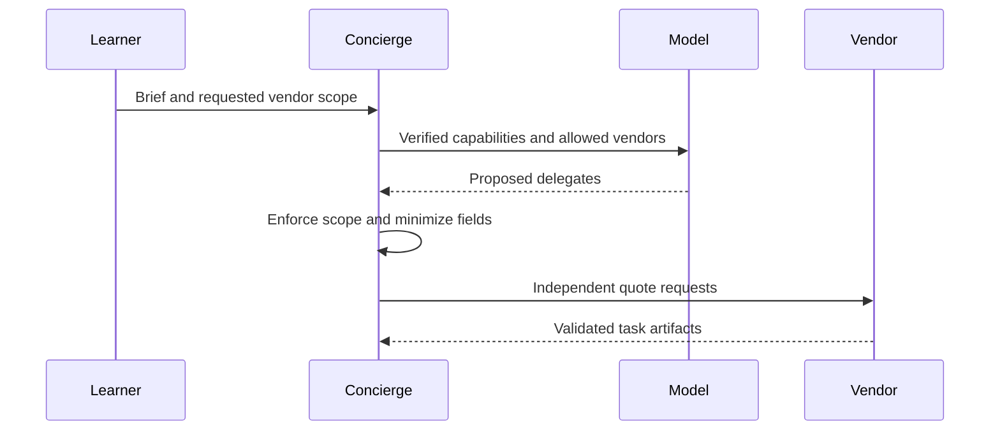

**Network and Concierge version 10:** what's new — the orchestrator.

# Module 10: The orchestrator
> After this module you can delegate concurrently.

**Time:** ~90 min · **Level:** Intermediate · **LLM needed:** No for examples and grading · **Agents running:** in-process; optional local network: uv run python scripts/network.py up --module 10
**Spec sections:** [Specification](https://a2a-protocol.org/v1.0.1/specification/) · [a2a.proto](https://github.com/a2aproject/A2A/blob/v1.0.1/specification/a2a.proto)

## Prerequisites

Python functions and dictionaries, plus the preceding module in [the learning path](../../LEARNING_PATH.md). New terms appear in [the glossary](../../docs/GLOSSARY.md).

## Learning objectives

- Delegate concurrently
- Aggregate validated quotes
- Minimize data sent to partners

## The big idea

The Concierge is an A2A client of vendors and can also be an A2A server for callers. It delegates independent quotes concurrently and returns partial results when one vendor needs input. Remote context IDs are owned by each vendor; retain a mapping rather than assuming one global context works everywhere. Give each vendor its own service credential and only the brief fields it needs.

**Analogy:** An event coordinator asks specialists for estimates while keeping a ledger of each conversation.

Read the [feature companion](../../docs/FEATURE_DEEP_DIVES.md) for field semantics, failure cases and
the connection to the final deployment.

## How it works



Under the hood: The model proposes routing; application policy authorizes it. Each vendor receives only fields needed by its skill. Independent quotes run concurrently. The result retains each vendor's state and IDs so a partial plan can resume interrupted work without repeating completed requests.

## On the wire

Executed by the course authoring tool through the same recording transport as scripts/wiretap.py. Credentials are redacted. Pure local transformations have no HTTP exchanges and an empty exchange file; their result is separate. gRPC captures are explicitly service-boundary protobuf roundtrips, not network packets.

- [delegate: exchanges](wire/01_delegate.jsonl) and [result](wire/01_delegate.result.json).
- [orchestrate: exchanges](wire/02_orchestrate.jsonl) and [result](wire/02_orchestrate.result.json).
- [minimize: exchanges](wire/03_minimize.jsonl) and [result](wire/03_minimize.result.json).

## Key APIs at a glance

| SDK API or labeled course helper | Spec operation or object | What it does | When to use it |
|---|---|---|---|
| agents.concierge.Concierge.plan (course) | Orchestration | Validates selections and vendor results | Plan across trusted vendors |
| SendMessageRequest | Delegated request | Carries a vendor-specific brief and continuation IDs | Start or resume remote work |

## Walkthrough

Run uv run python modules/10_orchestrator/examples/04_model_selection.py for an
offline scripted selection followed by a real A2A request. Predict which fields
the model needs before inspecting its prompt in tests/test_model_planning.py.
The [optional live-model guide](../../docs/LIVE_MODELS.md) explains how to use the
same helper with Ollama or a hosted provider.

### 01: delegate

Delegate concurrently.

> **Predict, then run:** Write the expected result and whether this operation creates, continues or inspects work.

```console
uv run python modules/10_orchestrator/examples/01_delegate.py
```

Captured output (generated values vary):

```json
{
  "delegations": [
    {
      "vendor": "venues",
      "state": "TASK_STATE_COMPLETED",
      "quotes": [
        {
          "guests": 40.0,
          "vendor": "venues",
          "approved": false,
          "selection": "room-1",
          "total_cents": 80000.0,
          "currency": "USD"
        }
      ],
      "question": {
        "role": "ROLE_AGENT",
        "parts": [
          {
            "text": "Quote ready; no money has been spent."
          }
        ]
      }
    },
    {
      "vendor": "catering",
      "state": "TASK_STATE_COMPLETED",
      "quotes": [
        {
          "guests": 40.0,
          "vendor": "catering",
          "approved": false,
          "selection": "garden",
          "total_cents": 96000.0,
          "currency": "USD"
        }
      ],
      "question": {
        "role": "ROLE_AGENT",
        "parts": [
          {
            "text": "Quote ready; no money has been spent."
          }
        ]
      }
    }
  ],
  "total_cents": 176000.0,
  "within_budget": true,
  "approval_required": true
}
```
### 02: orchestrate

Aggregate validated quotes.

> **Predict, then run:** Write the expected result and whether this operation creates, continues or inspects work.

```console
uv run python modules/10_orchestrator/examples/02_orchestrate.py
```

Captured output (generated values vary):

```json
{
  "result_type": "dict",
  "complete_result": "wire/02_orchestrate.result.json"
}
```
### 03: minimize

Minimize data sent to partners.

> **Predict, then run:** Write the expected result and whether this operation creates, continues or inspects work.

```console
uv run python modules/10_orchestrator/examples/03_minimize.py
```

Captured output (generated values vary):

```json
{
  "result_type": "dict",
  "complete_result": "wire/03_minimize.result.json"
}
```

## Try it in the Inspector and the Control Room

Start the network in another terminal. Run uv run streamlit run control_room/app.py, select a vendor, inspect its card and send a brief. The Inspector is now a standalone binary; use [its official installation guide](https://github.com/a2aproject/a2a-inspector).

## Real-world use case

Maplewood gathers venue and catering proposals in parallel and retains each vendor's task identity for follow-up.

Run:

```console
uv run python modules/10_orchestrator/use_case/run.py
```

Selected observed fields (see [the complete captured result](wire/01_delegate.result.json) for the full output):

```json
{
  "vendor": "venues",
  "state": "TASK_STATE_COMPLETED",
  "total_cents": 80000.0,
  "currency": "USD",
  "approval_required": true
}
```

A real deployment retains this boundary while substituting its own approved inventory, identity provider and operating policy.

## Common bugs

| Observed behavior | Cause | Fix and related practice |
|---|---|---|
| Unrequested vendor receives private data | Allow-list checked without requested scope | Enforce both boundaries before dispatch; [practice 10-42](../../gym/tasks/10/10-42_orchestration_untrusted/task.md) |
| Dietary fields reach every vendor | One shared payload sent to all | Apply per-vendor field minimization; [practice 10-43](../../gym/tasks/10/10-43_orchestration_private/task.md) |
| Whole plan crashes on malformed reply | Response shape trusted | Validate the task and isolate delegation failures; [practice 10-44](../../gym/tasks/10/10-44_orchestration_rejected/task.md) |
| Paused work starts on backup | Fallback reuses a foreign task ID | Keep continuation on its original server; [practice 10-45](../../gym/tasks/10/10-45_orchestration_fallback/task.md) |

## Practice

| ID | Type | Level | Concept |
|---|---|---|---|
| [10-01](../../gym/tasks/10/10-01_build/task.md) | build | medium | Minimize delegated event data |
| [10-02](../../gym/tasks/10/10-02_fix/task.md) | fix | easy | Repair: minimize delegated event data |
| [10-03](../../gym/tasks/10/10-03_predict/task.md) | predict | easy | Predict the first experiment's observable result |
| [10-04](../../gym/tasks/10/10-04_trace/task.md) | trace | medium | Identify the captured transport boundaries |
| [10-05](../../gym/tasks/10/10-05_conformance/task.md) | conformance | hard | Enforce the contract across edge cases |
| [10-06](../../gym/tasks/10/10-06_design/task.md) | design | hard | Design a partner contract and failure policy |

### Full boundary exercises

- [10-07: Share only Granite's required brief](../../gym/tasks/10/10-07_minimize/task.md)
- [10-40: Coordinate vendor work: parallel](../../gym/tasks/10/10-40_orchestration_parallel/task.md)
- [10-41: Coordinate vendor work: resume](../../gym/tasks/10/10-41_orchestration_resume/task.md)
- [10-42: Coordinate vendor work: untrusted](../../gym/tasks/10/10-42_orchestration_untrusted/task.md)
- [10-43: Coordinate vendor work: private](../../gym/tasks/10/10-43_orchestration_private/task.md)
- [10-44: Coordinate vendor work: rejected](../../gym/tasks/10/10-44_orchestration_rejected/task.md)
- [10-45: Coordinate vendor work: fallback](../../gym/tasks/10/10-45_orchestration_fallback/task.md)

These tasks execute actual SDK routes, workflows, cryptographic checks or independent
database connections offline. Each starter must fail and each reference solution must pass.

## Quiz

1. Can a trusted vendor be contacted outside requested needs?
<details><summary>Answer</summary>No. Trust and user-requested scope are separate checks.</details>

2. Should AV receive guests' dietary counts?
<details><summary>Answer</summary>No. Catering needs those counts; AV does not.</details>

3. What happens when one vendor returns malformed data?
<details><summary>Answer</summary>Mark that delegation failed while retaining other valid results.</details>

4. Can a completed task without a quote count as success?
<details><summary>Answer</summary>No. The quote contract requires a valid deliverable.</details>

5. What is reused on a follow-up plan?
<details><summary>Answer</summary>Completed quotes and the original identities of interrupted tasks.</details>

6. Does approval_required spend money?
<details><summary>Answer</summary>No. The plan remains a proposal requiring separate human approval.</details>

## Key takeaways

- No. Trust and user-requested scope are separate checks.
- No. Catering needs those counts; AV does not.
- Mark that delegation failed while retaining other valid results.
- No. The quote contract requires a valid deliverable.
- Completed quotes and the original identities of interrupted tasks.

## Go deeper

[Specification](https://a2a-protocol.org/v1.0.1/specification/) · [Protobuf](https://github.com/a2aproject/A2A/blob/v1.0.1/specification/a2a.proto) · [Official SDK](https://github.com/a2aproject/a2a-python/tree/v1.3.0)

## Next: Module 11

Use [the learning path](../../LEARNING_PATH.md) to continue or choose a capstone.
