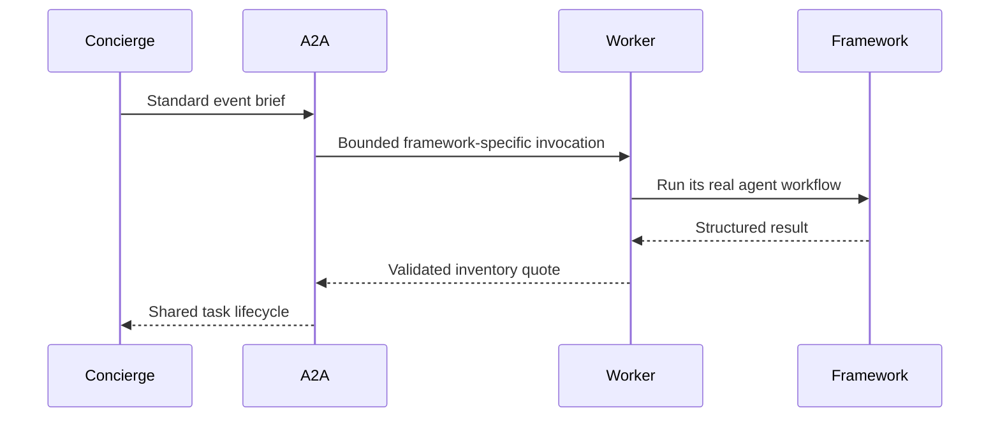

**Network and Concierge version 11:** what's new — framework integrations.

# Module 11: Framework integrations
> After this module you can separate framework internals from the protocol.

**Time:** ~90 min · **Level:** Intermediate · **LLM needed:** No for examples and grading · **Agents running:** in-process; optional local network: uv run python scripts/network.py up --module 11
**Spec sections:** [Specification](https://a2a-protocol.org/v1.0.1/specification/) · [a2a.proto](https://github.com/a2aproject/A2A/blob/v1.0.1/specification/a2a.proto)

## Prerequisites

Python functions and dictionaries, plus the preceding module in [the learning path](../../LEARNING_PATH.md). New terms appear in [the glossary](../../docs/GLOSSARY.md).

## Learning objectives

- Separate framework internals from the protocol
- Evaluate adapter compatibility
- Run an interop contract

## The big idea

A framework supplies internal agent execution; A2A supplies the external contract. A native adapter may lag the protocol, so inspect its dependency range and emitted card before using it. An official-SDK boundary can wrap a framework's public invocation API when its native adapter is incompatible. Test the combination, not just each package independently.

**Analogy:** Specialists may use different office software while sharing the same order form.

Read the [feature companion](../../docs/FEATURE_DEEP_DIVES.md) for field semantics, failure cases and
the connection to the final deployment.

## How it works



Under the hood: Frameworks own internal execution, while the official A2A SDK owns the external contract. Some framework dependencies still require incompatible SDK versions, so isolated worker environments keep them away from the main protocol runtime. Offline contract tests and real worker tests prove different boundaries.

## On the wire

Executed by the course authoring tool through the same recording transport as scripts/wiretap.py. Credentials are redacted. Pure local transformations have no HTTP exchanges and an empty exchange file; their result is separate. gRPC captures are explicitly service-boundary protobuf roundtrips, not network packets.

- [delegate: exchanges](wire/01_delegate.jsonl) and [result](wire/01_delegate.result.json).
- [grpc: exchanges](wire/02_grpc.jsonl) and [result](wire/02_grpc.result.json).
- [eval: exchanges](wire/03_eval.jsonl) and [result](wire/03_eval.result.json).

## Key APIs at a glance

| SDK API or labeled course helper | Spec operation or object | What it does | When to use it |
|---|---|---|---|
| agents.framework_vendor.FrameworkVendor (course) | Framework adapter | Preserves the shared A2A lifecycle | Run an isolated native worker |
| AgentExecutor | Protocol execution contract | Separates framework internals from A2A | Expose a framework agent |

## Walkthrough

The [seven-framework integration matrix](../../integrations/README.md) provides
the isolated installation commands, native runtime APIs and dependency rationale.
Run uv run python scripts/setup_frameworks.py, then
uv run python scripts/check_frameworks.py to execute all six isolated adapters.
LangGraph is included in the main environment.

The actual pause/resume captures are
[ADK](wire/adk.jsonl), [Strands](wire/strands.jsonl),
[Pydantic AI](wire/pydantic.jsonl), [CrewAI](wire/crewai.jsonl),
[Microsoft](wire/microsoft.jsonl) and [BeeAI](wire/beeai.jsonl).
For a live mixed-framework network, use
uv run python scripts/network.py up --module 11 --frameworks.

### 01: delegate

Separate framework internals from the protocol.

> **Predict, then run:** Write the expected result and whether this operation creates, continues or inspects work.

```console
uv run python modules/11_framework_integrations/examples/01_delegate.py
```

Captured output (generated values vary):

```json
{
  "delegations": [
    {
      "vendor": "venues",
      "state": "TASK_STATE_COMPLETED",
      "quotes": [
        {
          "guests": 40.0,
          "vendor": "venues",
          "approved": false,
          "selection": "room-1",
          "total_cents": 80000.0,
          "currency": "USD"
        }
      ],
      "question": {
        "role": "ROLE_AGENT",
        "parts": [
          {
            "text": "Quote ready; no money has been spent."
          }
        ]
      }
    },
    {
      "vendor": "catering",
      "state": "TASK_STATE_COMPLETED",
      "quotes": [
        {
          "guests": 40.0,
          "vendor": "catering",
          "approved": false,
          "selection": "garden",
          "total_cents": 96000.0,
          "currency": "USD"
        }
      ],
      "question": {
        "role": "ROLE_AGENT",
        "parts": [
          {
            "text": "Quote ready; no money has been spent."
          }
        ]
      }
    }
  ],
  "total_cents": 176000.0,
  "within_budget": true,
  "approval_required": true
}
```
### 02: grpc

Evaluate adapter compatibility.

> **Predict, then run:** Write the expected result and whether this operation creates, continues or inspects work.

```console
uv run python modules/11_framework_integrations/examples/02_grpc.py
```

Captured output (generated values vary):

```json
{
  "task": {
    "status": {
      "state": "TASK_STATE_COMPLETED",
      "message": {
        "role": "ROLE_AGENT",
        "parts": [
          {
            "text": "Quote ready; no money has been spent."
          }
        ]
      }
    },
    "artifacts": [
      {
        "artifactId": "quote",
        "name": "quote",
        "parts": [
          {
            "data": {
              "vendor": "print",
              "guests": 40.0,
              "approved": false,
              "selection": "badge",
              "total_cents": 10000.0,
              "currency": "USD"
            },
            "mediaType": "application/json"
          }
        ]
      }
    ],
    "history": [
      {
        "role": "ROLE_USER",
        "parts": [
          {
            "data": {
              "dietary": {
                "standard": 30.0,
                "vegan": 10.0
              },
              "guests": 40.0,
              "budget_cents": 1000000.0,
              "date": "2027-06-01"
            },
            "mediaType": "application/json"
          }
        ]
      },
      {
        "role": "ROLE_AGENT",
        "parts": [
          {
            "text": "print: checking the brief"
          }
        ]
      }
    ],
    "metadata": {
      "brief": {
        "guests": 40.0,
        "dietary": {
          "standard": 30.0,
          "vegan": 10.0
        },
        "budget_cents": 1000000.0,
        "date": "2027-06-01"
      }
    }
  }
}
```
### 03: eval

Run an interop contract.

> **Predict, then run:** Write the expected result and whether this operation creates, continues or inspects work.

```console
uv run python modules/11_framework_integrations/examples/03_eval.py
```

Captured output (generated values vary):

```json
{
  "result_type": "dict",
  "complete_result": "wire/03_eval.result.json"
}
```

## Try it in the Inspector and the Control Room

Start the network in another terminal. Run uv run streamlit run control_room/app.py, select a vendor, inspect its card and send a brief. The Inspector is now a standalone binary; use [its official installation guide](https://github.com/a2aproject/a2a-inspector).

## Real-world use case

Maplewood rehearses the shared vendor contract before replacing its implementation with a native framework worker.

Run:

```console
uv run python modules/11_framework_integrations/use_case/run.py
```

Selected observed fields (see [the complete captured result](wire/01_delegate.result.json) for the full output):

```json
{
  "vendor": "venues",
  "state": "TASK_STATE_COMPLETED",
  "total_cents": 80000.0,
  "currency": "USD",
  "approval_required": true
}
```

A real deployment retains this boundary while substituting its own approved inventory, identity provider and operating policy.

## Common bugs

| Observed behavior | Cause | Fix and related practice |
|---|---|---|
| Import failure after installing a framework | Dependency constraints collide | Use the pinned isolated worker environment; [practice 11-02](../../gym/tasks/11/11-02_fix/task.md) |
| Framework quote breaks artifact schema | Internal output exposed directly | Validate through the shared adapter; [practice 11-43](../../gym/tasks/11/11-43_framework_unsafe/task.md) |
| Missing dietary counts become completed | Framework bypasses shared lifecycle | Pause before invoking quote work; [practice 11-41](../../gym/tasks/11/11-41_framework_pause/task.md) |
| Capacity-invalid request succeeds | Worker result trusted unconditionally | Compare it with validated inventory rules; [practice 11-44](../../gym/tasks/11/11-44_framework_capacity/task.md) |

## Practice

| ID | Type | Level | Concept |
|---|---|---|---|
| [11-01](../../gym/tasks/11/11-01_build/task.md) | build | medium | Normalize framework output at the A2A boundary |
| [11-02](../../gym/tasks/11/11-02_fix/task.md) | fix | easy | Repair: normalize framework output at the a2a boundary |
| [11-03](../../gym/tasks/11/11-03_predict/task.md) | predict | easy | Predict the first experiment's observable result |
| [11-04](../../gym/tasks/11/11-04_trace/task.md) | trace | medium | Identify the captured transport boundaries |
| [11-05](../../gym/tasks/11/11-05_conformance/task.md) | conformance | hard | Enforce the contract across edge cases |
| [11-06](../../gym/tasks/11/11-06_design/task.md) | design | hard | Design a partner contract and failure policy |

### Full boundary exercises

- [11-40: Wrap a real LangGraph workflow: quote](../../gym/tasks/11/11-40_framework_quote/task.md)
- [11-41: Wrap a real LangGraph workflow: pause](../../gym/tasks/11/11-41_framework_pause/task.md)
- [11-42: Wrap a real LangGraph workflow: resume](../../gym/tasks/11/11-42_framework_resume/task.md)
- [11-43: Wrap a real LangGraph workflow: unsafe](../../gym/tasks/11/11-43_framework_unsafe/task.md)
- [11-44: Wrap a real LangGraph workflow: capacity](../../gym/tasks/11/11-44_framework_capacity/task.md)
- [11-45: Wrap a real LangGraph workflow: stream](../../gym/tasks/11/11-45_framework_stream/task.md)

These tasks execute actual SDK routes, workflows, cryptographic checks or independent
database connections offline. Each starter must fail and each reference solution must pass.

## Quiz

1. Must two vendors use the same framework?
<details><summary>Answer</summary>No. They must agree on the A2A contract.</details>

2. What does a mocked framework test fail to prove?
<details><summary>Answer</summary>That the real framework package imports and executes correctly.</details>

3. Why isolate worker environments?
<details><summary>Answer</summary>To prevent incompatible SDK dependencies from replacing the current boundary runtime.</details>

4. Who handles paused task IDs?
<details><summary>Answer</summary>The shared A2A handler and lifecycle adapter.</details>

5. How is a framework-generated quote checked?
<details><summary>Answer</summary>Against the deterministic inventory and business schema.</details>

6. What does the interoperability matrix measure?
<details><summary>Answer</summary>Actual tested framework and operating-system combinations, not presumed compatibility.</details>

## Key takeaways

- No. They must agree on the A2A contract.
- That the real framework package imports and executes correctly.
- To prevent incompatible SDK dependencies from replacing the current boundary runtime.
- The shared A2A handler and lifecycle adapter.
- Against the deterministic inventory and business schema.

## Go deeper

[Specification](https://a2a-protocol.org/v1.0.1/specification/) · [Protobuf](https://github.com/a2aproject/A2A/blob/v1.0.1/specification/a2a.proto) · [Official SDK](https://github.com/a2aproject/a2a-python/tree/v1.3.0)

## Next: Module 12

Use [the learning path](../../LEARNING_PATH.md) to continue or choose a capstone.

## Connected integration lab

Continue with [the tested integration walkthrough](../../docs/INTEGRATION_LABS.md), including actual commands, expected behavior, security boundaries and current limitations.
