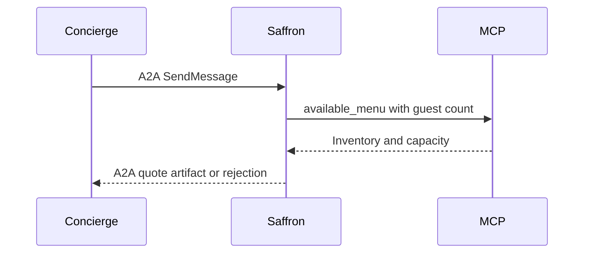

**Network and Concierge version 12:** what's new — a2a and mcp together.

# Module 12: A2A and MCP together
> After this module you can choose a tool versus a remote agent.

**Time:** ~90 min · **Level:** Intermediate · **LLM needed:** No for examples and grading · **Agents running:** in-process; optional local network: uv run python scripts/network.py up --module 12
**Spec sections:** [Specification](https://a2a-protocol.org/v1.0.1/specification/) · [a2a.proto](https://github.com/a2aproject/A2A/blob/v1.0.1/specification/a2a.proto)

## Prerequisites

Python functions and dictionaries, plus the preceding module in [the learning path](../../LEARNING_PATH.md). New terms appear in [the glossary](../../docs/GLOSSARY.md).

## Learning objectives

- Choose a tool versus a remote agent
- Describe bridge information loss
- Keep vendor inventory internal

## The big idea

MCP connects a host to tools and resources; A2A connects independently operated agents. Inventory lookup belongs inside Saffron Table as a tool, while menu quoting can remain a remote task. A bridge must decide how to represent task IDs, interruption, streaming and authorization. Turning every task into a single tool return can lose progress and continuation.

**Analogy:** The caterer's stockroom system is internal; its contract with the event planner is external.

Read the [feature companion](../../docs/FEATURE_DEEP_DIVES.md) for field semantics, failure cases and
the connection to the final deployment.

## How it works



Under the hood: An MCP call is an internal tool invocation, not an independently tracked A2A task. Saffron translates tool errors into its external business status. The Concierge cannot reach the kitchen directly or infer its private implementation from the quote artifact.

## On the wire

Executed by the course authoring tool through the same recording transport as scripts/wiretap.py. Credentials are redacted. Pure local transformations have no HTTP exchanges and an empty exchange file; their result is separate. gRPC captures are explicitly service-boundary protobuf roundtrips, not network packets.

- [tool_call: exchanges](wire/01_tool_call.jsonl) and [result](wire/01_tool_call.result.json).
- [delegate: exchanges](wire/02_delegate.jsonl) and [result](wire/02_delegate.result.json).
- [parts: exchanges](wire/03_parts.jsonl) and [result](wire/03_parts.result.json).

## Key APIs at a glance

| SDK API or labeled course helper | Spec operation or object | What it does | When to use it |
|---|---|---|---|
| mcp.Client | Internal tool client | Connects to the private kitchen server | Invoke available_menu |
| mcp.server.MCPServer | Tool server | Registers kitchen inventory tools | Keep tools behind Saffron |

## Walkthrough

### 01: tool call

Choose a tool versus a remote agent.

> **Predict, then run:** Write the expected result and whether this operation creates, continues or inspects work.

```console
uv run python modules/12_a2a_mcp/examples/01_tool_call.py
```

Captured output (generated values vary):

```json
{
  "state": "TASK_STATE_COMPLETED",
  "quote": {
    "vendor": "catering",
    "selection": "garden",
    "currency": "USD",
    "total_cents": 96000,
    "guests": 40,
    "approved": false
  }
}
```
### 02: delegate

Describe bridge information loss.

> **Predict, then run:** Write the expected result and whether this operation creates, continues or inspects work.

```console
uv run python modules/12_a2a_mcp/examples/02_delegate.py
```

Captured output (generated values vary):

```json
{
  "delegations": [
    {
      "vendor": "venues",
      "state": "TASK_STATE_COMPLETED",
      "quotes": [
        {
          "guests": 40.0,
          "vendor": "venues",
          "approved": false,
          "selection": "room-1",
          "total_cents": 80000.0,
          "currency": "USD"
        }
      ],
      "question": {
        "role": "ROLE_AGENT",
        "parts": [
          {
            "text": "Quote ready; no money has been spent."
          }
        ]
      }
    },
    {
      "vendor": "catering",
      "state": "TASK_STATE_COMPLETED",
      "quotes": [
        {
          "guests": 40.0,
          "vendor": "catering",
          "approved": false,
          "selection": "garden",
          "total_cents": 96000.0,
          "currency": "USD"
        }
      ],
      "question": {
        "role": "ROLE_AGENT",
        "parts": [
          {
            "text": "Quote ready; no money has been spent."
          }
        ]
      }
    }
  ],
  "total_cents": 176000.0,
  "within_budget": true,
  "approval_required": true
}
```
### 03: parts

Keep vendor inventory internal.

> **Predict, then run:** Write the expected result and whether this operation creates, continues or inspects work.

```console
uv run python modules/12_a2a_mcp/examples/03_parts.py
```

Captured output (generated values vary):

```json
[
  {
    "text": "Floor plan"
  },
  {
    "raw": "c3ludGhldGljIGZsb29yIHBsYW4=",
    "filename": "plan.txt",
    "mediaType": "text/plain"
  },
  {
    "url": "https://maplewood.example/plan",
    "mediaType": "text/plain"
  },
  {
    "data": {
      "total_cents": 96000.0
    },
    "mediaType": "application/json"
  }
]
```

## Try it in the Inspector and the Control Room

Start the network in another terminal. Run uv run streamlit run control_room/app.py, select a vendor, inspect its card and send a brief. The Inspector is now a standalone binary; use [its official installation guide](https://github.com/a2aproject/a2a-inspector).

## Real-world use case

Saffron distinguishes its internal menu tool from the independently operated A2A service visible to Maplewood.

Run:

```console
uv run python modules/12_a2a_mcp/use_case/run.py
```

Selected observed fields (see [the complete captured result](wire/01_tool_call.result.json) for the full output):

```json
{
  "state": "TASK_STATE_COMPLETED",
  "vendor": "catering",
  "currency": "USD",
  "total_cents": 96000
}
```

A real deployment retains this boundary while substituting its own approved inventory, identity provider and operating policy.

## Common bugs

| Observed behavior | Cause | Fix and related practice |
|---|---|---|
| Tool result treated as an A2A task | Protocol boundaries conflated | Wrap it in the vendor's lifecycle and artifact contract; [practice 12-02](../../gym/tasks/12/12-02_fix/task.md) |
| Too-large party receives a menu | Capacity validation bypassed | Reject beyond kitchen capacity; [practice 12-41](../../gym/tasks/12/12-41_mcp_too_many/task.md) |
| Boolean guest count accepted | Python bool treated as an integer | Validate business quantities explicitly; [practice 12-42](../../gym/tasks/12/12-42_mcp_invalid/task.md) |
| Kitchen details leak to Concierge | Internal tool result forwarded wholesale | Expose only the agreed quote artifact; [practice 12-43](../../gym/tasks/12/12-43_mcp_quote/task.md) |

## Practice

| ID | Type | Level | Concept |
|---|---|---|---|
| [12-01](../../gym/tasks/12/12-01_build/task.md) | build | medium | Choose inventory tools versus remote work |
| [12-02](../../gym/tasks/12/12-02_fix/task.md) | fix | easy | Repair: choose inventory tools versus remote work |
| [12-03](../../gym/tasks/12/12-03_predict/task.md) | predict | easy | Predict the first experiment's observable result |
| [12-04](../../gym/tasks/12/12-04_trace/task.md) | trace | medium | Identify the captured transport boundaries |
| [12-05](../../gym/tasks/12/12-05_conformance/task.md) | conformance | hard | Enforce the contract across edge cases |
| [12-06](../../gym/tasks/12/12-06_design/task.md) | design | hard | Design a partner contract and failure policy |

### Full boundary exercises

- [12-40: Keep kitchen tools inside the vendor: capacity](../../gym/tasks/12/12-40_mcp_capacity/task.md)
- [12-41: Keep kitchen tools inside the vendor: too_many](../../gym/tasks/12/12-41_mcp_too_many/task.md)
- [12-42: Keep kitchen tools inside the vendor: invalid](../../gym/tasks/12/12-42_mcp_invalid/task.md)
- [12-43: Keep kitchen tools inside the vendor: quote](../../gym/tasks/12/12-43_mcp_quote/task.md)
- [12-44: Keep kitchen tools inside the vendor: pause](../../gym/tasks/12/12-44_mcp_pause/task.md)
- [12-45: Keep kitchen tools inside the vendor: reject](../../gym/tasks/12/12-45_mcp_reject/task.md)

These tasks execute actual SDK routes, workflows, cryptographic checks or independent
database connections offline. Each starter must fail and each reference solution must pass.

## Quiz

1. Which protocol connects Saffron to its kitchen tool?
<details><summary>Answer</summary>MCP.</details>

2. Which protocol connects Maplewood to Saffron?
<details><summary>Answer</summary>A2A.</details>

3. Does an MCP result automatically include an A2A task lifecycle?
<details><summary>Answer</summary>No. The vendor supplies that lifecycle at its boundary.</details>

4. Should kitchen credentials appear in an A2A brief?
<details><summary>Answer</summary>No. The vendor provisions its own internal tool access.</details>

5. What happens above kitchen capacity?
<details><summary>Answer</summary>The vendor rejects the request instead of inventing inventory.</details>

6. What can be lost in an automatic MCP-to-A2A bridge?
<details><summary>Answer</summary>Task identity, interruption, cancellation, authorization and artifact semantics need explicit mapping.</details>

## Key takeaways

- MCP.
- A2A.
- No. The vendor supplies that lifecycle at its boundary.
- No. The vendor provisions its own internal tool access.
- The vendor rejects the request instead of inventing inventory.

## Go deeper

[Specification](https://a2a-protocol.org/v1.0.1/specification/) · [Protobuf](https://github.com/a2aproject/A2A/blob/v1.0.1/specification/a2a.proto) · [Official SDK](https://github.com/a2aproject/a2a-python/tree/v1.3.0)

## Next: Module 13

Use [the learning path](../../LEARNING_PATH.md) to continue or choose a capstone.

## Connected integration lab

Continue with [the tested integration walkthrough](../../docs/INTEGRATION_LABS.md), including actual commands, expected behavior, security boundaries and current limitations.
