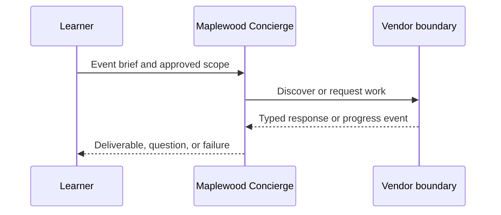

# Module 12: A2A and MCP together
> After this module you can choose a tool versus a remote agent.

**Time:** ~90 min · **Level:** Intermediate · **LLM needed:** No for examples and grading · **Agents running:** in-process; optional local network: uv run python scripts/network.py up --module 12
**Spec sections:** [Specification](https://a2a-protocol.org/v1.0.1/specification/) · [a2a.proto](https://github.com/a2aproject/A2A/blob/v1.0.1/specification/a2a.proto)
**Network and Concierge version 12:** what's new — a2a and mcp together.

## Prerequisites

Python functions and dictionaries, plus the preceding module in [the learning path](../../LEARNING_PATH.md). New terms appear in [the glossary](../../docs/GLOSSARY.md).

## Learning objectives

- Choose a tool versus a remote agent
- Describe bridge information loss
- Keep vendor inventory internal

## The big idea

MCP connects a host to tools and resources; A2A connects independently operated agents. Inventory lookup belongs inside Saffron Table as a tool, while menu quoting can remain a remote task. A bridge must decide how to represent task IDs, interruption, streaming and authorization. Turning every task into a single tool return can lose progress and continuation.

**Analogy:** The caterer's stockroom system is internal; its contract with the event planner is external.

## How it works



Under the hood, protobuf objects become JSON or binary bytes at the boundary. Route handlers enforce operation contracts; the executor performs business work. Compare the captured result with your prediction.

## On the wire

Executed by the course authoring tool through the same recording transport as scripts/wiretap.py. Credentials are redacted. Pure local transformations have no HTTP exchanges and an empty exchange file; their result is separate. gRPC captures are explicitly service-boundary protobuf roundtrips, not network packets.

- [tool_call: exchanges](wire/01_tool_call.jsonl) and [result](wire/01_tool_call.result.json).
- [delegate: exchanges](wire/02_delegate.jsonl) and [result](wire/02_delegate.result.json).
- [parts: exchanges](wire/03_parts.jsonl) and [result](wire/03_parts.result.json).

## Key APIs at a glance

| SDK API | Spec operation or object | What it does | When to use it |
|---|---|---|---|
| a2a.types | Protobuf objects | Defines wire-compatible values | Every protocol boundary |
| create_jsonrpc_routes | JSON-RPC binding | Mounts operations | Serving JSON-RPC |
| create_rest_routes | HTTP+JSON binding | Mounts HTTP routes | Serving HTTP+JSON |
| create_client | Client operations | Selects an advertised interface | Calling vendors |
| MessageToDict | ProtoJSON | Converts protobuf into JSON values | Inspecting traffic |

## Walkthrough

### 01: tool call

Choose a tool versus a remote agent.

> **Predict, then run:** Write the expected result and whether this operation creates, continues or inspects work.

```console
uv run python modules/12_a2a_mcp/examples/01_tool_call.py
```

Captured output (generated values vary):

```json
{
  "state": "TASK_STATE_COMPLETED",
  "quote": {
    "vendor": "catering",
    "selection": "garden",
    "currency": "USD",
    "total_cents": 96000,
    "guests": 40,
    "approved": false
  }
}
```
### 02: delegate

Describe bridge information loss.

> **Predict, then run:** Write the expected result and whether this operation creates, continues or inspects work.

```console
uv run python modules/12_a2a_mcp/examples/02_delegate.py
```

Captured output (generated values vary):

```json
{
  "delegations": [
    {
      "vendor": "venues",
      "state": "TASK_STATE_COMPLETED",
      "quotes": [
        {
          "guests": 40.0,
          "vendor": "venues",
          "approved": false,
          "selection": "room-1",
          "total_cents": 80000.0,
          "currency": "USD"
        }
      ],
      "question": {
        "role": "ROLE_AGENT",
        "parts": [
          {
            "text": "Quote ready; no money has been spent."
          }
        ]
      }
    },
    {
      "vendor": "catering",
      "state": "TASK_STATE_COMPLETED",
      "quotes": [
        {
          "guests": 40.0,
          "vendor": "catering",
          "approved": false,
          "selection": "garden",
          "total_cents": 96000.0,
          "currency": "USD"
        }
      ],
      "question": {
        "role": "ROLE_AGENT",
        "parts": [
          {
            "text": "Quote ready; no money has been spent."
          }
        ]
      }
    }
  ],
  "total_cents": 176000.0,
  "within_budget": true,
  "approval_required": true
}
```
### 03: parts

Keep vendor inventory internal.

> **Predict, then run:** Write the expected result and whether this operation creates, continues or inspects work.

```console
uv run python modules/12_a2a_mcp/examples/03_parts.py
```

Captured output (generated values vary):

```json
[
  {
    "text": "Floor plan"
  },
  {
    "raw": "c3ludGhldGljIGZsb29yIHBsYW4=",
    "filename": "plan.txt",
    "mediaType": "text/plain"
  },
  {
    "url": "https://maplewood.example/plan",
    "mediaType": "text/plain"
  },
  {
    "data": {
      "total_cents": 96000.0
    },
    "mediaType": "application/json"
  }
]
```

## Try it in the Inspector and the Control Room

Start the network in another terminal. Run uv run streamlit run control_room/app.py, select a vendor, inspect its card and send a brief. The Inspector is now a standalone binary; use [its official installation guide](https://github.com/a2aproject/a2a-inspector).

## Real-world use case

Maplewood needs quotes for a 40-person offsite. Run uv run python modules/12_a2a_mcp/use_case/run.py. The result applies this module's first experiment to shared synthetic data. A real team substitutes validated inventory and its identity system while retaining the A2A boundary.

## Common bugs

| Observed behavior | Cause | Fix |
|---|---|---|
| HTTP 401 | Missing vendor credential | Obtain the vendor token outside A2A and send a header |
| Version not supported | Missing or wrong A2A-Version | Select the card interface and send version 1.0 |
| Task remains interrupted | Required input is missing | Preserve IDs and answer the missing-input request |
| Edge-case assertion fails | Happy path was hard-coded | Work through [Fix task](../../gym/tasks/12/12-02_fix/task.md) |

## Practice

| ID | Type | Level | Concept |
|---|---|---|---|
| [12-01](../../gym/tasks/12/12-01_build/task.md) | build | medium | Choose inventory tools versus remote work |
| [12-02](../../gym/tasks/12/12-02_fix/task.md) | fix | easy | Repair: choose inventory tools versus remote work |
| [12-03](../../gym/tasks/12/12-03_predict/task.md) | predict | easy | Predict the first experiment's observable result |
| [12-04](../../gym/tasks/12/12-04_trace/task.md) | trace | medium | Identify the captured transport boundaries |
| [12-05](../../gym/tasks/12/12-05_conformance/task.md) | conformance | hard | Enforce the contract across edge cases |
| [12-06](../../gym/tasks/12/12-06_design/task.md) | design | hard | Design a partner contract and failure policy |

## Quiz

1. What does the vendor own?
<details><summary>Answer</summary>Its execution, inventory, task IDs, context scope and authorization policy.</details>

2. How would you demonstrate: choose a tool versus a remote agent?
<details><summary>Answer</summary>Run example 01 and identify the exact output field or event that proves the result.</details>

3. Does a signed card grant access?
<details><summary>Answer</summary>No. A trusted signature checks integrity and identity; authorization is enforced separately.</details>

4. Why use a scripted model in graded tasks?
<details><summary>Answer</summary>Repeatable decisions isolate protocol behavior and cost no API tokens.</details>

5. What if an artifact asks for credentials?
<details><summary>Answer</summary>Treat it as untrusted data. Never forward user tokens or expand the allow-list.</details>

6. Which edge case should you test?
<details><summary>Answer</summary>Use the negative cases in this module's Fix task; explain why the broken implementation accepts or mishandles them.</details>

## Key takeaways

- Read typed fields instead of inferring behavior from prose.
- Separate transport concerns from business work.
- Predict before running.
- Test successful and rejected inputs.
- Treat every remote peer as a trust boundary.

## Go deeper

[Specification](https://a2a-protocol.org/v1.0.1/specification/) · [Protobuf](https://github.com/a2aproject/A2A/blob/v1.0.1/specification/a2a.proto) · [Official SDK](https://github.com/a2aproject/a2a-python/tree/v1.3.0)

## Next: Module 13

Use [the learning path](../../LEARNING_PATH.md) to continue or choose a capstone.

## Connected integration lab

Continue with [the tested integration walkthrough](../../docs/INTEGRATION_LABS.md), including actual commands, expected behavior, security boundaries and current limitations.
