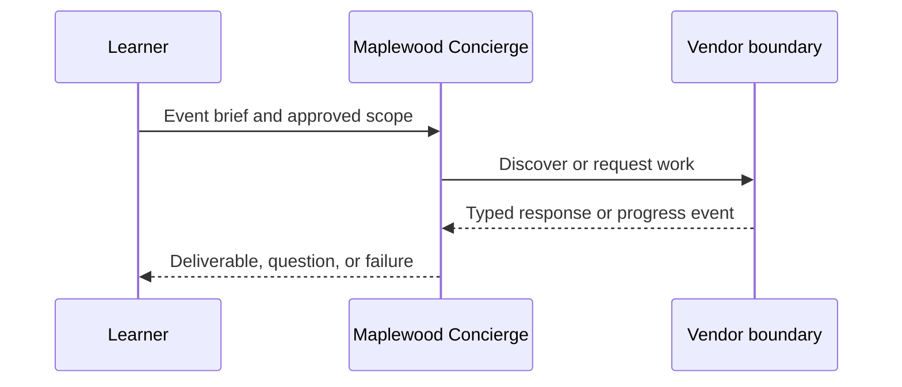

# Module 13: Authentication and authorization
> After this module you can reject missing credentials.

**Time:** ~90 min · **Level:** Advanced · **LLM needed:** No for examples and grading · **Agents running:** in-process; optional local network: uv run python scripts/network.py up --module 13
**Spec sections:** [Specification](https://a2a-protocol.org/v1.0.1/specification/) · [a2a.proto](https://github.com/a2aproject/A2A/blob/v1.0.1/specification/a2a.proto)
**Network and Concierge version 13:** what's new — authentication and authorization.

## Prerequisites

Python functions and dictionaries, plus the preceding module in [the learning path](../../LEARNING_PATH.md). New terms appear in [the glossary](../../docs/GLOSSARY.md).

## Learning objectives

- Reject missing credentials
- Scope task access to a caller
- Retrieve an extended card

## The big idea

Authentication proves identity; authorization decides what that identity may do. A card advertises schemes but does not issue credentials. Obtain API keys or OAuth tokens out of band. A JWT is signed claims, not proof until issuer, audience, signature and expiration are checked. OpenID Connect adds identity discovery to OAuth. TLS protects the connection; mutual TLS also verifies a client certificate.

**Analogy:** A badge identifies a visitor; a room-access policy determines which doors it opens.

## How it works



Under the hood, protobuf objects become JSON or binary bytes at the boundary. Route handlers enforce operation contracts; the executor performs business work. Compare the captured result with your prediction.

## On the wire

Executed by the course authoring tool through the same recording transport as scripts/wiretap.py. Credentials are redacted. Pure local transformations have no HTTP exchanges and an empty exchange file; their result is separate. gRPC captures are explicitly service-boundary protobuf roundtrips, not network packets.

- [auth: exchanges](wire/01_auth.jsonl) and [result](wire/01_auth.result.json).
- [extended: exchanges](wire/02_extended.jsonl) and [result](wire/02_extended.result.json).
- [pause: exchanges](wire/03_pause.jsonl) and [result](wire/03_pause.result.json).

## Key APIs at a glance

| SDK API | Spec operation or object | What it does | When to use it |
|---|---|---|---|
| a2a.types | Protobuf objects | Defines wire-compatible values | Every protocol boundary |
| create_jsonrpc_routes | JSON-RPC binding | Mounts operations | Serving JSON-RPC |
| create_rest_routes | HTTP+JSON binding | Mounts HTTP routes | Serving HTTP+JSON |
| create_client | Client operations | Selects an advertised interface | Calling vendors |
| MessageToDict | ProtoJSON | Converts protobuf into JSON values | Inspecting traffic |

## Walkthrough

### 01: auth

Reject missing credentials.

> **Predict, then run:** Write the expected result and whether this operation creates, continues or inspects work.

```console
uv run python modules/13_authentication/examples/01_auth.py
```

Captured output (generated values vary):

```json
{
  "unauthorized_status": 401,
  "authorized": {
    "task": {
      "status": {
        "state": "TASK_STATE_COMPLETED",
        "message": {
          "role": "ROLE_AGENT",
          "parts": [
            {
              "text": "Quote ready; no money has been spent."
            }
          ]
        }
      },
      "artifacts": [
        {
          "artifactId": "quote",
          "name": "quote",
          "parts": [
            {
              "data": {
                "guests": 40.0,
                "vendor": "venues",
                "approved": false,
                "selection": "room-1",
                "total_cents": 80000.0,
                "currency": "USD"
              },
              "mediaType": "application/json"
            }
          ]
        }
      ],
      "history": [
        {
          "role": "ROLE_USER",
          "parts": [
            {
              "data": {
                "dietary": {
                  "standard": 30.0,
                  "vegan": 10.0
                },
                "guests": 40.0,
                "budget_cents": 1000000.0,
                "date": "2027-06-01"
              },
              "mediaType": "application/json"
            }
          ]
        },
        {
          "role": "ROLE_AGENT",
          "parts": [
            {
              "text": "venues: checking the brief"
            }
          ]
        }
      ],
      "metadata": {
        "brief": {
          "guests": 40.0,
          "dietary": {
            "standard": 30.0,
            "vegan": 10.0
          },
          "budget_cents": 1000000.0,
          "date": "2027-06-01"
        }
      }
    }
  }
}
```
### 02: extended

Scope task access to a caller.

> **Predict, then run:** Write the expected result and whether this operation creates, continues or inspects work.

```console
uv run python modules/13_authentication/examples/02_extended.py
```

Captured output (generated values vary):

```json
{
  "result_type": "dict",
  "complete_result": "wire/02_extended.result.json"
}
```
### 03: pause

Retrieve an extended card.

> **Predict, then run:** Write the expected result and whether this operation creates, continues or inspects work.

```console
uv run python modules/13_authentication/examples/03_pause.py
```

Captured output (generated values vary):

```json
{
  "status": {
    "state": "TASK_STATE_INPUT_REQUIRED",
    "message": {
      "role": "ROLE_AGENT",
      "parts": [
        {
          "text": "How many guests need each dietary option?"
        }
      ]
    }
  },
  "history": [
    {
      "role": "ROLE_USER",
      "parts": [
        {
          "data": {
            "guests": 40.0
          },
          "mediaType": "application/json"
        }
      ]
    },
    {
      "role": "ROLE_AGENT",
      "parts": [
        {
          "text": "catering: checking the brief"
        }
      ]
    }
  ],
  "metadata": {
    "brief": {
      "guests": 40.0
    }
  }
}
```

## Try it in the Inspector and the Control Room

Start the network in another terminal. Run uv run streamlit run control_room/app.py, select a vendor, inspect its card and send a brief. The Inspector is now a standalone binary; use [its official installation guide](https://github.com/a2aproject/a2a-inspector).

## Real-world use case

Maplewood needs quotes for a 40-person offsite. Run uv run python modules/13_authentication/use_case/run.py. The result applies this module's first experiment to shared synthetic data. A real team substitutes validated inventory and its identity system while retaining the A2A boundary.

## Common bugs

| Observed behavior | Cause | Fix |
|---|---|---|
| HTTP 401 | Missing vendor credential | Obtain the vendor token outside A2A and send a header |
| Version not supported | Missing or wrong A2A-Version | Select the card interface and send version 1.0 |
| Task remains interrupted | Required input is missing | Preserve IDs and answer the missing-input request |
| Edge-case assertion fails | Happy path was hard-coded | Work through [Fix task](../../gym/tasks/13/13-02_fix/task.md) |

## Practice

| ID | Type | Level | Concept |
|---|---|---|---|
| [13-01](../../gym/tasks/13/13-01_build/task.md) | build | medium | Authorize the requested partner skill |
| [13-02](../../gym/tasks/13/13-02_fix/task.md) | fix | easy | Repair: authorize the requested partner skill |
| [13-03](../../gym/tasks/13/13-03_predict/task.md) | predict | easy | Predict the first experiment's observable result |
| [13-04](../../gym/tasks/13/13-04_trace/task.md) | trace | medium | Identify the captured transport boundaries |
| [13-05](../../gym/tasks/13/13-05_conformance/task.md) | conformance | hard | Enforce the contract across edge cases |
| [13-06](../../gym/tasks/13/13-06_design/task.md) | design | hard | Design a partner contract and failure policy |

## Quiz

1. What does the vendor own?
<details><summary>Answer</summary>Its execution, inventory, task IDs, context scope and authorization policy.</details>

2. How would you demonstrate: reject missing credentials?
<details><summary>Answer</summary>Run example 01 and identify the exact output field or event that proves the result.</details>

3. Does a signed card grant access?
<details><summary>Answer</summary>No. A trusted signature checks integrity and identity; authorization is enforced separately.</details>

4. Why use a scripted model in graded tasks?
<details><summary>Answer</summary>Repeatable decisions isolate protocol behavior and cost no API tokens.</details>

5. What if an artifact asks for credentials?
<details><summary>Answer</summary>Treat it as untrusted data. Never forward user tokens or expand the allow-list.</details>

6. Which edge case should you test?
<details><summary>Answer</summary>Use the negative cases in this module's Fix task; explain why the broken implementation accepts or mishandles them.</details>

## Key takeaways

- Read typed fields instead of inferring behavior from prose.
- Separate transport concerns from business work.
- Predict before running.
- Test successful and rejected inputs.
- Treat every remote peer as a trust boundary.

## Go deeper

[Specification](https://a2a-protocol.org/v1.0.1/specification/) · [Protobuf](https://github.com/a2aproject/A2A/blob/v1.0.1/specification/a2a.proto) · [Official SDK](https://github.com/a2aproject/a2a-python/tree/v1.3.0)

## Next: Module 14

Use [the learning path](../../LEARNING_PATH.md) to continue or choose a capstone.

## Connected integration lab

Continue with [the tested integration walkthrough](../../docs/INTEGRATION_LABS.md), including actual commands, expected behavior, security boundaries and current limitations.
