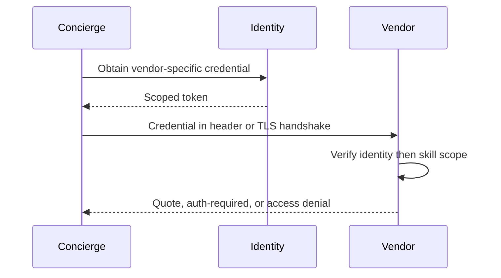

**Network and Concierge version 13:** what's new — authentication and authorization.

# Module 13: Authentication and authorization
> After this module you can reject missing credentials.

**Time:** ~90 min · **Level:** Advanced · **LLM needed:** No for examples and grading · **Agents running:** in-process; optional local network: uv run python scripts/network.py up --module 13
**Spec sections:** [Specification](https://a2a-protocol.org/v1.0.1/specification/) · [a2a.proto](https://github.com/a2aproject/A2A/blob/v1.0.1/specification/a2a.proto)

## Prerequisites

Python functions and dictionaries, plus the preceding module in [the learning path](../../LEARNING_PATH.md). New terms appear in [the glossary](../../docs/GLOSSARY.md).

## Learning objectives

- Reject missing credentials
- Scope task access to a caller
- Retrieve an extended card

## The big idea

Authentication proves identity; authorization decides what that identity may do. A card advertises schemes but does not issue credentials. Obtain API keys or OAuth tokens out of band. A JWT is signed claims, not proof until issuer, audience, signature and expiration are checked. OpenID Connect adds identity discovery to OAuth. TLS protects the connection; mutual TLS also verifies a client certificate.

**Analogy:** A badge identifies a visitor; a room-access policy determines which doors it opens.

Read the [feature companion](../../docs/FEATURE_DEEP_DIVES.md) for field semantics, failure cases and
the connection to the final deployment.

## How it works



Under the hood: Authentication happens before protocol routing. Authorization then checks the caller's tenant and partner scope. A readable JWT payload proves nothing until signature, issuer, audience and expiry are validated. A2A advertises the requirements but does not issue the credentials.

## On the wire

Executed by the course authoring tool through the same recording transport as scripts/wiretap.py. Credentials are redacted. Pure local transformations have no HTTP exchanges and an empty exchange file; their result is separate. gRPC captures are explicitly service-boundary protobuf roundtrips, not network packets.

- [auth: exchanges](wire/01_auth.jsonl) and [result](wire/01_auth.result.json).
- [extended: exchanges](wire/02_extended.jsonl) and [result](wire/02_extended.result.json).
- [pause: exchanges](wire/03_pause.jsonl) and [result](wire/03_pause.result.json).

## Key APIs at a glance

| SDK API or labeled course helper | Spec operation or object | What it does | When to use it |
|---|---|---|---|
| SecurityScheme | Advertised authentication | Describes supported credential mechanisms | Publish access requirements |
| ServerCallContext | Authenticated request context | Carries identity and authorization state | Scope task access |

## Walkthrough

For actual token issuance and verification, run the
[Keycloak service-account lab](../../deploy/OIDC_LAB.md). It obtains a token
outside A2A, then authenticates a venue quote using the standard bearer header.

### 01: auth

Reject missing credentials.

> **Predict, then run:** Write the expected result and whether this operation creates, continues or inspects work.

```console
uv run python modules/13_authentication/examples/01_auth.py
```

Captured output (generated values vary):

```json
{
  "unauthorized_status": 401,
  "authorized": {
    "task": {
      "status": {
        "state": "TASK_STATE_COMPLETED",
        "message": {
          "role": "ROLE_AGENT",
          "parts": [
            {
              "text": "Quote ready; no money has been spent."
            }
          ]
        }
      },
      "artifacts": [
        {
          "artifactId": "quote",
          "name": "quote",
          "parts": [
            {
              "data": {
                "guests": 40.0,
                "vendor": "venues",
                "approved": false,
                "selection": "room-1",
                "total_cents": 80000.0,
                "currency": "USD"
              },
              "mediaType": "application/json"
            }
          ]
        }
      ],
      "history": [
        {
          "role": "ROLE_USER",
          "parts": [
            {
              "data": {
                "dietary": {
                  "standard": 30.0,
                  "vegan": 10.0
                },
                "guests": 40.0,
                "budget_cents": 1000000.0,
                "date": "2027-06-01"
              },
              "mediaType": "application/json"
            }
          ]
        },
        {
          "role": "ROLE_AGENT",
          "parts": [
            {
              "text": "venues: checking the brief"
            }
          ]
        }
      ],
      "metadata": {
        "brief": {
          "guests": 40.0,
          "dietary": {
            "standard": 30.0,
            "vegan": 10.0
          },
          "budget_cents": 1000000.0,
          "date": "2027-06-01"
        }
      }
    }
  }
}
```
### 02: extended

Scope task access to a caller.

> **Predict, then run:** Write the expected result and whether this operation creates, continues or inspects work.

```console
uv run python modules/13_authentication/examples/02_extended.py
```

Captured output (generated values vary):

```json
{
  "result_type": "dict",
  "complete_result": "wire/02_extended.result.json"
}
```
### 03: pause

Retrieve an extended card.

> **Predict, then run:** Write the expected result and whether this operation creates, continues or inspects work.

```console
uv run python modules/13_authentication/examples/03_pause.py
```

Captured output (generated values vary):

```json
{
  "status": {
    "state": "TASK_STATE_INPUT_REQUIRED",
    "message": {
      "role": "ROLE_AGENT",
      "parts": [
        {
          "text": "How many guests need each dietary option?"
        }
      ]
    }
  },
  "history": [
    {
      "role": "ROLE_USER",
      "parts": [
        {
          "data": {
            "guests": 40.0
          },
          "mediaType": "application/json"
        }
      ]
    },
    {
      "role": "ROLE_AGENT",
      "parts": [
        {
          "text": "catering: checking the brief"
        }
      ]
    }
  ],
  "metadata": {
    "brief": {
      "guests": 40.0
    }
  }
}
```

## Try it in the Inspector and the Control Room

Start the network in another terminal. Run uv run streamlit run control_room/app.py, select a vendor, inspect its card and send a brief. The Inspector is now a standalone binary; use [its official installation guide](https://github.com/a2aproject/a2a-inspector).

## Real-world use case

A caller requests a venue quote first without a token and then with a properly provisioned vendor credential.

Run:

```console
uv run python modules/13_authentication/use_case/run.py
```

Selected observed fields (see [the complete captured result](wire/01_auth.result.json) for the full output):

```json
{
  "unauthorized_status": 401,
  "state": "TASK_STATE_COMPLETED",
  "name": "quote",
  "vendor": "venues",
  "total_cents": 80000.0
}
```

A real deployment retains this boundary while substituting its own approved inventory, identity provider and operating policy.

## Common bugs

| Observed behavior | Cause | Fix and related practice |
|---|---|---|
| HTTP 401 despite readable JWT claims | Signature, audience or expiry invalid | Validate the whole token against pinned issuer policy; [practice 13-20](../../gym/tasks/13/13-20_security_anonymous/task.md) |
| Partner prices visible to ordinary caller | Authentication confused with authorization | Check partner scope separately; [practice 13-02](../../gym/tasks/13/13-02_fix/task.md) |
| Another tenant's task is visible | Caller-controlled tenant accepted | Derive ownership from authenticated identity; [practice 13-22](../../gym/tasks/13/13-22_security_tenant/task.md) |
| Body credential bypasses login | Message data treated as identity | Accept credentials only through configured auth mechanisms; [practice 13-25](../../gym/tasks/13/13-25_security_body_secret/task.md) |

## Practice

| ID | Type | Level | Concept |
|---|---|---|---|
| [13-01](../../gym/tasks/13/13-01_build/task.md) | build | medium | Authorize the requested partner skill |
| [13-02](../../gym/tasks/13/13-02_fix/task.md) | fix | easy | Repair: authorize the requested partner skill |
| [13-03](../../gym/tasks/13/13-03_predict/task.md) | predict | easy | Predict the first experiment's observable result |
| [13-04](../../gym/tasks/13/13-04_trace/task.md) | trace | medium | Identify the captured transport boundaries |
| [13-05](../../gym/tasks/13/13-05_conformance/task.md) | conformance | hard | Enforce the contract across edge cases |
| [13-06](../../gym/tasks/13/13-06_design/task.md) | design | hard | Design a partner contract and failure policy |

### Full boundary exercises

- [13-07: Close Granite's anonymous quote endpoint](../../gym/tasks/13/13-07_auth/task.md)
- [13-20: Keep work endpoints authenticated](../../gym/tasks/13/13-20_security_anonymous/task.md)
- [13-21: Attack a different caller's task ID](../../gym/tasks/13/13-21_security_owner/task.md)
- [13-22: Reject a forged tenant header](../../gym/tasks/13/13-22_security_tenant/task.md)
- [13-23: Enforce the extended-card partner scope](../../gym/tasks/13/13-23_security_extended_denied/task.md)
- [13-24: Discover the authorized partner skill](../../gym/tasks/13/13-24_security_extended_partner/task.md)
- [13-25: Reject a credential smuggled in task data](../../gym/tasks/13/13-25_security_body_secret/task.md)

These tasks execute actual SDK routes, workflows, cryptographic checks or independent
database connections offline. Each starter must fail and each reference solution must pass.

## Quiz

1. Does an authenticated caller automatically get partner pricing?
<details><summary>Answer</summary>No. The partner skill requires its own authorization scope.</details>

2. Where should bearer credentials travel?
<details><summary>Answer</summary>In the Authorization header, not message Parts.</details>

3. What does a wrong JWT audience mean?
<details><summary>Answer</summary>The token was issued for another service and must be rejected.</details>

4. How does mutual TLS identify a client?
<details><summary>Answer</summary>The TLS handshake verifies a client certificate under the configured trust policy.</details>

5. When is auth-required useful?
<details><summary>Answer</summary>When valid tracked work needs additional authorization obtained outside the conversation.</details>

6. Can a public Agent Card contain service secrets?
<details><summary>Answer</summary>No. It advertises mechanisms and requirements, not reusable credentials.</details>

## Key takeaways

- No. The partner skill requires its own authorization scope.
- In the Authorization header, not message Parts.
- The token was issued for another service and must be rejected.
- The TLS handshake verifies a client certificate under the configured trust policy.
- When valid tracked work needs additional authorization obtained outside the conversation.

## Go deeper

[Specification](https://a2a-protocol.org/v1.0.1/specification/) · [Protobuf](https://github.com/a2aproject/A2A/blob/v1.0.1/specification/a2a.proto) · [Official SDK](https://github.com/a2aproject/a2a-python/tree/v1.3.0)

## Next: Module 14

Use [the learning path](../../LEARNING_PATH.md) to continue or choose a capstone.

## Connected integration lab

Continue with [the tested integration walkthrough](../../docs/INTEGRATION_LABS.md), including actual commands, expected behavior, security boundaries and current limitations.
