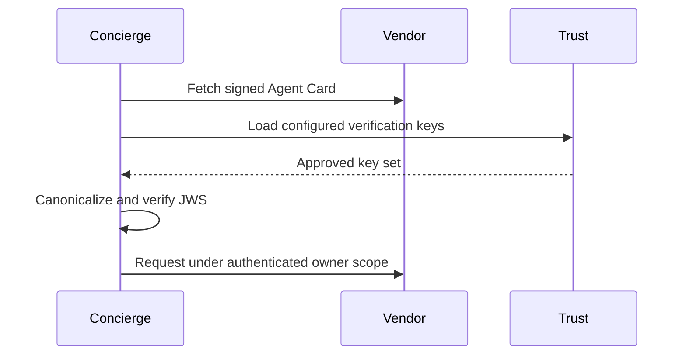

**Network and Concierge version 14:** what's new — trust, signed cards and multi-tenancy.

# Module 14: Trust, signed cards and multi-tenancy
> After this module you can sign canonical card bytes.

**Time:** ~90 min · **Level:** Advanced · **LLM needed:** No for examples and grading · **Agents running:** in-process; optional local network: uv run python scripts/network.py up --module 14
**Spec sections:** [Specification](https://a2a-protocol.org/v1.0.1/specification/) · [a2a.proto](https://github.com/a2aproject/A2A/blob/v1.0.1/specification/a2a.proto)

## Prerequisites

Python functions and dictionaries, plus the preceding module in [the learning path](../../LEARNING_PATH.md). New terms appear in [the glossary](../../docs/GLOSSARY.md).

## Learning objectives

- Sign canonical card bytes
- Reject a forged card
- Separate routing and ownership

## The big idea

A signature detects changes to a card and binds it to a key you already trust. Canonical JSON makes equivalent objects produce the same signed bytes. JWS specifies how headers and payload are signed. A JWKS is a set of public keys; a key URL advertised by an attacker is not automatically trusted. Tenant routing is separate from authenticated ownership.

**Analogy:** A signed letter matters only if you know whose seal it bears.

Read the [feature companion](../../docs/FEATURE_DEEP_DIVES.md) for field semantics, failure cases and
the connection to the final deployment.

## How it works



Under the hood: JWS authenticates the canonical card payload with a protected header. Key trust comes from operator policy, not a URL supplied by the card. Card integrity and task authorization are independent: knowing a task ID or having a valid card signature cannot grant access to another owner's task.

## On the wire

Executed by the course authoring tool through the same recording transport as scripts/wiretap.py. Credentials are redacted. Pure local transformations have no HTTP exchanges and an empty exchange file; their result is separate. gRPC captures are explicitly service-boundary protobuf roundtrips, not network packets.

- [sign: exchanges](wire/01_sign.jsonl) and [result](wire/01_sign.result.json).
- [forgery: exchanges](wire/02_forgery.jsonl) and [result](wire/02_forgery.result.json).
- [jwks: exchanges](wire/03_jwks.jsonl) and [result](wire/03_jwks.result.json).

## Key APIs at a glance

| SDK API or labeled course helper | Spec operation or object | What it does | When to use it |
|---|---|---|---|
| common.security.sign_card (course) | Agent Card JWS | Signs the canonical unsigned card | Publish a verifiable identity |
| common.security.verify_card (course) | Trust verification | Accepts only approved signing keys | Reject forgery before delegation |

## Walkthrough

### 01: sign

Sign canonical card bytes.

> **Predict, then run:** Write the expected result and whether this operation creates, continues or inspects work.

```console
uv run python modules/14_trust_tenants/examples/01_sign.py
```

Captured output (generated values vary):

```json
{
  "result_type": "dict",
  "complete_result": "wire/01_sign.result.json"
}
```
### 02: forgery

Reject a forged card.

> **Predict, then run:** Write the expected result and whether this operation creates, continues or inspects work.

```console
uv run python modules/14_trust_tenants/examples/02_forgery.py
```

Captured output (generated values vary):

```json
{
  "rejected": true,
  "reason": "Card signature did not verify"
}
```
### 03: jwks

Separate routing and ownership.

> **Predict, then run:** Write the expected result and whether this operation creates, continues or inspects work.

```console
uv run python modules/14_trust_tenants/examples/03_jwks.py
```

Captured output (generated values vary):

```json
{
  "jwks": {
    "keys": [
      {
        "kty": "OKP",
        "crv": "Ed25519",
        "use": "sig",
        "alg": "EdDSA",
        "kid": "granite-2026",
        "x": "QH6aupGC-BrQcZe09lfwfho3DnIq0D0LMlL5_7Ps2JI"
      }
    ]
  },
  "verified": true
}
```

## Try it in the Inspector and the Control Room

Start the network in another terminal. Run uv run streamlit run control_room/app.py, select a vendor, inspect its card and send a brief. The Inspector is now a standalone binary; use [its official installation guide](https://github.com/a2aproject/a2a-inspector).

## Real-world use case

Maplewood verifies that a published vendor card has an approved signature before trusting its advertised identity.

Run:

```console
uv run python modules/14_trust_tenants/use_case/run.py
```

Selected observed fields (see [the complete captured result](wire/01_sign.result.json) for the full output):

```json
{
  "name": "Granite Hall Venues",
  "protocolBinding": "JSONRPC",
  "protocolVersion": "1.0"
}
```

A real deployment retains this boundary while substituting its own approved inventory, identity provider and operating policy.

## Common bugs

| Observed behavior | Cause | Fix and related practice |
|---|---|---|
| Signature fails after harmless JSON formatting | Raw serialization signed | Use canonical JSON; [practice 14-43](../../gym/tasks/14/14-43_trust_canonical/task.md) |
| Attacker signs its own forged identity | Any supplied key accepted | Verify only approved vendor keys; [practice 14-02](../../gym/tasks/14/14-02_fix/task.md) |
| Cached cards fail during rotation | Old verification key removed too early | Retain the overlap window; [practice 14-44](../../gym/tasks/14/14-44_trust_rotation/task.md) |
| Revoked key still verifies | Verifier uses a stale unbounded cache | Refresh and enforce revocation policy; [practice 14-45](../../gym/tasks/14/14-45_trust_revocation/task.md) |

## Practice

| ID | Type | Level | Concept |
|---|---|---|---|
| [14-01](../../gym/tasks/14/14-01_build/task.md) | build | medium | Keep task owners isolated |
| [14-02](../../gym/tasks/14/14-02_fix/task.md) | fix | easy | Repair: keep task owners isolated |
| [14-03](../../gym/tasks/14/14-03_predict/task.md) | predict | easy | Predict the first experiment's observable result |
| [14-04](../../gym/tasks/14/14-04_trace/task.md) | trace | medium | Identify the captured transport boundaries |
| [14-05](../../gym/tasks/14/14-05_conformance/task.md) | conformance | hard | Enforce the contract across edge cases |
| [14-06](../../gym/tasks/14/14-06_design/task.md) | design | hard | Design a partner contract and failure policy |

### Full boundary exercises

- [14-07: Reject a forged skill description](../../gym/tasks/14/14-07_signature/task.md)
- [14-40: Verify a pinned vendor signature](../../gym/tasks/14/14-40_trust_verify/task.md)
- [14-41: Reject an injected skill description](../../gym/tasks/14/14-41_trust_tamper/task.md)
- [14-42: Reject a self-appointed signing key](../../gym/tasks/14/14-42_trust_unknown/task.md)
- [14-43: Canonicalize before signing](../../gym/tasks/14/14-43_trust_canonical/task.md)
- [14-44: Keep valid keys during rotation overlap](../../gym/tasks/14/14-44_trust_rotation/task.md)
- [14-45: Reject a revoked card key](../../gym/tasks/14/14-45_trust_revocation/task.md)

These tasks execute actual SDK routes, workflows, cryptographic checks or independent
database connections offline. Each starter must fail and each reference solution must pass.

## Quiz

1. Which card field is excluded from the signed payload?
<details><summary>Answer</summary>signatures itself.</details>

2. Why canonicalize JSON before signing?
<details><summary>Answer</summary>Equivalent JSON formatting and key order should produce the same signing bytes.</details>

3. Can a key URL in an untrusted card establish trust?
<details><summary>Answer</summary>No. Use separately configured keys or an operator-pinned HTTPS source.</details>

4. Why overlap keys during rotation?
<details><summary>Answer</summary>Previously cached cards must remain verifiable for their allowed lifetime.</details>

5. Does a signed card authorize reading a task?
<details><summary>Answer</summary>No. Task ownership comes from authenticated request identity.</details>

6. What should a malformed signature header do?
<details><summary>Answer</summary>Fail validation cleanly without accepting the card or crashing orchestration.</details>

## Key takeaways

- signatures itself.
- Equivalent JSON formatting and key order should produce the same signing bytes.
- No. Use separately configured keys or an operator-pinned HTTPS source.
- Previously cached cards must remain verifiable for their allowed lifetime.
- No. Task ownership comes from authenticated request identity.

## Go deeper

[Specification](https://a2a-protocol.org/v1.0.1/specification/) · [Protobuf](https://github.com/a2aproject/A2A/blob/v1.0.1/specification/a2a.proto) · [Official SDK](https://github.com/a2aproject/a2a-python/tree/v1.3.0)

## Next: Module 15

Use [the learning path](../../LEARNING_PATH.md) to continue or choose a capstone.

## Connected integration lab

Continue with [the tested integration walkthrough](../../docs/INTEGRATION_LABS.md), including actual commands, expected behavior, security boundaries and current limitations.
