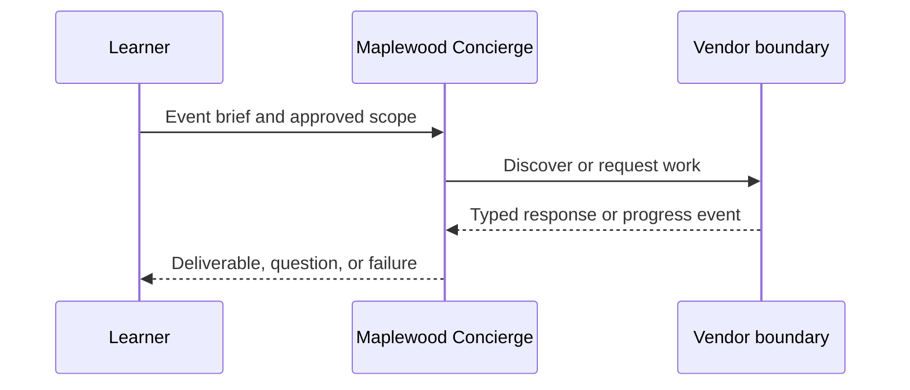

**Network and Concierge version 14:** what's new — trust, signed cards and multi-tenancy.

# Module 14: Trust, signed cards and multi-tenancy
> After this module you can sign canonical card bytes.

**Time:** ~90 min · **Level:** Advanced · **LLM needed:** No for examples and grading · **Agents running:** in-process; optional local network: uv run python scripts/network.py up --module 14
**Spec sections:** [Specification](https://a2a-protocol.org/v1.0.1/specification/) · [a2a.proto](https://github.com/a2aproject/A2A/blob/v1.0.1/specification/a2a.proto)

## Prerequisites

Python functions and dictionaries, plus the preceding module in [the learning path](../../LEARNING_PATH.md). New terms appear in [the glossary](../../docs/GLOSSARY.md).

## Learning objectives

- Sign canonical card bytes
- Reject a forged card
- Separate routing and ownership

## The big idea

A signature detects changes to a card and binds it to a key you already trust. Canonical JSON makes equivalent objects produce the same signed bytes. JWS specifies how headers and payload are signed. A JWKS is a set of public keys; a key URL advertised by an attacker is not automatically trusted. Tenant routing is separate from authenticated ownership.

**Analogy:** A signed letter matters only if you know whose seal it bears.

Read the [feature companion](../../docs/FEATURE_DEEP_DIVES.md) for field semantics, failure cases and
the connection to the final deployment.

## How it works



Under the hood: No. Trust comes from operator-pinned keys or a configured HTTPS vendor endpoint. Compare that behavior with the captured requests and responses below.

## On the wire

Executed by the course authoring tool through the same recording transport as scripts/wiretap.py. Credentials are redacted. Pure local transformations have no HTTP exchanges and an empty exchange file; their result is separate. gRPC captures are explicitly service-boundary protobuf roundtrips, not network packets.

- [sign: exchanges](wire/01_sign.jsonl) and [result](wire/01_sign.result.json).
- [forgery: exchanges](wire/02_forgery.jsonl) and [result](wire/02_forgery.result.json).
- [jwks: exchanges](wire/03_jwks.jsonl) and [result](wire/03_jwks.result.json).

## Key APIs at a glance

| SDK API | Spec operation or object | What it does | When to use it |
|---|---|---|---|
| a2a.types | Protobuf objects | Defines wire-compatible values | Every protocol boundary |
| create_jsonrpc_routes | JSON-RPC binding | Mounts operations | Serving JSON-RPC |
| create_rest_routes | HTTP+JSON binding | Mounts HTTP routes | Serving HTTP+JSON |
| create_client | Client operations | Selects an advertised interface | Calling vendors |
| MessageToDict | ProtoJSON | Converts protobuf into JSON values | Inspecting traffic |

## Walkthrough

### 01: sign

Sign canonical card bytes.

> **Predict, then run:** Write the expected result and whether this operation creates, continues or inspects work.

```console
uv run python modules/14_trust_tenants/examples/01_sign.py
```

Captured output (generated values vary):

```json
{
  "result_type": "dict",
  "complete_result": "wire/01_sign.result.json"
}
```
### 02: forgery

Reject a forged card.

> **Predict, then run:** Write the expected result and whether this operation creates, continues or inspects work.

```console
uv run python modules/14_trust_tenants/examples/02_forgery.py
```

Captured output (generated values vary):

```json
{
  "rejected": true,
  "reason": "Card signature did not verify"
}
```
### 03: jwks

Separate routing and ownership.

> **Predict, then run:** Write the expected result and whether this operation creates, continues or inspects work.

```console
uv run python modules/14_trust_tenants/examples/03_jwks.py
```

Captured output (generated values vary):

```json
{
  "jwks": {
    "keys": [
      {
        "kty": "OKP",
        "crv": "Ed25519",
        "use": "sig",
        "alg": "EdDSA",
        "kid": "granite-2026",
        "x": "QH6aupGC-BrQcZe09lfwfho3DnIq0D0LMlL5_7Ps2JI"
      }
    ]
  },
  "verified": true
}
```

## Try it in the Inspector and the Control Room

Start the network in another terminal. Run uv run streamlit run control_room/app.py, select a vendor, inspect its card and send a brief. The Inspector is now a standalone binary; use [its official installation guide](https://github.com/a2aproject/a2a-inspector).

## Real-world use case

Maplewood needs quotes for a 40-person offsite. Run uv run python modules/14_trust_tenants/use_case/run.py. The result applies this module's first experiment to shared synthetic data. A real team substitutes validated inventory and its identity system while retaining the A2A boundary.

## Common bugs

| Observed behavior | Cause | Fix |
|---|---|---|
| HTTP 401 | Missing vendor credential | Obtain the vendor token outside A2A and send a header |
| Version not supported | Missing or wrong A2A-Version | Select the card interface and send version 1.0 |
| Task remains interrupted | Required input is missing | Preserve IDs and answer the missing-input request |
| Edge-case assertion fails | Happy path was hard-coded | Work through [Fix task](../../gym/tasks/14/14-02_fix/task.md) |

## Practice

| ID | Type | Level | Concept |
|---|---|---|---|
| [14-01](../../gym/tasks/14/14-01_build/task.md) | build | medium | Keep task owners isolated |
| [14-02](../../gym/tasks/14/14-02_fix/task.md) | fix | easy | Repair: keep task owners isolated |
| [14-03](../../gym/tasks/14/14-03_predict/task.md) | predict | easy | Predict the first experiment's observable result |
| [14-04](../../gym/tasks/14/14-04_trace/task.md) | trace | medium | Identify the captured transport boundaries |
| [14-05](../../gym/tasks/14/14-05_conformance/task.md) | conformance | hard | Enforce the contract across edge cases |
| [14-06](../../gym/tasks/14/14-06_design/task.md) | design | hard | Design a partner contract and failure policy |

### Full boundary exercises

- [14-07: Reject a forged skill description](../../gym/tasks/14/14-07_signature/task.md)
- [14-40: Verify a pinned vendor signature](../../gym/tasks/14/14-40_trust_verify/task.md)
- [14-41: Reject an injected skill description](../../gym/tasks/14/14-41_trust_tamper/task.md)
- [14-42: Reject a self-appointed signing key](../../gym/tasks/14/14-42_trust_unknown/task.md)
- [14-43: Canonicalize before signing](../../gym/tasks/14/14-43_trust_canonical/task.md)
- [14-44: Keep valid keys during rotation overlap](../../gym/tasks/14/14-44_trust_rotation/task.md)
- [14-45: Reject a revoked card key](../../gym/tasks/14/14-45_trust_revocation/task.md)

These tasks execute actual SDK routes, workflows, cryptographic checks or independent
database connections offline. Each starter must fail and each reference solution must pass.

## Quiz

1. What does the vendor own?
<details><summary>Answer</summary>Its execution, inventory, task IDs, context scope and authorization policy.</details>

2. How would you demonstrate: sign canonical card bytes?
<details><summary>Answer</summary>Run example 01 and identify the exact output field or event that proves the result.</details>

3. Does a signed card grant access?
<details><summary>Answer</summary>No. A trusted signature checks integrity and identity; authorization is enforced separately.</details>

4. Why use a scripted model in graded tasks?
<details><summary>Answer</summary>Repeatable decisions isolate protocol behavior and cost no API tokens.</details>

5. What if an artifact asks for credentials?
<details><summary>Answer</summary>Treat it as untrusted data. Never forward user tokens or expand the allow-list.</details>

6. Which edge case should you test?
<details><summary>Answer</summary>Use the negative cases in this module's Fix task; explain why the broken implementation accepts or mishandles them.</details>

## Key takeaways

- Read typed fields instead of inferring behavior from prose.
- Separate transport concerns from business work.
- Predict before running.
- Test successful and rejected inputs.
- Treat every remote peer as a trust boundary.

## Go deeper

[Specification](https://a2a-protocol.org/v1.0.1/specification/) · [Protobuf](https://github.com/a2aproject/A2A/blob/v1.0.1/specification/a2a.proto) · [Official SDK](https://github.com/a2aproject/a2a-python/tree/v1.3.0)

## Next: Module 15

Use [the learning path](../../LEARNING_PATH.md) to continue or choose a capstone.

## Connected integration lab

Continue with [the tested integration walkthrough](../../docs/INTEGRATION_LABS.md), including actual commands, expected behavior, security boundaries and current limitations.
