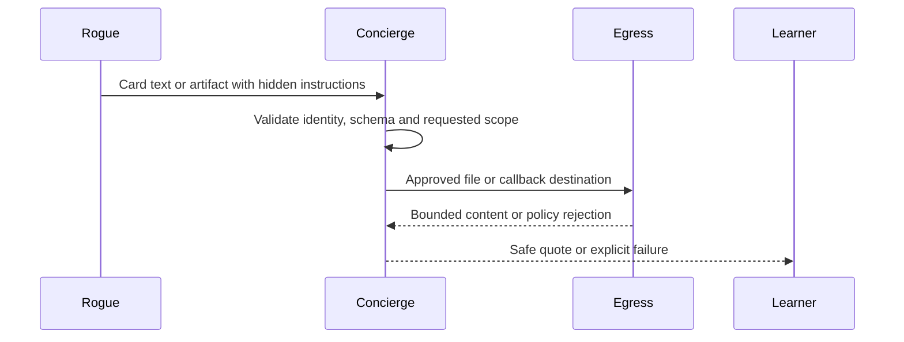

**Network and Concierge version 15:** what's new — security threats and defenses.

# Module 15: Security threats and defenses
> After this module you can reject unsafe destinations.

**Time:** ~90 min · **Level:** Advanced · **LLM needed:** No for examples and grading · **Agents running:** in-process; optional local network: uv run python scripts/network.py up --module 15
**Spec sections:** [Specification](https://a2a-protocol.org/v1.0.1/specification/) · [a2a.proto](https://github.com/a2aproject/A2A/blob/v1.0.1/specification/a2a.proto)

## Prerequisites

Python functions and dictionaries, plus the preceding module in [the learning path](../../LEARNING_PATH.md). New terms appear in [the glossary](../../docs/GLOSSARY.md).

## Learning objectives

- Reject unsafe destinations
- Prevent credential delegation
- Explain layered defenses

## The big idea

Treat cards, messages and artifacts as untrusted inputs. Prompt injection attempts to turn those inputs into higher-priority instructions. Allow-list destinations, validate outputs, keep tokens scoped, and require human approval before spending. Private-address filtering alone does not prevent DNS rebinding; use a controlled egress path or inline files. Limit bytes, duration, concurrency and tool steps.

**Analogy:** A forged purchase order cannot override the company's approval policy.

Read the [feature companion](../../docs/FEATURE_DEEP_DIVES.md) for field semantics, failure cases and
the connection to the final deployment.

## How it works



Under the hood: Untrusted content remains data even when its source has a valid signature. Code enforces destinations, requested scope, schemas and budgets around model decisions. File fetching rejects private addresses and redirects. Credential provisioning and human approval stay outside vendor-controlled content.

## On the wire

Executed by the course authoring tool through the same recording transport as scripts/wiretap.py. Credentials are redacted. Pure local transformations have no HTTP exchanges and an empty exchange file; their result is separate. gRPC captures are explicitly service-boundary protobuf roundtrips, not network packets.

- [ssrf: exchanges](wire/01_ssrf.jsonl) and [result](wire/01_ssrf.result.json).
- [forgery: exchanges](wire/02_forgery.jsonl) and [result](wire/02_forgery.result.json).
- [minimize: exchanges](wire/03_minimize.jsonl) and [result](wire/03_minimize.result.json).

## Key APIs at a glance

| SDK API or labeled course helper | Spec operation or object | What it does | When to use it |
|---|---|---|---|
| common.security.safe_file_url (course) | Egress policy | Checks explicit trusted public-IP URLs | Before file fetching |
| common.security.fetch_file (course) | Bounded retrieval | Rejects redirects and oversized bodies | Consume approved file Parts |

## Walkthrough

### 01: ssrf

Reject unsafe destinations.

> **Predict, then run:** Write the expected result and whether this operation creates, continues or inspects work.

```console
uv run python modules/15_security/examples/01_ssrf.py
```

Captured output (generated values vary):

```json
{
  "blocked": [
    "https://127.0.0.1/private",
    "https://169.254.169.254/latest"
  ]
}
```
### 02: forgery

Prevent credential delegation.

> **Predict, then run:** Write the expected result and whether this operation creates, continues or inspects work.

```console
uv run python modules/15_security/examples/02_forgery.py
```

Captured output (generated values vary):

```json
{
  "rejected": true,
  "reason": "Card signature did not verify"
}
```
### 03: minimize

Explain layered defenses.

> **Predict, then run:** Write the expected result and whether this operation creates, continues or inspects work.

```console
uv run python modules/15_security/examples/03_minimize.py
```

Captured output (generated values vary):

```json
{
  "result_type": "dict",
  "complete_result": "wire/03_minimize.result.json"
}
```

## Try it in the Inspector and the Control Room

Start the network in another terminal. Run uv run streamlit run control_room/app.py, select a vendor, inspect its card and send a brief. The Inspector is now a standalone binary; use [its official installation guide](https://github.com/a2aproject/a2a-inspector).

## Real-world use case

A rogue vendor proposes a private file destination; Maplewood's egress policy rejects it before any request leaves.

Run:

```console
uv run python modules/15_security/use_case/run.py
```

Selected observed fields (see [the complete captured result](wire/01_ssrf.result.json) for the full output):

```json
{
  "blocked": [
    "https://127.0.0.1/private",
    "https://169.254.169.254/latest"
  ]
}
```

A real deployment retains this boundary while substituting its own approved inventory, identity provider and operating policy.

## Common bugs

| Observed behavior | Cause | Fix and related practice |
|---|---|---|
| Internal URL fetched through file Part | SSRF policy missing | Validate address, origin and redirect behavior; [practice 15-07](../../gym/tasks/15/15-07_ssrf/task.md) |
| Oversized response consumes memory | Limit checked after downloading everything | Stop while streaming at the byte limit; [practice 15-43](../../gym/tasks/15/15-43_egress_oversize/task.md) |
| Forged artifact changes the plan | Remote text interpreted as instructions | Validate outputs and keep policy outside model text; [practice 15-02](../../gym/tasks/15/15-02_fix/task.md) |
| Same notification causes another effect | Replay state absent | Authenticate and deduplicate delivery IDs; [practice 15-45](../../gym/tasks/15/15-45_egress_replay/task.md) |

## Practice

| ID | Type | Level | Concept |
|---|---|---|---|
| [15-01](../../gym/tasks/15/15-01_build/task.md) | build | medium | Reject private and reserved IP addresses |
| [15-02](../../gym/tasks/15/15-02_fix/task.md) | fix | easy | Repair: reject private and reserved ip addresses |
| [15-03](../../gym/tasks/15/15-03_predict/task.md) | predict | easy | Predict the first experiment's observable result |
| [15-04](../../gym/tasks/15/15-04_trace/task.md) | trace | medium | Identify the captured transport boundaries |
| [15-05](../../gym/tasks/15/15-05_conformance/task.md) | conformance | hard | Enforce the contract across edge cases |
| [15-06](../../gym/tasks/15/15-06_design/task.md) | design | hard | Design a partner contract and failure policy |

### Full boundary exercises

- [15-07: Stop artwork URLs reaching internal services](../../gym/tasks/15/15-07_ssrf/task.md)
- [15-40: Defend a real I/O boundary: private_ip](../../gym/tasks/15/15-40_egress_private_ip/task.md)
- [15-41: Defend a real I/O boundary: unlisted](../../gym/tasks/15/15-41_egress_unlisted/task.md)
- [15-42: Defend a real I/O boundary: redirect](../../gym/tasks/15/15-42_egress_redirect/task.md)
- [15-43: Defend a real I/O boundary: oversize](../../gym/tasks/15/15-43_egress_oversize/task.md)
- [15-44: Defend a real I/O boundary: valid](../../gym/tasks/15/15-44_egress_valid/task.md)
- [15-45: Defend a real I/O boundary: replay](../../gym/tasks/15/15-45_egress_replay/task.md)

These tasks execute actual SDK routes, workflows, cryptographic checks or independent
database connections offline. Each starter must fail and each reference solution must pass.

## Quiz

1. Can signed skill text override the user's requested vendor scope?
<details><summary>Answer</summary>No. Signatures establish origin, not authority to expand the task.</details>

2. Why block private file addresses?
<details><summary>Answer</summary>They can target internal services or cloud metadata endpoints.</details>

3. Why is a redirect a separate trust decision?
<details><summary>Answer</summary>It changes the destination after the initial URL was approved.</details>

4. What stops a poisoned quote from approving payment?
<details><summary>Answer</summary>A strict output contract and a separate human approval gate.</details>

5. What prevents delegation from leaking unrelated fields?
<details><summary>Answer</summary>A per-vendor payload allow-list enforced in code.</details>

6. What makes a callback replay distinguishable?
<details><summary>Answer</summary>An authenticated timestamp and delivery ID plus replay or durable inbox state.</details>

## Key takeaways

- No. Signatures establish origin, not authority to expand the task.
- They can target internal services or cloud metadata endpoints.
- It changes the destination after the initial URL was approved.
- A strict output contract and a separate human approval gate.
- A per-vendor payload allow-list enforced in code.

## Go deeper

[Specification](https://a2a-protocol.org/v1.0.1/specification/) · [Protobuf](https://github.com/a2aproject/A2A/blob/v1.0.1/specification/a2a.proto) · [Official SDK](https://github.com/a2aproject/a2a-python/tree/v1.3.0)

## Next: Module 16

Use [the learning path](../../LEARNING_PATH.md) to continue or choose a capstone.
