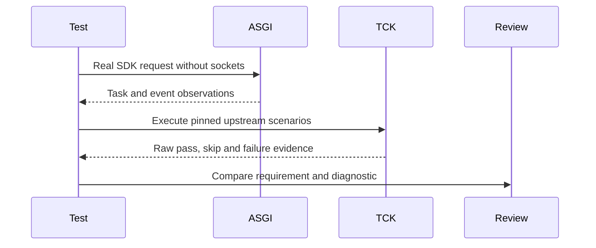

**Network and Concierge version 16:** what's new — testing, conformance and debugging.

# Module 16: Testing, conformance and debugging
> After this module you can run offline contracts.

**Time:** ~90 min · **Level:** Advanced · **LLM needed:** No for examples and grading · **Agents running:** in-process; optional local network: uv run python scripts/network.py up --module 16
**Spec sections:** [Specification](https://a2a-protocol.org/v1.0.1/specification/) · [a2a.proto](https://github.com/a2aproject/A2A/blob/v1.0.1/specification/a2a.proto)

## Prerequisites

Python functions and dictionaries, plus the preceding module in [the learning path](../../LEARNING_PATH.md). New terms appear in [the glossary](../../docs/GLOSSARY.md).

## Learning objectives

- Run offline contracts
- Diagnose a wire error
- Distinguish course tests from official certification

## The big idea

An offline contract test should observe actual routing and serialized responses. Conformance checks protocol behavior; evaluation checks business outcomes. The official TCK expects a reachable server and is a separate integration job. Course tests do not certify official compliance. Record and redact traffic, inject failures and assert the sequence that a client can observe.

**Analogy:** Testing a form's format is different from checking that the quote satisfies the event.

Read the [feature companion](../../docs/FEATURE_DEEP_DIVES.md) for field semantics, failure cases and
the connection to the final deployment.

## How it works



Under the hood: Contract checks exercise the real SDK through in-process transports. They are distinct from real socket and language tests. Conformance claims must retain the raw upstream result: a regression gate with named known contradictions is not equivalent to every official test passing.

## On the wire

Executed by the course authoring tool through the same recording transport as scripts/wiretap.py. Credentials are redacted. Pure local transformations have no HTTP exchanges and an empty exchange file; their result is separate. gRPC captures are explicitly service-boundary protobuf roundtrips, not network packets.

- [errors: exchanges](wire/01_errors.jsonl) and [result](wire/01_errors.result.json).
- [stream: exchanges](wire/02_stream.jsonl) and [result](wire/02_stream.result.json).
- [grpc: exchanges](wire/03_grpc.jsonl) and [result](wire/03_grpc.result.json).

## Key APIs at a glance

| SDK API or labeled course helper | Spec operation or object | What it does | When to use it |
|---|---|---|---|
| httpx.ASGITransport | In-process HTTP boundary | Runs real routes without sockets | Offline contract tests |
| TaskEventStream | Shared event interface | Supports independent observers | Reconnect and replica tests |

## Walkthrough

### 01: errors

Run offline contracts.

> **Predict, then run:** Write the expected result and whether this operation creates, continues or inspects work.

```console
uv run python modules/16_testing_conformance/examples/01_errors.py
```

Captured output (generated values vary):

```json
{
  "error": {
    "code": 404,
    "status": "NOT_FOUND",
    "message": "Task not found",
    "details": [
      {
        "@type": "type.googleapis.com/google.rpc.ErrorInfo",
        "reason": "TASK_NOT_FOUND",
        "domain": "a2a-protocol.org",
        "metadata": {}
      }
    ]
  }
}
```
### 02: stream

Diagnose a wire error.

> **Predict, then run:** Write the expected result and whether this operation creates, continues or inspects work.

```console
uv run python modules/16_testing_conformance/examples/02_stream.py
```

Captured output (generated values vary):

```json
{
  "result_type": "list",
  "complete_result": "wire/02_stream.result.json"
}
```
### 03: grpc

Distinguish course tests from official certification.

> **Predict, then run:** Write the expected result and whether this operation creates, continues or inspects work.

```console
uv run python modules/16_testing_conformance/examples/03_grpc.py
```

Captured output (generated values vary):

```json
{
  "task": {
    "status": {
      "state": "TASK_STATE_COMPLETED",
      "message": {
        "role": "ROLE_AGENT",
        "parts": [
          {
            "text": "Quote ready; no money has been spent."
          }
        ]
      }
    },
    "artifacts": [
      {
        "artifactId": "quote",
        "name": "quote",
        "parts": [
          {
            "data": {
              "vendor": "print",
              "guests": 40.0,
              "approved": false,
              "selection": "badge",
              "total_cents": 10000.0,
              "currency": "USD"
            },
            "mediaType": "application/json"
          }
        ]
      }
    ],
    "history": [
      {
        "role": "ROLE_USER",
        "parts": [
          {
            "data": {
              "dietary": {
                "standard": 30.0,
                "vegan": 10.0
              },
              "guests": 40.0,
              "budget_cents": 1000000.0,
              "date": "2027-06-01"
            },
            "mediaType": "application/json"
          }
        ]
      },
      {
        "role": "ROLE_AGENT",
        "parts": [
          {
            "text": "print: checking the brief"
          }
        ]
      }
    ],
    "metadata": {
      "brief": {
        "guests": 40.0,
        "dietary": {
          "standard": 30.0,
          "vegan": 10.0
        },
        "budget_cents": 1000000.0,
        "date": "2027-06-01"
      }
    }
  }
}
```

## Try it in the Inspector and the Control Room

Start the network in another terminal. Run uv run streamlit run control_room/app.py, select a vendor, inspect its card and send a brief. The Inspector is now a standalone binary; use [its official installation guide](https://github.com/a2aproject/a2a-inspector).

## Real-world use case

Maplewood deliberately requests missing or unsupported work to verify that the boundary returns protocol errors.

Run:

```console
uv run python modules/16_testing_conformance/use_case/run.py
```

Selected observed fields (see [the complete captured result](wire/01_errors.result.json) for the full output):

```json
{
  "error": {
    "code": 404,
    "status": "NOT_FOUND",
    "message": "Task not found",
    "details": [
      {
        "@type": "type.googleapis.com/google.rpc.ErrorInfo",
        "reason": "TASK_NOT_FOUND",
        "domain": "a2a-protocol.org",
        "metadata": {}
      }
    ]
  }
}
```

A real deployment retains this boundary while substituting its own approved inventory, identity provider and operating policy.

## Common bugs

| Observed behavior | Cause | Fix and related practice |
|---|---|---|
| Unknown operation treated as success | Method dispatch too permissive | Return the protocol method error; [practice 16-20](../../gym/tasks/16/16-20_conformance_method/task.md) |
| Malformed request crashes handler | Parsing failures not mapped | Return the correct invalid-request response; [practice 16-24](../../gym/tasks/16/16-24_conformance_parse/task.md) |
| Every response labeled application/json | Binding-specific media rules ignored | Use the required A2A media type; [practice 16-25](../../gym/tasks/16/16-25_conformance_rest_media/task.md) |
| Regression disappears behind broad TCK exception | Failures ignored by substring alone | Match case name and exact known diagnostic; [practice 16-02](../../gym/tasks/16/16-02_fix/task.md) |

## Practice

| ID | Type | Level | Concept |
|---|---|---|---|
| [16-01](../../gym/tasks/16/16-01_build/task.md) | build | medium | Detect invalid mixed event streams |
| [16-02](../../gym/tasks/16/16-02_fix/task.md) | fix | easy | Repair: detect invalid mixed event streams |
| [16-03](../../gym/tasks/16/16-03_predict/task.md) | predict | easy | Predict the first experiment's observable result |
| [16-04](../../gym/tasks/16/16-04_trace/task.md) | trace | medium | Identify the captured transport boundaries |
| [16-05](../../gym/tasks/16/16-05_conformance/task.md) | conformance | hard | Enforce the contract across edge cases |
| [16-06](../../gym/tasks/16/16-06_design/task.md) | design | hard | Design a partner contract and failure policy |

### Full boundary exercises

- [16-20: Reject an unknown operation](../../gym/tasks/16/16-20_conformance_method/task.md)
- [16-21: Return TaskNotFound for an unknown ID](../../gym/tasks/16/16-21_conformance_missing/task.md)
- [16-22: Reject an unsupported Part media type](../../gym/tasks/16/16-22_conformance_media/task.md)
- [16-23: Reject an unsupported protocol version](../../gym/tasks/16/16-23_conformance_version/task.md)
- [16-24: Separate parse errors from invalid parameters](../../gym/tasks/16/16-24_conformance_parse/task.md)
- [16-25: Verify the HTTP error representation](../../gym/tasks/16/16-25_conformance_rest_media/task.md)

These tasks execute actual SDK routes, workflows, cryptographic checks or independent
database connections offline. Each starter must fail and each reference solution must pass.

## Quiz

1. Does an in-process HTTP test need a listening port?
<details><summary>Answer</summary>No. ASGITransport calls the app in the same process.</details>

2. What does protobuf parsing alone fail to check?
<details><summary>Answer</summary>Behavioral rules such as task transitions and authorization.</details>

3. Why retain the raw TCK report?
<details><summary>Answer</summary>To distinguish actual passes from skips and documented upstream contradictions.</details>

4. Does green CI mean full official certification?
<details><summary>Answer</summary>No. Read the exact conformance scope and exceptions.</details>

5. How do you test reconnect after publisher loss?
<details><summary>Answer</summary>Persist the task and journal, then subscribe through a second handler.</details>

6. What makes a useful bug report?
<details><summary>Answer</summary>A minimal request, observed response, expected behavior and specific requirement reference.</details>

## Key takeaways

- No. ASGITransport calls the app in the same process.
- Behavioral rules such as task transitions and authorization.
- To distinguish actual passes from skips and documented upstream contradictions.
- No. Read the exact conformance scope and exceptions.
- Persist the task and journal, then subscribe through a second handler.

## Go deeper

[Specification](https://a2a-protocol.org/v1.0.1/specification/) · [Protobuf](https://github.com/a2aproject/A2A/blob/v1.0.1/specification/a2a.proto) · [Official SDK](https://github.com/a2aproject/a2a-python/tree/v1.3.0)

## Next: Module 17

Use [the learning path](../../LEARNING_PATH.md) to continue or choose a capstone.
