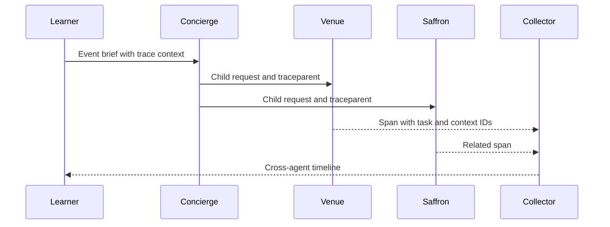

**Network and Concierge version 17:** what's new — observability and evaluation.

# Module 17: Observability and evaluation
> After this module you can read related spans.

**Time:** ~90 min · **Level:** Advanced · **LLM needed:** No for examples and grading · **Agents running:** in-process; optional local network: uv run python scripts/network.py up --module 17
**Spec sections:** [Specification](https://a2a-protocol.org/v1.0.1/specification/) · [a2a.proto](https://github.com/a2aproject/A2A/blob/v1.0.1/specification/a2a.proto)

## Prerequisites

Python functions and dictionaries, plus the preceding module in [the learning path](../../LEARNING_PATH.md). New terms appear in [the glossary](../../docs/GLOSSARY.md).

## Learning objectives

- Read related spans
- Evaluate a golden event
- Redact sensitive telemetry

## The big idea

A trace groups spans for one distributed request; a span records one operation. Propagate W3C trace context through transports and correlate task IDs without making them authorization credentials. Course attribute names are explicitly application conventions. Golden scenarios check delegations, states and artifacts, not whether prose sounds convincing. Never log tokens or entire sensitive briefs.

**Analogy:** A shipment's tracking history shows where time was spent across organizations.

Read the [feature companion](../../docs/FEATURE_DEEP_DIVES.md) for field semantics, failure cases and
the connection to the final deployment.

## How it works



Under the hood: Trace IDs join a distributed request; span IDs describe individual operations. Task and context IDs are attributes, not metric labels. Metrics aggregate bounded categories such as vendor and outcome. Golden evaluation checks the business result independently of whether a trace looks healthy.

## On the wire

Executed by the course authoring tool through the same recording transport as scripts/wiretap.py. Credentials are redacted. Pure local transformations have no HTTP exchanges and an empty exchange file; their result is separate. gRPC captures are explicitly service-boundary protobuf roundtrips, not network packets.

- [trace: exchanges](wire/01_trace.jsonl) and [result](wire/01_trace.result.json).
- [eval: exchanges](wire/02_eval.jsonl) and [result](wire/02_eval.result.json).
- [orchestrate: exchanges](wire/03_orchestrate.jsonl) and [result](wire/03_orchestrate.result.json).

## Key APIs at a glance

| SDK API or labeled course helper | Spec operation or object | What it does | When to use it |
|---|---|---|---|
| opentelemetry.trace.get_tracer | Tracing | Creates related operation spans | Instrument vendor work |
| common.observability.record_task (course) | Correlation | Adds task and context attributes | Connect protocol work to traces |

## Walkthrough

### 01: trace

Read related spans.

> **Predict, then run:** Write the expected result and whether this operation creates, continues or inspects work.

```console
uv run python modules/17_observability/examples/01_trace.py
```

Captured output (generated values vary):

```json
[
  {
    "name": "venues.request"
  },
  {
    "name": "concierge.plan"
  }
]
```
### 02: eval

Evaluate a golden event.

> **Predict, then run:** Write the expected result and whether this operation creates, continues or inspects work.

```console
uv run python modules/17_observability/examples/02_eval.py
```

Captured output (generated values vary):

```json
{
  "result_type": "dict",
  "complete_result": "wire/02_eval.result.json"
}
```
### 03: orchestrate

Redact sensitive telemetry.

> **Predict, then run:** Write the expected result and whether this operation creates, continues or inspects work.

```console
uv run python modules/17_observability/examples/03_orchestrate.py
```

Captured output (generated values vary):

```json
{
  "result_type": "dict",
  "complete_result": "wire/03_orchestrate.result.json"
}
```

## Try it in the Inspector and the Control Room

Start the network in another terminal. Run uv run streamlit run control_room/app.py, select a vendor, inspect its card and send a brief. The Inspector is now a standalone binary; use [its official installation guide](https://github.com/a2aproject/a2a-inspector).

## Real-world use case

Maplewood follows an offsite request through related vendor spans instead of treating each service log as an isolated event.

Run:

```console
uv run python modules/17_observability/use_case/run.py
```

Selected observed fields (see [the complete captured result](wire/01_trace.result.json) for the full output):

```json
{
  "name": "venues.request"
}
```

A real deployment retains this boundary while substituting its own approved inventory, identity provider and operating policy.

## Common bugs

| Observed behavior | Cause | Fix and related practice |
|---|---|---|
| Separate traces for one plan | traceparent not forwarded | Propagate context at every outgoing boundary; [practice 17-02](../../gym/tasks/17/17-02_fix/task.md) |
| Exploding metric series | Task IDs used as labels | Use bounded vendor and outcome labels; [practice 17-02](../../gym/tasks/17/17-02_fix/task.md) |
| Green transport but wrong event result | Only status codes evaluated | Compare exact golden business outputs; [practice 17-05](../../gym/tasks/17/17-05_conformance/task.md) |
| Credentials visible in logs | Raw headers recorded | Redact secrets before recording; [practice 17-02](../../gym/tasks/17/17-02_fix/task.md) |

## Practice

| ID | Type | Level | Concept |
|---|---|---|---|
| [17-01](../../gym/tasks/17/17-01_build/task.md) | build | medium | Evaluate golden delegations without prose scoring |
| [17-02](../../gym/tasks/17/17-02_fix/task.md) | fix | easy | Repair: evaluate golden delegations without prose scoring |
| [17-03](../../gym/tasks/17/17-03_predict/task.md) | predict | easy | Predict the first experiment's observable result |
| [17-04](../../gym/tasks/17/17-04_trace/task.md) | trace | medium | Identify the captured transport boundaries |
| [17-05](../../gym/tasks/17/17-05_conformance/task.md) | conformance | hard | Enforce the contract across edge cases |
| [17-06](../../gym/tasks/17/17-06_design/task.md) | design | hard | Design a partner contract and failure policy |

## Quiz

1. What links spans across HTTP and gRPC?
<details><summary>Answer</summary>W3C trace context propagated in headers or metadata.</details>

2. Are task ID and trace ID interchangeable?
<details><summary>Answer</summary>No. A task can outlive a single request trace.</details>

3. Why avoid task IDs as metric labels?
<details><summary>Answer</summary>Each new ID creates another time series and unbounded cardinality.</details>

4. Can a successful HTTP span prove the quote is correct?
<details><summary>Answer</summary>No. Golden evaluation must check delegations, states and artifacts.</details>

5. What should be excluded from telemetry?
<details><summary>Answer</summary>Credentials, private reasoning and unnecessary personal event fields.</details>

6. Why preserve a recording span across the SDK boundary?
<details><summary>Answer</summary>A non-recording replacement can silently lose task and context attributes.</details>

## Key takeaways

- W3C trace context propagated in headers or metadata.
- No. A task can outlive a single request trace.
- Each new ID creates another time series and unbounded cardinality.
- No. Golden evaluation must check delegations, states and artifacts.
- Credentials, private reasoning and unnecessary personal event fields.

## Go deeper

[Specification](https://a2a-protocol.org/v1.0.1/specification/) · [Protobuf](https://github.com/a2aproject/A2A/blob/v1.0.1/specification/a2a.proto) · [Official SDK](https://github.com/a2aproject/a2a-python/tree/v1.3.0)

## Next: Module 18

Use [the learning path](../../LEARNING_PATH.md) to continue or choose a capstone.

## Connected integration lab

Continue with [the tested integration walkthrough](../../docs/INTEGRATION_LABS.md), including actual commands, expected behavior, security boundaries and current limitations.

## Request metrics

Run `uv run python modules/17_observability/examples/04_metrics.py`. The actual
OpenTelemetry reader reports two requests with only the vendor label. Predict why
task IDs belong in spans rather than this counter's labels. Configure an SDK metric
reader/exporter in the hosting process to deliver this instrument to your backend.
