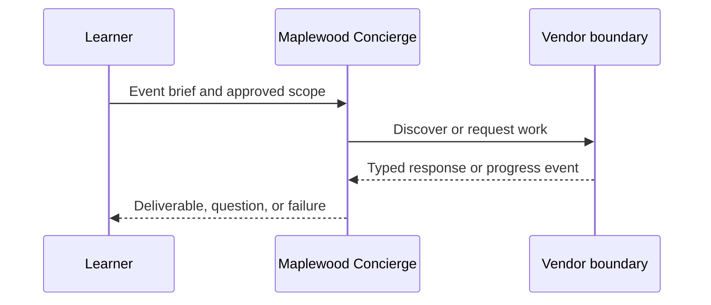

# Module 17: Observability and evaluation
> After this module you can read related spans.

**Time:** ~90 min · **Level:** Advanced · **LLM needed:** No for examples and grading · **Agents running:** in-process; optional local network: uv run python scripts/network.py up --module 17
**Spec sections:** [Specification](https://a2a-protocol.org/v1.0.1/specification/) · [a2a.proto](https://github.com/a2aproject/A2A/blob/v1.0.1/specification/a2a.proto)
**Network and Concierge version 17:** what's new — observability and evaluation.

## Prerequisites

Python functions and dictionaries, plus the preceding module in [the learning path](../../LEARNING_PATH.md). New terms appear in [the glossary](../../docs/GLOSSARY.md).

## Learning objectives

- Read related spans
- Evaluate a golden event
- Redact sensitive telemetry

## The big idea

A trace groups spans for one distributed request; a span records one operation. Propagate W3C trace context through transports and correlate task IDs without making them authorization credentials. Course attribute names are explicitly application conventions. Golden scenarios check delegations, states and artifacts, not whether prose sounds convincing. Never log tokens or entire sensitive briefs.

**Analogy:** A shipment's tracking history shows where time was spent across organizations.

## How it works



Under the hood, protobuf objects become JSON or binary bytes at the boundary. Route handlers enforce operation contracts; the executor performs business work. Compare the captured result with your prediction.

## On the wire

Executed by the course authoring tool through the same recording transport as scripts/wiretap.py. Credentials are redacted. Pure local transformations have no HTTP exchanges and an empty exchange file; their result is separate. gRPC captures are explicitly service-boundary protobuf roundtrips, not network packets.

- [trace: exchanges](wire/01_trace.jsonl) and [result](wire/01_trace.result.json).
- [eval: exchanges](wire/02_eval.jsonl) and [result](wire/02_eval.result.json).
- [orchestrate: exchanges](wire/03_orchestrate.jsonl) and [result](wire/03_orchestrate.result.json).

## Key APIs at a glance

| SDK API | Spec operation or object | What it does | When to use it |
|---|---|---|---|
| a2a.types | Protobuf objects | Defines wire-compatible values | Every protocol boundary |
| create_jsonrpc_routes | JSON-RPC binding | Mounts operations | Serving JSON-RPC |
| create_rest_routes | HTTP+JSON binding | Mounts HTTP routes | Serving HTTP+JSON |
| create_client | Client operations | Selects an advertised interface | Calling vendors |
| MessageToDict | ProtoJSON | Converts protobuf into JSON values | Inspecting traffic |

## Walkthrough

### 01: trace

Read related spans.

> **Predict, then run:** Write the expected result and whether this operation creates, continues or inspects work.

```console
uv run python modules/17_observability/examples/01_trace.py
```

Captured output (generated values vary):

```json
[
  {
    "name": "granite.quote"
  },
  {
    "name": "concierge.plan"
  }
]
```
### 02: eval

Evaluate a golden event.

> **Predict, then run:** Write the expected result and whether this operation creates, continues or inspects work.

```console
uv run python modules/17_observability/examples/02_eval.py
```

Captured output (generated values vary):

```json
{
  "result_type": "dict",
  "complete_result": "wire/02_eval.result.json"
}
```
### 03: orchestrate

Redact sensitive telemetry.

> **Predict, then run:** Write the expected result and whether this operation creates, continues or inspects work.

```console
uv run python modules/17_observability/examples/03_orchestrate.py
```

Captured output (generated values vary):

```json
{
  "result_type": "dict",
  "complete_result": "wire/03_orchestrate.result.json"
}
```

## Try it in the Inspector and the Control Room

Start the network in another terminal. Run uv run streamlit run control_room/app.py, select a vendor, inspect its card and send a brief. The Inspector is now a standalone binary; use [its official installation guide](https://github.com/a2aproject/a2a-inspector).

## Real-world use case

Maplewood needs quotes for a 40-person offsite. Run uv run python modules/17_observability/use_case/run.py. The result applies this module's first experiment to shared synthetic data. A real team substitutes validated inventory and its identity system while retaining the A2A boundary.

## Common bugs

| Observed behavior | Cause | Fix |
|---|---|---|
| HTTP 401 | Missing vendor credential | Obtain the vendor token outside A2A and send a header |
| Version not supported | Missing or wrong A2A-Version | Select the card interface and send version 1.0 |
| Task remains interrupted | Required input is missing | Preserve IDs and answer the missing-input request |
| Edge-case assertion fails | Happy path was hard-coded | Work through [Fix task](../../gym/tasks/17/17-02_fix/task.md) |

## Practice

| ID | Type | Level | Concept |
|---|---|---|---|
| [17-01](../../gym/tasks/17/17-01_build/task.md) | build | medium | Evaluate golden delegations without prose scoring |
| [17-02](../../gym/tasks/17/17-02_fix/task.md) | fix | easy | Repair: evaluate golden delegations without prose scoring |
| [17-03](../../gym/tasks/17/17-03_predict/task.md) | predict | easy | Predict the first experiment's observable result |
| [17-04](../../gym/tasks/17/17-04_trace/task.md) | trace | medium | Identify the captured transport boundaries |
| [17-05](../../gym/tasks/17/17-05_conformance/task.md) | conformance | hard | Enforce the contract across edge cases |
| [17-06](../../gym/tasks/17/17-06_design/task.md) | design | hard | Design a partner contract and failure policy |

## Quiz

1. What does the vendor own?
<details><summary>Answer</summary>Its execution, inventory, task IDs, context scope and authorization policy.</details>

2. How would you demonstrate: read related spans?
<details><summary>Answer</summary>Run example 01 and identify the exact output field or event that proves the result.</details>

3. Does a signed card grant access?
<details><summary>Answer</summary>No. A trusted signature checks integrity and identity; authorization is enforced separately.</details>

4. Why use a scripted model in graded tasks?
<details><summary>Answer</summary>Repeatable decisions isolate protocol behavior and cost no API tokens.</details>

5. What if an artifact asks for credentials?
<details><summary>Answer</summary>Treat it as untrusted data. Never forward user tokens or expand the allow-list.</details>

6. Which edge case should you test?
<details><summary>Answer</summary>Use the negative cases in this module's Fix task; explain why the broken implementation accepts or mishandles them.</details>

## Key takeaways

- Read typed fields instead of inferring behavior from prose.
- Separate transport concerns from business work.
- Predict before running.
- Test successful and rejected inputs.
- Treat every remote peer as a trust boundary.

## Go deeper

[Specification](https://a2a-protocol.org/v1.0.1/specification/) · [Protobuf](https://github.com/a2aproject/A2A/blob/v1.0.1/specification/a2a.proto) · [Official SDK](https://github.com/a2aproject/a2a-python/tree/v1.3.0)

## Next: Module 18

Use [the learning path](../../LEARNING_PATH.md) to continue or choose a capstone.

## Connected integration lab

Continue with [the tested integration walkthrough](../../docs/INTEGRATION_LABS.md), including actual commands, expected behavior, security boundaries and current limitations.
