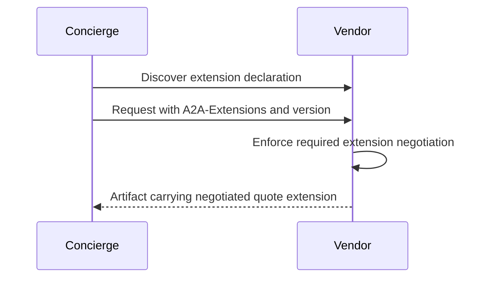

**Network and Concierge version 18:** what's new — extensions and versioning.

# Module 18: Extensions and versioning
> After this module you can declare an extension.

**Time:** ~90 min · **Level:** Advanced · **LLM needed:** No for examples and grading · **Agents running:** in-process; optional local network: uv run python scripts/network.py up --module 18
**Spec sections:** [Specification](https://a2a-protocol.org/v1.0.1/specification/) · [a2a.proto](https://github.com/a2aproject/A2A/blob/v1.0.1/specification/a2a.proto)

## Prerequisites

Python functions and dictionaries, plus the preceding module in [the learning path](../../LEARNING_PATH.md). New terms appear in [the glossary](../../docs/GLOSSARY.md).

## Learning objectives

- Declare an extension
- Activate it on a request
- Reject unsupported protocol versions

## The big idea

An extension has a URI, a declaration in capabilities and request-time activation through A2A-Extensions. A required extension is a compatibility obligation. Version selection belongs to the advertised interface. The structured quote extension adds a schema for the deliverable; it must not redefine core task states. Preserve skill contracts or version them when behavior changes.

**Analogy:** An optional rider adds terms to an agreement without rewriting the basic contract.

Read the [feature companion](../../docs/FEATURE_DEEP_DIVES.md) for field semantics, failure cases and
the connection to the final deployment.

## How it works



Under the hood: An extension URI identifies additional agreed semantics. The Agent Card advertises it and each request activates it. A required extension affects compatibility. It must not silently redefine the core protocol, and product skill versions remain separate from wire protocol versions.

## On the wire

Executed by the course authoring tool through the same recording transport as scripts/wiretap.py. Credentials are redacted. Pure local transformations have no HTTP exchanges and an empty exchange file; their result is separate. gRPC captures are explicitly service-boundary protobuf roundtrips, not network packets.

- [extension: exchanges](wire/01_extension.jsonl) and [result](wire/01_extension.result.json).
- [version: exchanges](wire/02_version.jsonl) and [result](wire/02_version.result.json).
- [list: exchanges](wire/03_list.jsonl) and [result](wire/03_list.result.json).

## Key APIs at a glance

| SDK API or labeled course helper | Spec operation or object | What it does | When to use it |
|---|---|---|---|
| AgentExtension | Capability declaration | Names extension URI and requirement | Publish extension support |
| RequestContext.requested_extensions | Negotiated extensions | Exposes request activation | Choose extension-specific behavior |

## Walkthrough

### 01: extension

Declare an extension.

> **Predict, then run:** Write the expected result and whether this operation creates, continues or inspects work.

```console
uv run python modules/18_extensions/examples/01_extension.py
```

Captured output (generated values vary):

```json
{
  "task": {
    "status": {
      "state": "TASK_STATE_COMPLETED",
      "message": {
        "role": "ROLE_AGENT",
        "parts": [
          {
            "text": "Quote ready; no money has been spent."
          }
        ]
      }
    },
    "artifacts": [
      {
        "artifactId": "quote",
        "name": "quote",
        "parts": [
          {
            "data": {
              "guests": 40.0,
              "vendor": "venues",
              "approved": false,
              "selection": "room-1",
              "total_cents": 80000.0,
              "currency": "USD"
            },
            "mediaType": "application/json"
          }
        ],
        "extensions": [
          "https://maplewood.example/extensions/structured-quote/v1"
        ]
      }
    ],
    "history": [
      {
        "role": "ROLE_USER",
        "parts": [
          {
            "data": {
              "dietary": {
                "standard": 30.0,
                "vegan": 10.0
              },
              "guests": 40.0,
              "budget_cents": 1000000.0,
              "date": "2027-06-01"
            },
            "mediaType": "application/json"
          }
        ]
      },
      {
        "role": "ROLE_AGENT",
        "parts": [
          {
            "text": "venues: checking the brief"
          }
        ]
      }
    ],
    "metadata": {
      "brief": {
        "guests": 40.0,
        "dietary": {
          "standard": 30.0,
          "vegan": 10.0
        },
        "budget_cents": 1000000.0,
        "date": "2027-06-01"
      }
    }
  }
}
```
### 02: version

Activate it on a request.

> **Predict, then run:** Write the expected result and whether this operation creates, continues or inspects work.

```console
uv run python modules/18_extensions/examples/02_version.py
```

Captured output (generated values vary):

```json
{
  "supported": 200,
  "unsupported": {
    "error": {
      "code": 400,
      "status": "FAILED_PRECONDITION",
      "message": "A2A version '99.0' is not supported by this handler. Expected version '1.0'.",
      "details": [
        {
          "@type": "type.googleapis.com/google.rpc.ErrorInfo",
          "reason": "VERSION_NOT_SUPPORTED",
          "domain": "a2a-protocol.org",
          "metadata": {}
        }
      ]
    }
  }
}
```
### 03: list

Reject unsupported protocol versions.

> **Predict, then run:** Write the expected result and whether this operation creates, continues or inspects work.

```console
uv run python modules/18_extensions/examples/03_list.py
```

Captured output (generated values vary):

```json
{
  "result_type": "dict",
  "complete_result": "wire/03_list.result.json"
}
```

## Try it in the Inspector and the Control Room

Start the network in another terminal. Run uv run streamlit run control_room/app.py, select a vendor, inspect its card and send a brief. The Inspector is now a standalone binary; use [its official installation guide](https://github.com/a2aproject/a2a-inspector).

## Real-world use case

Saffron negotiates a structured-quote extension and marks the returned artifact with the activated contract.

Run:

```console
uv run python modules/18_extensions/use_case/run.py
```

Selected observed fields (see [the complete captured result](wire/01_extension.result.json) for the full output):

```json
{
  "state": "TASK_STATE_COMPLETED",
  "name": "quote",
  "vendor": "venues",
  "total_cents": 80000.0,
  "currency": "USD"
}
```

A real deployment retains this boundary while substituting its own approved inventory, identity provider and operating policy.

## Common bugs

| Observed behavior | Cause | Fix and related practice |
|---|---|---|
| Optional extension appears when not requested | Declaration confused with activation | Check request negotiation; [practice 18-40](../../gym/tasks/18/18-40_extensions_optional/task.md) |
| Required extension silently ignored | Compatibility check absent | Reject missing required activation; [practice 18-42](../../gym/tasks/18/18-42_extensions_required_missing/task.md) |
| Unsupported version accepted | Version header unvalidated | Enforce the advertised protocol; [practice 18-44](../../gym/tasks/18/18-44_extensions_unsupported_version/task.md) |
| Quote artifact has unrecognized fields | Extension schema not agreed | Declare and validate its contract; [practice 18-02](../../gym/tasks/18/18-02_fix/task.md) |

## Practice

| ID | Type | Level | Concept |
|---|---|---|---|
| [18-01](../../gym/tasks/18/18-01_build/task.md) | build | medium | Check required extension activation |
| [18-02](../../gym/tasks/18/18-02_fix/task.md) | fix | easy | Repair: check required extension activation |
| [18-03](../../gym/tasks/18/18-03_predict/task.md) | predict | easy | Predict the first experiment's observable result |
| [18-04](../../gym/tasks/18/18-04_trace/task.md) | trace | medium | Identify the captured transport boundaries |
| [18-05](../../gym/tasks/18/18-05_conformance/task.md) | conformance | hard | Enforce the contract across edge cases |
| [18-06](../../gym/tasks/18/18-06_design/task.md) | design | hard | Design a partner contract and failure policy |

### Full boundary exercises

- [18-40: Omit an optional extension](../../gym/tasks/18/18-40_extensions_optional/task.md)
- [18-41: Activate the quote extension](../../gym/tasks/18/18-41_extensions_negotiated/task.md)
- [18-42: Reject an unmet required extension](../../gym/tasks/18/18-42_extensions_required_missing/task.md)
- [18-43: Satisfy a required extension](../../gym/tasks/18/18-43_extensions_required_present/task.md)
- [18-44: Reject unsupported protocol negotiation](../../gym/tasks/18/18-44_extensions_unsupported_version/task.md)
- [18-45: Discover the structured-quote extension](../../gym/tasks/18/18-45_extensions_declared/task.md)

These tasks execute actual SDK routes, workflows, cryptographic checks or independent
database connections offline. Each starter must fail and each reference solution must pass.

## Quiz

1. Does declaring an extension activate it on every request?
<details><summary>Answer</summary>No. Activation is request-time negotiation.</details>

2. What header carries requested extensions?
<details><summary>Answer</summary>A2A-Extensions.</details>

3. What if a required extension is missing?
<details><summary>Answer</summary>Reject the incompatible request rather than silently ignoring the requirement.</details>

4. May the quote extension invent a new core TaskState?
<details><summary>Answer</summary>No. It adds agreed semantics without redefining core states.</details>

5. Are agent product and protocol versions identical?
<details><summary>Answer</summary>No. The interface carries its protocol version separately.</details>

6. How should a breaking skill change be introduced?
<details><summary>Answer</summary>Version its contract and provide an explicit migration path.</details>

## Key takeaways

- No. Activation is request-time negotiation.
- A2A-Extensions.
- Reject the incompatible request rather than silently ignoring the requirement.
- No. It adds agreed semantics without redefining core states.
- No. The interface carries its protocol version separately.

## Go deeper

[Specification](https://a2a-protocol.org/v1.0.1/specification/) · [Protobuf](https://github.com/a2aproject/A2A/blob/v1.0.1/specification/a2a.proto) · [Official SDK](https://github.com/a2aproject/a2a-python/tree/v1.3.0)

## Next: Module 19

Use [the learning path](../../LEARNING_PATH.md) to continue or choose a capstone.
