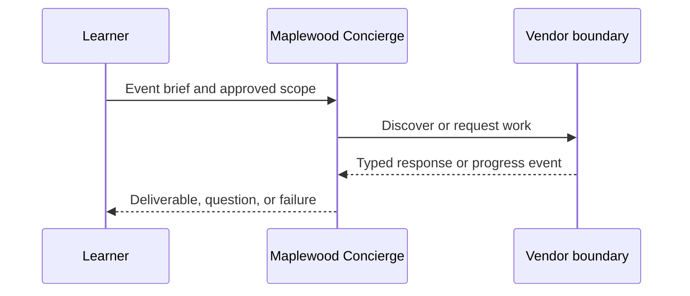

**Network and Concierge version 19:** what's new — deployment and scale.

# Module 19: Deployment and scale
> After this module you can persist and reload a task.

**Time:** ~90 min · **Level:** Advanced · **LLM needed:** No for examples and grading · **Agents running:** in-process; optional local network: uv run python scripts/network.py up --module 19
**Spec sections:** [Specification](https://a2a-protocol.org/v1.0.1/specification/) · [a2a.proto](https://github.com/a2aproject/A2A/blob/v1.0.1/specification/a2a.proto)

## Prerequisites

Python functions and dictionaries, plus the preceding module in [the learning path](../../LEARNING_PATH.md). New terms appear in [the glossary](../../docs/GLOSSARY.md).

## Learning objectives

- Persist and reload a task
- Explain multi-replica event delivery
- Identify deployment checks

## The big idea

A persistent task store survives process loss; an in-memory event queue does not coordinate multiple replicas. The current SDK offers a database event stream and versioned database store, which must be paired correctly. Proxies need streaming timeouts and buffering disabled. Webhook retry requires a durable outbox for crash recovery. Docker packages the process; it does not automatically provide trust or persistence.

**Analogy:** Keeping a ledger is different from ensuring every office sees new entries immediately.

Read the [feature companion](../../docs/FEATURE_DEEP_DIVES.md) for field semantics, failure cases and
the connection to the final deployment.

## How it works



Under the hood: It fences acknowledgements from an expired worker after another worker claims the delivery. Compare that behavior with the captured requests and responses below.

## On the wire

Executed by the course authoring tool through the same recording transport as scripts/wiretap.py. Credentials are redacted. Pure local transformations have no HTTP exchanges and an empty exchange file; their result is separate. gRPC captures are explicitly service-boundary protobuf roundtrips, not network packets.

- [persist: exchanges](wire/01_persist.jsonl) and [result](wire/01_persist.result.json).
- [stream: exchanges](wire/02_stream.jsonl) and [result](wire/02_stream.result.json).
- [push: exchanges](wire/03_push.jsonl) and [result](wire/03_push.result.json).

## Key APIs at a glance

| SDK API | Spec operation or object | What it does | When to use it |
|---|---|---|---|
| a2a.types | Protobuf objects | Defines wire-compatible values | Every protocol boundary |
| create_jsonrpc_routes | JSON-RPC binding | Mounts operations | Serving JSON-RPC |
| create_rest_routes | HTTP+JSON binding | Mounts HTTP routes | Serving HTTP+JSON |
| create_client | Client operations | Selects an advertised interface | Calling vendors |
| MessageToDict | ProtoJSON | Converts protobuf into JSON values | Inspecting traffic |

## Walkthrough

Run uv run python modules/19_deployment/examples/04_durable_delivery.py to reopen
a SQLite outbox and deliver a pending signed notification. The corresponding
tests/test_durable_delivery.py additionally loses the first acknowledgement,
restarts sender and receiver, and proves the retry creates only one inbox record.

> **Predict, then run:** If a receiver saved the event but its HTTP response was
> lost, should the sender invent a new delivery ID? No: keep the ID so the durable
> inbox can recognize a retry. Authenticate every retry before deduplicating it.

This lab uses one dispatcher and a transactional inbox. It does not make SDK
task persistence and outbox insertion one atomic transaction; closing that gap
requires a shared transaction boundary or reconciliation process. Production
workers also need leases, retention policies and dead-letter operations.

### 01: persist

Persist and reload a task.

> **Predict, then run:** Write the expected result and whether this operation creates, continues or inspects work.

```console
uv run python modules/19_deployment/examples/01_persist.py
```

Captured output (generated values vary):

```json
{
  "status": {
    "state": "TASK_STATE_COMPLETED"
  }
}
```
### 02: stream

Explain multi-replica event delivery.

> **Predict, then run:** Write the expected result and whether this operation creates, continues or inspects work.

```console
uv run python modules/19_deployment/examples/02_stream.py
```

Captured output (generated values vary):

```json
{
  "result_type": "list",
  "complete_result": "wire/02_stream.result.json"
}
```
### 03: push

Identify deployment checks.

> **Predict, then run:** Write the expected result and whether this operation creates, continues or inspects work.

```console
uv run python modules/19_deployment/examples/03_push.py
```

Captured output (generated values vary):

```json
{
  "result_type": "dict",
  "complete_result": "wire/03_push.result.json"
}
```

## Try it in the Inspector and the Control Room

Start the network in another terminal. Run uv run streamlit run control_room/app.py, select a vendor, inspect its card and send a brief. The Inspector is now a standalone binary; use [its official installation guide](https://github.com/a2aproject/a2a-inspector).

## Real-world use case

Maplewood needs quotes for a 40-person offsite. Run uv run python modules/19_deployment/use_case/run.py. The result applies this module's first experiment to shared synthetic data. A real team substitutes validated inventory and its identity system while retaining the A2A boundary.

## Common bugs

| Observed behavior | Cause | Fix |
|---|---|---|
| HTTP 401 | Missing vendor credential | Obtain the vendor token outside A2A and send a header |
| Version not supported | Missing or wrong A2A-Version | Select the card interface and send version 1.0 |
| Task remains interrupted | Required input is missing | Preserve IDs and answer the missing-input request |
| Edge-case assertion fails | Happy path was hard-coded | Work through [Fix task](../../gym/tasks/19/19-02_fix/task.md) |

## Practice

| ID | Type | Level | Concept |
|---|---|---|---|
| [19-01](../../gym/tasks/19/19-01_build/task.md) | build | medium | Bound webhook retry attempts |
| [19-02](../../gym/tasks/19/19-02_fix/task.md) | fix | easy | Repair: bound webhook retry attempts |
| [19-03](../../gym/tasks/19/19-03_predict/task.md) | predict | easy | Predict the first experiment's observable result |
| [19-04](../../gym/tasks/19/19-04_trace/task.md) | trace | medium | Identify the captured transport boundaries |
| [19-05](../../gym/tasks/19/19-05_conformance/task.md) | conformance | hard | Enforce the contract across edge cases |
| [19-06](../../gym/tasks/19/19-06_design/task.md) | design | hard | Design a partner contract and failure policy |

### Full boundary exercises

- [19-40: Load a task through another replica](../../gym/tasks/19/19-40_persistence_reload/task.md)
- [19-41: Reject a stale task writer](../../gym/tasks/19/19-41_persistence_stale/task.md)
- [19-42: Recover an event before publication](../../gym/tasks/19/19-42_persistence_replay/task.md)
- [19-43: Fence an expired delivery worker](../../gym/tasks/19/19-43_persistence_lease/task.md)
- [19-44: Share a request budget across replicas](../../gym/tasks/19/19-44_persistence_budget/task.md)
- [19-45: Inspect the atomic event and outbox commit](../../gym/tasks/19/19-45_persistence_atomic/task.md)

These tasks execute actual SDK routes, workflows, cryptographic checks or independent
database connections offline. Each starter must fail and each reference solution must pass.

## Quiz

1. What does the vendor own?
<details><summary>Answer</summary>Its execution, inventory, task IDs, context scope and authorization policy.</details>

2. How would you demonstrate: persist and reload a task?
<details><summary>Answer</summary>Run example 01 and identify the exact output field or event that proves the result.</details>

3. Does a signed card grant access?
<details><summary>Answer</summary>No. A trusted signature checks integrity and identity; authorization is enforced separately.</details>

4. Why use a scripted model in graded tasks?
<details><summary>Answer</summary>Repeatable decisions isolate protocol behavior and cost no API tokens.</details>

5. What if an artifact asks for credentials?
<details><summary>Answer</summary>Treat it as untrusted data. Never forward user tokens or expand the allow-list.</details>

6. Which edge case should you test?
<details><summary>Answer</summary>Use the negative cases in this module's Fix task; explain why the broken implementation accepts or mishandles them.</details>

## Key takeaways

- Read typed fields instead of inferring behavior from prose.
- Separate transport concerns from business work.
- Predict before running.
- Test successful and rejected inputs.
- Treat every remote peer as a trust boundary.

## Go deeper

[Specification](https://a2a-protocol.org/v1.0.1/specification/) · [Protobuf](https://github.com/a2aproject/A2A/blob/v1.0.1/specification/a2a.proto) · [Official SDK](https://github.com/a2aproject/a2a-python/tree/v1.3.0)

## Next: Module 20

Use [the learning path](../../LEARNING_PATH.md) to continue or choose a capstone.

## Connected integration lab

Continue with [the tested integration walkthrough](../../docs/INTEGRATION_LABS.md), including actual commands, expected behavior, security boundaries and current limitations.
