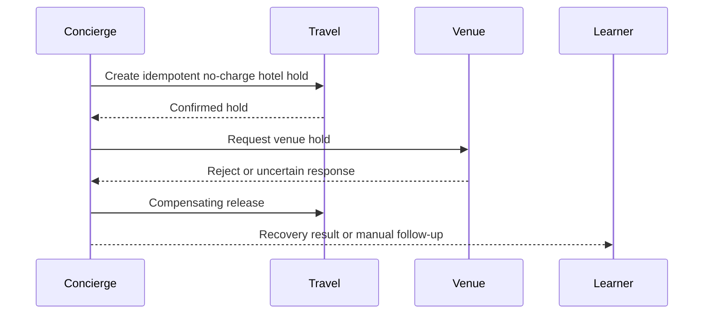

**Network and Concierge version 20:** what's new — designing agent networks.

# Module 20: Designing agent networks
> After this module you can choose useful agent boundaries.

**Time:** ~90 min · **Level:** Advanced · **LLM needed:** No for examples and grading · **Agents running:** in-process; optional local network: uv run python scripts/network.py up --module 20
**Spec sections:** [Specification](https://a2a-protocol.org/v1.0.1/specification/) · [a2a.proto](https://github.com/a2aproject/A2A/blob/v1.0.1/specification/a2a.proto)

## Prerequisites

Python functions and dictionaries, plus the preceding module in [the learning path](../../LEARNING_PATH.md). New terms appear in [the glossary](../../docs/GLOSSARY.md).

## Learning objectives

- Choose useful agent boundaries
- Design partial-failure handling
- Write an architecture decision record

## The big idea

Choose agent boundaries around ownership, independent deployment and durable responsibilities. An in-process function call is often simpler for tightly coupled work. Distributed requests can partially succeed. Compensating actions are new business operations, such as releasing a hold; they are not database rollback across organizations. Write an architecture decision record that states alternatives, failure handling and measurable tradeoffs.

**Analogy:** A coordinator can release a hotel hold, but cannot pretend the vendor never processed it.

Read the [feature companion](../../docs/FEATURE_DEEP_DIVES.md) for field semantics, failure cases and
the connection to the final deployment.

## How it works



Under the hood: An organizational boundary justifies independent agents when ownership or deployment must remain separate. Distributed failure can leave partially completed business work. Compensation is a new authorized action, not a cross-company database rollback. Unknown outcomes need reconciliation before declaring success.

## On the wire

Executed by the course authoring tool through the same recording transport as scripts/wiretap.py. Credentials are redacted. Pure local transformations have no HTTP exchanges and an empty exchange file; their result is separate. gRPC captures are explicitly service-boundary protobuf roundtrips, not network packets.

- [orchestrate: exchanges](wire/01_orchestrate.jsonl) and [result](wire/01_orchestrate.result.json).
- [rejected: exchanges](wire/02_rejected.jsonl) and [result](wire/02_rejected.result.json).
- [compensate: exchanges](wire/03_compensate.jsonl) and [result](wire/03_compensate.result.json).

## Key APIs at a glance

| SDK API or labeled course helper | Spec operation or object | What it does | When to use it |
|---|---|---|---|
| common.saga.reserve_pair (course) | Business compensation | Reconciles and releases tentative holds | Recover partial success |
| CancelTaskRequest | Protocol cancellation | Stops eligible unfinished work | Cancel a task, not a completed business effect |

## Walkthrough

### 01: orchestrate

Choose useful agent boundaries.

> **Predict, then run:** Write the expected result and whether this operation creates, continues or inspects work.

```console
uv run python modules/20_designing_agent_networks/examples/01_orchestrate.py
```

Captured output (generated values vary):

```json
{
  "result_type": "dict",
  "complete_result": "wire/01_orchestrate.result.json"
}
```
### 02: rejected

Design partial-failure handling.

> **Predict, then run:** Write the expected result and whether this operation creates, continues or inspects work.

```console
uv run python modules/20_designing_agent_networks/examples/02_rejected.py
```

Captured output (generated values vary):

```json
{
  "task": {
    "status": {
      "state": "TASK_STATE_REJECTED",
      "message": {
        "role": "ROLE_AGENT",
        "parts": [
          {
            "text": "No available room has sufficient capacity."
          }
        ]
      }
    },
    "history": [
      {
        "role": "ROLE_USER",
        "parts": [
          {
            "data": {
              "guests": 900.0
            },
            "mediaType": "application/json"
          }
        ]
      },
      {
        "role": "ROLE_AGENT",
        "parts": [
          {
            "text": "venues: checking the brief"
          }
        ]
      }
    ],
    "metadata": {
      "brief": {
        "guests": 900.0
      }
    }
  }
}
```
### 03: compensate

Write an architecture decision record.

> **Predict, then run:** Write the expected result and whether this operation creates, continues or inspects work.

```console
uv run python modules/20_designing_agent_networks/examples/03_compensate.py
```

Captured output (generated values vary):

```json
{
  "reserved": false,
  "compensated": true,
  "manual_followup_required": false,
  "charged_cents": 0,
  "remaining_hotel_holds": 0
}
```

## Try it in the Inspector and the Control Room

Start the network in another terminal. Run uv run streamlit run control_room/app.py, select a vendor, inspect its card and send a brief. The Inspector is now a standalone binary; use [its official installation guide](https://github.com/a2aproject/a2a-inspector).

## Real-world use case

Maplewood evaluates independent vendor outcomes before approving an event; the compensation example then handles partial holds.

Run:

```console
uv run python modules/20_designing_agent_networks/use_case/run.py
```

Selected observed fields (see [the complete captured result](wire/01_orchestrate.result.json) for the full output):

```json
{
  "vendor": "venues",
  "state": "TASK_STATE_COMPLETED",
  "total_cents": 80000.0,
  "currency": "USD",
  "approval_required": true
}
```

A real deployment retains this boundary while substituting its own approved inventory, identity provider and operating policy.

## Common bugs

| Observed behavior | Cause | Fix and related practice |
|---|---|---|
| Duplicate hotel holds after retry | No stable application request ID | Use idempotent reservation keys; [practice 20-02](../../gym/tasks/20/20-02_fix/task.md) |
| Completed hold survives task cancellation | Business undo confused with protocol cancellation | Invoke the release skill; [practice 20-02](../../gym/tasks/20/20-02_fix/task.md) |
| Partial plan presented as fully booked | Failure state discarded | Report each vendor outcome and approval state; [practice 20-05](../../gym/tasks/20/20-05_conformance/task.md) |
| Unknown cleanup reported successful | Acknowledgement not verified | Require explicit confirmation or manual follow-up; [practice 20-02](../../gym/tasks/20/20-02_fix/task.md) |

## Practice

| ID | Type | Level | Concept |
|---|---|---|---|
| [20-01](../../gym/tasks/20/20-01_build/task.md) | build | medium | Compensate only confirmed holds |
| [20-02](../../gym/tasks/20/20-02_fix/task.md) | fix | easy | Repair: compensate only confirmed holds |
| [20-03](../../gym/tasks/20/20-03_predict/task.md) | predict | easy | Predict the first experiment's observable result |
| [20-04](../../gym/tasks/20/20-04_trace/task.md) | trace | medium | Identify the captured transport boundaries |
| [20-05](../../gym/tasks/20/20-05_conformance/task.md) | conformance | hard | Enforce the contract across edge cases |
| [20-06](../../gym/tasks/20/20-06_design/task.md) | design | hard | Design a partner contract and failure policy |

## Quiz

1. When is one process preferable to A2A services?
<details><summary>Answer</summary>When work shares ownership and lifecycle and independent deployment adds little value.</details>

2. Does canceling an A2A task undo a completed hold?
<details><summary>Answer</summary>No. A release skill performs the compensating business action.</details>

3. Why use a stable hold request ID?
<details><summary>Answer</summary>Retries can reconcile the same business operation instead of creating duplicate holds.</details>

4. What if a hold committed but its confirmation is malformed?
<details><summary>Answer</summary>Treat the outcome as uncertain and reconcile by its idempotency key.</details>

5. What if cleanup cannot be confirmed?
<details><summary>Answer</summary>Report manual follow-up explicitly rather than claiming compensation succeeded.</details>

6. What belongs in an architecture decision record?
<details><summary>Answer</summary>Context, alternatives, chosen boundaries, measurable tradeoffs and failure policy.</details>

## Key takeaways

- When work shares ownership and lifecycle and independent deployment adds little value.
- No. A release skill performs the compensating business action.
- Retries can reconcile the same business operation instead of creating duplicate holds.
- Treat the outcome as uncertain and reconcile by its idempotency key.
- Report manual follow-up explicitly rather than claiming compensation succeeded.

## Go deeper

[Specification](https://a2a-protocol.org/v1.0.1/specification/) · [Protobuf](https://github.com/a2aproject/A2A/blob/v1.0.1/specification/a2a.proto) · [Official SDK](https://github.com/a2aproject/a2a-python/tree/v1.3.0)

## Next: Module checkpoint

Use [the learning path](../../LEARNING_PATH.md) to continue or choose a capstone.

## Connected integration lab

Continue with [the tested integration walkthrough](../../docs/INTEGRATION_LABS.md), including actual commands, expected behavior, security boundaries and current limitations.
