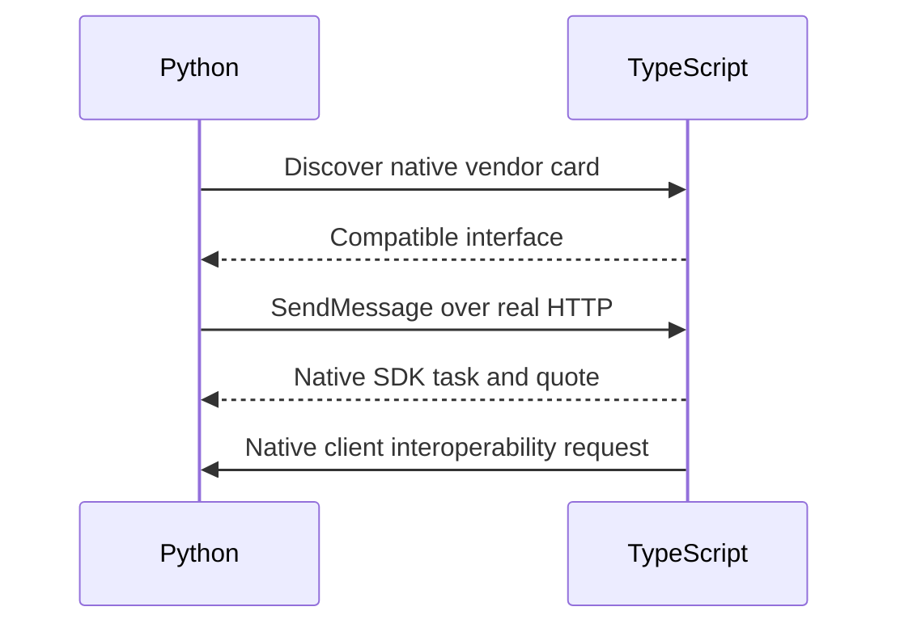

**Network and Concierge version B1:** what's new — a2a in typescript.

# Module B1: A2A in TypeScript
> After this module you can compare json representations.

**Time:** ~90 min · **Level:** Advanced · **LLM needed:** No for examples and grading · **Agents running:** in-process; optional local network: uv run python scripts/network.py up --module 08
**Spec sections:** [Specification](https://a2a-protocol.org/v1.0.1/specification/) · [a2a.proto](https://github.com/a2aproject/A2A/blob/v1.0.1/specification/a2a.proto)

## Prerequisites

Python functions and dictionaries, plus the preceding module in [the learning path](../../../LEARNING_PATH.md). New terms appear in [the glossary](../../../docs/GLOSSARY.md).

## Learning objectives

- Compare JSON representations
- Identify transport boundaries
- Plan cross-language validation

## The big idea

Language interoperability rests on wire contracts, not shared Python objects. The TypeScript track pins the official JavaScript SDK and uses the same synthetic briefs. A test must cross the language boundary to demonstrate interoperability; a Python-only simulation is preparation rather than evidence.

**Analogy:** Two offices can use different languages while agreeing on the fields of an order.

Read the [feature companion](../../../docs/FEATURE_DEEP_DIVES.md) for field semantics, failure cases and
the connection to the final deployment.

## How it works



Under the hood: The JSON contract crosses a process and language boundary; no Python task object is shared. Native TypeScript source and its pinned JavaScript SDK are checked with the Python client. The introductory Python scripts show wire shapes, while the native lab proves interoperability.

## On the wire

Executed by the course authoring tool through the same recording transport as scripts/wiretap.py. Credentials are redacted. Pure local transformations have no HTTP exchanges and an empty exchange file; their result is separate. gRPC captures are explicitly service-boundary protobuf roundtrips, not network packets.

- [jsonrpc: exchanges](wire/01_jsonrpc.jsonl) and [result](wire/01_jsonrpc.result.json).
- [rest: exchanges](wire/02_rest.jsonl) and [result](wire/02_rest.result.json).
- [grpc: exchanges](wire/03_grpc.jsonl) and [result](wire/03_grpc.result.json).

## Key APIs at a glance

| SDK API or labeled course helper | Spec operation or object | What it does | When to use it |
|---|---|---|---|
| scripts/check_typescript_interop.py (course) | Native interoperability check | Starts real language endpoints | Verify both directions |
| AgentCard | Shared wire contract | Advertises compatible native interfaces | Choose the cross-language transport |

## Walkthrough

### 01: jsonrpc

Compare JSON representations.

> **Predict, then run:** Write the expected result and whether this operation creates, continues or inspects work.

```console
uv run python modules/bonus/B1_typescript/examples/01_jsonrpc.py
```

Captured output (generated values vary):

```json
{
  "result": {
    "task": {
      "status": {
        "state": "TASK_STATE_COMPLETED",
        "message": {
          "role": "ROLE_AGENT",
          "parts": [
            {
              "text": "Quote ready; no money has been spent."
            }
          ]
        }
      },
      "artifacts": [
        {
          "artifactId": "quote",
          "name": "quote",
          "parts": [
            {
              "data": {
                "guests": 40.0,
                "vendor": "venues",
                "approved": false,
                "selection": "room-1",
                "total_cents": 80000.0,
                "currency": "USD"
              },
              "mediaType": "application/json"
            }
          ]
        }
      ],
      "history": [
        {
          "role": "ROLE_USER",
          "parts": [
            {
              "data": {
                "dietary": {
                  "standard": 30.0,
                  "vegan": 10.0
                },
                "guests": 40.0,
                "budget_cents": 1000000.0,
                "date": "2027-06-01"
              },
              "mediaType": "application/json"
            }
          ]
        },
        {
          "role": "ROLE_AGENT",
          "parts": [
            {
              "text": "venues: checking the brief"
            }
          ]
        }
      ],
      "metadata": {
        "brief": {
          "guests": 40.0,
          "dietary": {
            "standard": 30.0,
            "vegan": 10.0
          },
          "budget_cents": 1000000.0,
          "date": "2027-06-01"
        }
      }
    }
  },
  "jsonrpc": "2.0"
}
```
### 02: rest

Identify transport boundaries.

> **Predict, then run:** Write the expected result and whether this operation creates, continues or inspects work.

```console
uv run python modules/bonus/B1_typescript/examples/02_rest.py
```

Captured output (generated values vary):

```json
{
  "task": {
    "status": {
      "state": "TASK_STATE_COMPLETED",
      "message": {
        "role": "ROLE_AGENT",
        "parts": [
          {
            "text": "Quote ready; no money has been spent."
          }
        ]
      }
    },
    "artifacts": [
      {
        "artifactId": "quote",
        "name": "quote",
        "parts": [
          {
            "data": {
              "guests": 40.0,
              "vendor": "venues",
              "approved": false,
              "selection": "room-1",
              "total_cents": 80000.0,
              "currency": "USD"
            },
            "mediaType": "application/json"
          }
        ]
      }
    ],
    "history": [
      {
        "role": "ROLE_USER",
        "parts": [
          {
            "data": {
              "dietary": {
                "standard": 30.0,
                "vegan": 10.0
              },
              "guests": 40.0,
              "budget_cents": 1000000.0,
              "date": "2027-06-01"
            },
            "mediaType": "application/json"
          }
        ]
      },
      {
        "role": "ROLE_AGENT",
        "parts": [
          {
            "text": "venues: checking the brief"
          }
        ]
      }
    ],
    "metadata": {
      "brief": {
        "guests": 40.0,
        "dietary": {
          "standard": 30.0,
          "vegan": 10.0
        },
        "budget_cents": 1000000.0,
        "date": "2027-06-01"
      }
    }
  }
}
```
### 03: grpc

Plan cross-language validation.

> **Predict, then run:** Write the expected result and whether this operation creates, continues or inspects work.

```console
uv run python modules/bonus/B1_typescript/examples/03_grpc.py
```

Captured output (generated values vary):

```json
{
  "task": {
    "status": {
      "state": "TASK_STATE_COMPLETED",
      "message": {
        "role": "ROLE_AGENT",
        "parts": [
          {
            "text": "Quote ready; no money has been spent."
          }
        ]
      }
    },
    "artifacts": [
      {
        "artifactId": "quote",
        "name": "quote",
        "parts": [
          {
            "data": {
              "vendor": "print",
              "guests": 40.0,
              "approved": false,
              "selection": "badge",
              "total_cents": 10000.0,
              "currency": "USD"
            },
            "mediaType": "application/json"
          }
        ]
      }
    ],
    "history": [
      {
        "role": "ROLE_USER",
        "parts": [
          {
            "data": {
              "dietary": {
                "standard": 30.0,
                "vegan": 10.0
              },
              "guests": 40.0,
              "budget_cents": 1000000.0,
              "date": "2027-06-01"
            },
            "mediaType": "application/json"
          }
        ]
      },
      {
        "role": "ROLE_AGENT",
        "parts": [
          {
            "text": "print: checking the brief"
          }
        ]
      }
    ],
    "metadata": {
      "brief": {
        "guests": 40.0,
        "dietary": {
          "standard": 30.0,
          "vegan": 10.0
        },
        "budget_cents": 1000000.0,
        "date": "2027-06-01"
      }
    }
  }
}
```

## Try it in the Inspector and the Control Room

Start the network in another terminal. Run uv run streamlit run control_room/app.py, select a vendor, inspect its card and send a brief. The Inspector is now a standalone binary; use [its official installation guide](https://github.com/a2aproject/a2a-inspector).

## Real-world use case

Maplewood studies the JSON contract that its native TypeScript vendor and Python client exchange in the accompanying native lab.

Run:

```console
uv run python modules/bonus/B1_typescript/use_case/run.py
```

Selected observed fields (see [the complete captured result](wire/01_jsonrpc.result.json) for the full output):

```json
{
  "state": "TASK_STATE_COMPLETED",
  "name": "quote",
  "vendor": "venues",
  "total_cents": 80000.0,
  "currency": "USD"
}
```

A real deployment retains this boundary while substituting its own approved inventory, identity provider and operating policy.

## Common bugs

| Observed behavior | Cause | Fix and related practice |
|---|---|---|
| Compile succeeds but exchange fails | Only type checking was run | Run the native interoperability command; [practice B1-02](../../../gym/tasks/B1/B1-02_fix/task.md) |
| Task comparison fails on fresh IDs | Whole responses compared literally | Compare invariant semantics; [practice B1-05](../../../gym/tasks/B1/B1-05_conformance/task.md) |
| Client uses an unsupported binding | Card ignored | Select a compatible advertised interface; [practice B1-02](../../../gym/tasks/B1/B1-02_fix/task.md) |
| Dependency update changes behavior | Lockfile bypassed | Use npm ci and rerun contract tests; [practice B1-02](../../../gym/tasks/B1/B1-02_fix/task.md) |

## Practice

| ID | Type | Level | Concept |
|---|---|---|---|
| [B1-01](../../../gym/tasks/B1/B1-01_build/task.md) | build | medium | Compare cross-language quote semantics |
| [B1-02](../../../gym/tasks/B1/B1-02_fix/task.md) | fix | easy | Repair: compare cross-language quote semantics |
| [B1-03](../../../gym/tasks/B1/B1-03_predict/task.md) | predict | easy | Predict the first experiment's observable result |
| [B1-04](../../../gym/tasks/B1/B1-04_trace/task.md) | trace | medium | Identify the captured transport boundaries |
| [B1-05](../../../gym/tasks/B1/B1-05_conformance/task.md) | conformance | hard | Enforce the contract across edge cases |
| [B1-06](../../../gym/tasks/B1/B1-06_design/task.md) | design | hard | Design a partner contract and failure policy |

## Quiz

1. Does a Python-only test prove TypeScript interoperability?
<details><summary>Answer</summary>No. A native TypeScript process must participate.</details>

2. Why run npm ci instead of an unpinned install?
<details><summary>Answer</summary>It reproduces the dependency lockfile used by CI.</details>

3. Should task IDs match across independent runs?
<details><summary>Answer</summary>No. Compare semantic states, fields and amounts rather than generated IDs.</details>

4. Which files contain the native implementation?
<details><summary>Answer</summary>The TypeScript lab files in this module, linked in its native-language walkthrough.</details>

5. Does a TypeScript interface replace runtime validation?
<details><summary>Answer</summary>No. Remote JSON still needs validation at the boundary.</details>

6. Why test both client and server directions?
<details><summary>Answer</summary>Serialization and transport assumptions can fail in either role.</details>

## Key takeaways

- No. A native TypeScript process must participate.
- It reproduces the dependency lockfile used by CI.
- No. Compare semantic states, fields and amounts rather than generated IDs.
- The TypeScript lab files in this module, linked in its native-language walkthrough.
- No. Remote JSON still needs validation at the boundary.

## Go deeper

[Specification](https://a2a-protocol.org/v1.0.1/specification/) · [Protobuf](https://github.com/a2aproject/A2A/blob/v1.0.1/specification/a2a.proto) · [Official SDK](https://github.com/a2aproject/a2a-python/tree/v1.3.0)

## Next: Module checkpoint

Use [the learning path](../../../LEARNING_PATH.md) to continue or choose a capstone.
