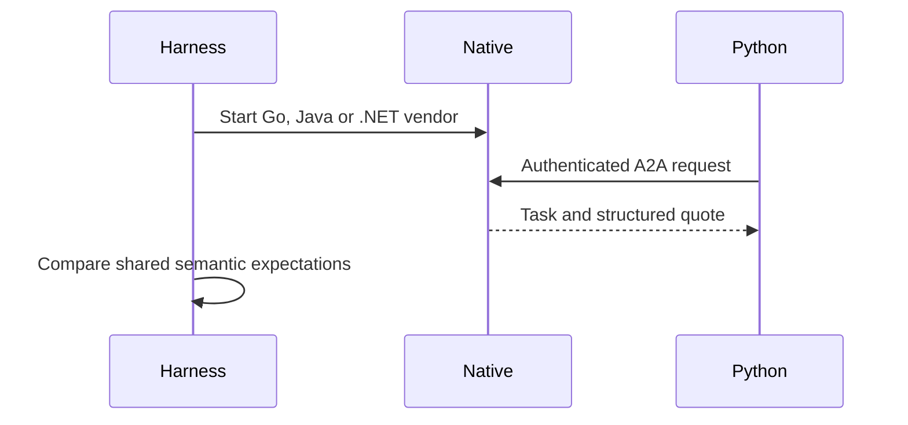

**Network and Concierge version B2:** what's new — other official sdks.

# Module B2: Other official SDKs
> After this module you can inspect language compatibility.

**Time:** ~90 min · **Level:** Advanced · **LLM needed:** No for examples and grading · **Agents running:** in-process; optional local network: uv run python scripts/network.py up --module 08
**Spec sections:** [Specification](https://a2a-protocol.org/v1.0.1/specification/) · [a2a.proto](https://github.com/a2aproject/A2A/blob/v1.0.1/specification/a2a.proto)

## Prerequisites

Python functions and dictionaries, plus the preceding module in [the learning path](../../../LEARNING_PATH.md). New terms appear in [the glossary](../../../docs/GLOSSARY.md).

## Learning objectives

- Inspect language compatibility
- Compare task semantics
- Choose a migration boundary

## The big idea

Official SDK status does not guarantee that every language release supports the same protocol revision. Check Go, Java and .NET release notes and minimum runtimes before selecting versions. Run the same request and compare semantics, allowing generated IDs and timestamps to differ.

**Analogy:** An approved translation still needs checking against the edition of the contract in use.

Read the [feature companion](../../../docs/FEATURE_DEEP_DIVES.md) for field semantics, failure cases and
the connection to the final deployment.

## How it works



Under the hood: Official SDKs have independent release schedules and runtime requirements. Their version numbers need not match one another or the protocol. Native subprocess checks run on Windows, macOS and Linux. The .NET dependency remains explicitly labeled preview rather than promoted to stable by the course.

## On the wire

Executed by the course authoring tool through the same recording transport as scripts/wiretap.py. Credentials are redacted. Pure local transformations have no HTTP exchanges and an empty exchange file; their result is separate. gRPC captures are explicitly service-boundary protobuf roundtrips, not network packets.

- [grpc: exchanges](wire/01_grpc.jsonl) and [result](wire/01_grpc.result.json).
- [discover: exchanges](wire/02_discover.jsonl) and [result](wire/02_discover.result.json).
- [version: exchanges](wire/03_version.jsonl) and [result](wire/03_version.result.json).

## Key APIs at a glance

| SDK API or labeled course helper | Spec operation or object | What it does | When to use it |
|---|---|---|---|
| scripts/check_go_interop.py (course) | Native Go verification | Runs authenticated cross-language requests | Check the Go implementation |
| scripts/check_java_interop.py / check_dotnet_interop.py (course) | Native JVM/.NET verification | Exercises real official SDK processes | Check other language boundaries |

## Walkthrough

The [native Go lab](go/README.md) and [native Java lab](java/README.md) compile
official SDK servers and compare actual Python requests against shared inventory.
Java's [captured JSON-RPC traffic](wire/java.jsonl) includes rejected requests.
The [.NET preview lab](dotnet/README.md) also runs native interoperability checks;
its upstream package is explicitly prerelease.

### 01: grpc

Inspect language compatibility.

> **Predict, then run:** Write the expected result and whether this operation creates, continues or inspects work.

```console
uv run python modules/bonus/B2_other_sdks/examples/01_grpc.py
```

Captured output (generated values vary):

```json
{
  "task": {
    "status": {
      "state": "TASK_STATE_COMPLETED",
      "message": {
        "role": "ROLE_AGENT",
        "parts": [
          {
            "text": "Quote ready; no money has been spent."
          }
        ]
      }
    },
    "artifacts": [
      {
        "artifactId": "quote",
        "name": "quote",
        "parts": [
          {
            "data": {
              "vendor": "print",
              "guests": 40.0,
              "approved": false,
              "selection": "badge",
              "total_cents": 10000.0,
              "currency": "USD"
            },
            "mediaType": "application/json"
          }
        ]
      }
    ],
    "history": [
      {
        "role": "ROLE_USER",
        "parts": [
          {
            "data": {
              "dietary": {
                "standard": 30.0,
                "vegan": 10.0
              },
              "guests": 40.0,
              "budget_cents": 1000000.0,
              "date": "2027-06-01"
            },
            "mediaType": "application/json"
          }
        ]
      },
      {
        "role": "ROLE_AGENT",
        "parts": [
          {
            "text": "print: checking the brief"
          }
        ]
      }
    ],
    "metadata": {
      "brief": {
        "guests": 40.0,
        "dietary": {
          "standard": 30.0,
          "vegan": 10.0
        },
        "budget_cents": 1000000.0,
        "date": "2027-06-01"
      }
    }
  }
}
```
### 02: discover

Compare task semantics.

> **Predict, then run:** Write the expected result and whether this operation creates, continues or inspects work.

```console
uv run python modules/bonus/B2_other_sdks/examples/02_discover.py
```

Captured output (generated values vary):

```json
{
  "result_type": "dict",
  "complete_result": "wire/02_discover.result.json"
}
```
### 03: version

Choose a migration boundary.

> **Predict, then run:** Write the expected result and whether this operation creates, continues or inspects work.

```console
uv run python modules/bonus/B2_other_sdks/examples/03_version.py
```

Captured output (generated values vary):

```json
{
  "supported": 200,
  "unsupported": {
    "error": {
      "code": 400,
      "status": "FAILED_PRECONDITION",
      "message": "A2A version '99.0' is not supported by this handler. Expected version '1.0'.",
      "details": [
        {
          "@type": "type.googleapis.com/google.rpc.ErrorInfo",
          "reason": "VERSION_NOT_SUPPORTED",
          "domain": "a2a-protocol.org",
          "metadata": {}
        }
      ]
    }
  }
}
```

## Try it in the Inspector and the Control Room

Start the network in another terminal. Run uv run streamlit run control_room/app.py, select a vendor, inspect its card and send a brief. The Inspector is now a standalone binary; use [its official installation guide](https://github.com/a2aproject/a2a-inspector).

## Real-world use case

Maplewood inspects protobuf semantics before comparing the real Go, Java and .NET vendor implementations.

Run:

```console
uv run python modules/bonus/B2_other_sdks/use_case/run.py
```

Selected observed fields (see [the complete captured result](wire/01_grpc.result.json) for the full output):

```json
{
  "state": "TASK_STATE_COMPLETED",
  "name": "quote",
  "vendor": "print",
  "total_cents": 10000.0,
  "currency": "USD"
}
```

A real deployment retains this boundary while substituting its own approved inventory, identity provider and operating policy.

## Common bugs

| Observed behavior | Cause | Fix and related practice |
|---|---|---|
| Native process fails before serving | Required runtime missing | Run environment checks and install the documented runtime; [practice B2-02](../../../gym/tasks/B2/B2-02_fix/task.md) |
| Authenticated Python call rejected | Header or metadata omitted | Send the vendor-specific credential; [practice B2-02](../../../gym/tasks/B2/B2-02_fix/task.md) |
| Preview API breaks after update | Version floated | Use the pinned .NET dependency; [practice B2-05](../../../gym/tasks/B2/B2-05_conformance/task.md) |
| Equivalent quotes compare unequal | Numeric representation differs | Validate whole-number cents and semantic values; [practice B2-02](../../../gym/tasks/B2/B2-02_fix/task.md) |

## Practice

| ID | Type | Level | Concept |
|---|---|---|---|
| [B2-01](../../../gym/tasks/B2/B2-01_build/task.md) | build | medium | Select SDK releases by protocol support |
| [B2-02](../../../gym/tasks/B2/B2-02_fix/task.md) | fix | easy | Repair: select sdk releases by protocol support |
| [B2-03](../../../gym/tasks/B2/B2-03_predict/task.md) | predict | easy | Predict the first experiment's observable result |
| [B2-04](../../../gym/tasks/B2/B2-04_trace/task.md) | trace | medium | Identify the captured transport boundaries |
| [B2-05](../../../gym/tasks/B2/B2-05_conformance/task.md) | conformance | hard | Enforce the contract across edge cases |
| [B2-06](../../../gym/tasks/B2/B2-06_design/task.md) | design | hard | Design a partner contract and failure policy |

## Quiz

1. Do SDK version numbers have to match across languages?
<details><summary>Answer</summary>No. The implemented protocol contract must be compatible.</details>

2. What does the .NET preview label imply?
<details><summary>Answer</summary>Its upstream API may change; pin it and retain interoperability tests.</details>

3. Does protobuf alone guarantee correct business behavior?
<details><summary>Answer</summary>No. State transitions, authorization and artifacts still need checks.</details>

4. Why run the same scenario in all languages?
<details><summary>Answer</summary>It reveals semantic differences hidden by language-specific types.</details>

5. What differs across operating systems?
<details><summary>Answer</summary>Runtime installation, process startup and filesystem or shell behavior can differ.</details>

6. What should an SDK migration preserve?
<details><summary>Answer</summary>Advertised interfaces, authorization rules and observable task semantics.</details>

## Key takeaways

- No. The implemented protocol contract must be compatible.
- Its upstream API may change; pin it and retain interoperability tests.
- No. State transitions, authorization and artifacts still need checks.
- It reveals semantic differences hidden by language-specific types.
- Runtime installation, process startup and filesystem or shell behavior can differ.

## Go deeper

[Specification](https://a2a-protocol.org/v1.0.1/specification/) · [Protobuf](https://github.com/a2aproject/A2A/blob/v1.0.1/specification/a2a.proto) · [Official SDK](https://github.com/a2aproject/a2a-python/tree/v1.3.0)

## Next: Module checkpoint

Use [the learning path](../../../LEARNING_PATH.md) to continue or choose a capstone.
