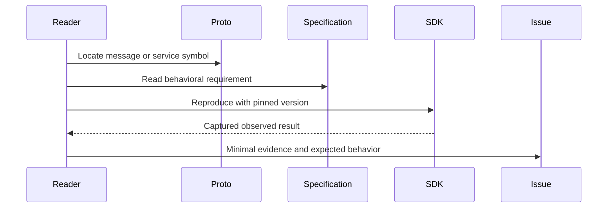

**Network and Concierge version B3:** what's new — reading the specification and contributing.

# Module B3: Reading the specification and contributing
> After this module you can locate a protobuf field.

**Time:** ~90 min · **Level:** Advanced · **LLM needed:** No for examples and grading · **Agents running:** in-process; optional local network: uv run python scripts/network.py up --module 08
**Spec sections:** [Specification](https://a2a-protocol.org/v1.0.1/specification/) · [a2a.proto](https://github.com/a2aproject/A2A/blob/v1.0.1/specification/a2a.proto)

## Prerequisites

Python functions and dictionaries, plus the preceding module in [the learning path](../../../LEARNING_PATH.md). New terms appear in [the glossary](../../../docs/GLOSSARY.md).

## Learning objectives

- Locate a protobuf field
- Reduce a conformance report
- Identify normative requirements

## The big idea

Read the normative protobuf alongside binding rules and behavioral requirements. A field being parseable does not make a behavior conformant. Reduce a suspected bug to a captured request, observed response and specific requirement. Distinguish a documentation typo from a change to the protocol contract.

**Analogy:** A building blueprint and an inspection checklist describe different aspects of the same building.

Read the [feature companion](../../../docs/FEATURE_DEEP_DIVES.md) for field semantics, failure cases and
the connection to the final deployment.

## How it works



Under the hood: A field descriptor tells you the legal structure, while normative prose explains behavioral obligations. Compare both before calling a result a bug. Preserve the version, request and response in a minimal reproduction. Governance and proposal processes decide changes to the standard; a local workaround does not change it.

## On the wire

Executed by the course authoring tool through the same recording transport as scripts/wiretap.py. Credentials are redacted. Pure local transformations have no HTTP exchanges and an empty exchange file; their result is separate. gRPC captures are explicitly service-boundary protobuf roundtrips, not network packets.

- [parts: exchanges](wire/01_parts.jsonl) and [result](wire/01_parts.result.json).
- [validate_card: exchanges](wire/02_validate_card.jsonl) and [result](wire/02_validate_card.result.json).
- [errors: exchanges](wire/03_errors.jsonl) and [result](wire/03_errors.result.json).

## Key APIs at a glance

| SDK API or labeled course helper | Spec operation or object | What it does | When to use it |
|---|---|---|---|
| a2a.types.a2a_pb2.DESCRIPTOR | Schema reflection | Locates messages, fields and services | Navigate the normative model |
| google.protobuf.json_format.ParseDict | Wire validation | Checks a reproduction against generated types | Separate shape from behavior |

## Walkthrough

### 01: parts

Locate a protobuf field.

> **Predict, then run:** Write the expected result and whether this operation creates, continues or inspects work.

```console
uv run python modules/bonus/B3_spec_contributing/examples/01_parts.py
```

Captured output (generated values vary):

```json
[
  {
    "text": "Floor plan"
  },
  {
    "raw": "c3ludGhldGljIGZsb29yIHBsYW4=",
    "filename": "plan.txt",
    "mediaType": "text/plain"
  },
  {
    "url": "https://maplewood.example/plan",
    "mediaType": "text/plain"
  },
  {
    "data": {
      "total_cents": 96000.0
    },
    "mediaType": "application/json"
  }
]
```
### 02: validate card

Reduce a conformance report.

> **Predict, then run:** Write the expected result and whether this operation creates, continues or inspects work.

```console
uv run python modules/bonus/B3_spec_contributing/examples/02_validate_card.py
```

Captured output (generated values vary):

```json
{
  "result_type": "dict",
  "complete_result": "wire/02_validate_card.result.json"
}
```
### 03: errors

Identify normative requirements.

> **Predict, then run:** Write the expected result and whether this operation creates, continues or inspects work.

```console
uv run python modules/bonus/B3_spec_contributing/examples/03_errors.py
```

Captured output (generated values vary):

```json
{
  "error": {
    "code": 404,
    "status": "NOT_FOUND",
    "message": "Task not found",
    "details": [
      {
        "@type": "type.googleapis.com/google.rpc.ErrorInfo",
        "reason": "TASK_NOT_FOUND",
        "domain": "a2a-protocol.org",
        "metadata": {}
      }
    ]
  }
}
```

## Try it in the Inspector and the Control Room

Start the network in another terminal. Run uv run streamlit run control_room/app.py, select a vendor, inspect its card and send a brief. The Inspector is now a standalone binary; use [its official installation guide](https://github.com/a2aproject/a2a-inspector).

## Real-world use case

A contributor locates concrete Part alternatives in the generated schema before writing a minimal protocol reproduction.

Run:

```console
uv run python modules/bonus/B3_spec_contributing/use_case/run.py
```

Selected observed fields (see [the complete captured result](wire/01_parts.result.json) for the full output):

```json
{
  "total_cents": 96000.0
}
```

A real deployment retains this boundary while substituting its own approved inventory, identity provider and operating policy.

## Common bugs

| Observed behavior | Cause | Fix and related practice |
|---|---|---|
| Bug report cannot be reproduced | Versions and request omitted | Include a minimal pinned reproduction; [practice B3-02](../../../gym/tasks/B3/B3-02_fix/task.md) |
| Field absence treated as behavioral permission | Only schema was read | Check the normative operation rules too; [practice B3-05](../../../gym/tasks/B3/B3-05_conformance/task.md) |
| Secret published in issue attachment | Raw traffic copied | Redact credentials before sharing; [practice B3-02](../../../gym/tasks/B3/B3-02_fix/task.md) |
| Local convention presented as standard | Course policy not distinguished | Label HMAC and business rules as application policy; [practice B3-02](../../../gym/tasks/B3/B3-02_fix/task.md) |

## Practice

| ID | Type | Level | Concept |
|---|---|---|---|
| [B3-01](../../../gym/tasks/B3/B3-01_build/task.md) | build | medium | Validate Part oneof content |
| [B3-02](../../../gym/tasks/B3/B3-02_fix/task.md) | fix | easy | Repair: validate part oneof content |
| [B3-03](../../../gym/tasks/B3/B3-03_predict/task.md) | predict | easy | Predict the first experiment's observable result |
| [B3-04](../../../gym/tasks/B3/B3-04_trace/task.md) | trace | medium | Identify the captured transport boundaries |
| [B3-05](../../../gym/tasks/B3/B3-05_conformance/task.md) | conformance | hard | Enforce the contract across edge cases |
| [B3-06](../../../gym/tasks/B3/B3-06_design/task.md) | design | hard | Design a partner contract and failure policy |

## Quiz

1. Which source defines protocol messages and services?
<details><summary>Answer</summary>The normative a2a.proto definition.</details>

2. Does a parseable message necessarily conform?
<details><summary>Answer</summary>No. Behavioral requirements can still be violated.</details>

3. Why cite an exact requirement in a bug report?
<details><summary>Answer</summary>It makes expected behavior independently reviewable.</details>

4. What should be removed from reproduction logs?
<details><summary>Answer</summary>Credentials, personal information and unrelated application data.</details>

5. How is a documentation typo different from a protocol change?
<details><summary>Answer</summary>A typo corrects explanation; a protocol change alters the agreed contract and follows governance review.</details>

6. Why pin the failing version?
<details><summary>Answer</summary>Otherwise reviewers may reproduce against different behavior.</details>

## Key takeaways

- The normative a2a.proto definition.
- No. Behavioral requirements can still be violated.
- It makes expected behavior independently reviewable.
- Credentials, personal information and unrelated application data.
- A typo corrects explanation; a protocol change alters the agreed contract and follows governance review.

## Go deeper

[Specification](https://a2a-protocol.org/v1.0.1/specification/) · [Protobuf](https://github.com/a2aproject/A2A/blob/v1.0.1/specification/a2a.proto) · [Official SDK](https://github.com/a2aproject/a2a-python/tree/v1.3.0)

## Next: Module checkpoint

Use [the learning path](../../../LEARNING_PATH.md) to continue or choose a capstone.
