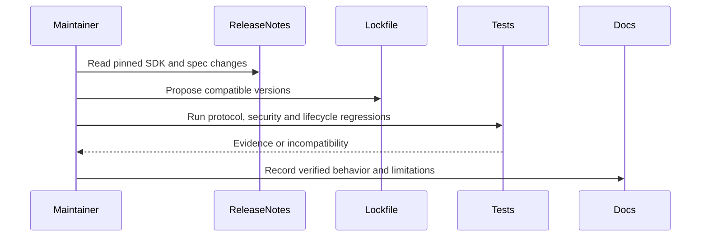

**Network and Concierge version B4:** what's new — recent changes.

# Module B4: Recent changes
> After this module you can separate sdk and protocol releases.

**Time:** ~90 min · **Level:** Advanced · **LLM needed:** No for examples and grading · **Agents running:** in-process; optional local network: uv run python scripts/network.py up --module 08
**Spec sections:** [Specification](https://a2a-protocol.org/v1.0.1/specification/) · [a2a.proto](https://github.com/a2aproject/A2A/blob/v1.0.1/specification/a2a.proto)

## Prerequisites

Python functions and dictionaries, plus the preceding module in [the learning path](../../../LEARNING_PATH.md). New terms appear in [the glossary](../../../docs/GLOSSARY.md).

## Learning objectives

- Separate SDK and protocol releases
- Check pagination fields
- Verify an upgrade

## The big idea

Package versions and protocol versions are separate. SDK 1.3 can implement protocol 1.0 while adding runtime features such as shared event delivery. Re-run compatibility tests after a dependency update and retain the lockfile. Prefer demonstrated behavior over copying examples from an overview that may contain stale field names.

**Analogy:** A newer printing of a handbook may add tools without changing the contract it describes.

Read the [feature companion](../../../docs/FEATURE_DEEP_DIVES.md) for field semantics, failure cases and
the connection to the final deployment.

## How it works



Under the hood: A newer SDK can add runtime behavior without changing protocol version 1.0. Upgrade evidence must cover behavior, not just successful imports. Pagination, interrupted-task parking and shared storage are independently testable features. The lockfile and verification notes record what the course actually executed.

## On the wire

Executed by the course authoring tool through the same recording transport as scripts/wiretap.py. Credentials are redacted. Pure local transformations have no HTTP exchanges and an empty exchange file; their result is separate. gRPC captures are explicitly service-boundary protobuf roundtrips, not network packets.

- [list: exchanges](wire/01_list.jsonl) and [result](wire/01_list.result.json).
- [version: exchanges](wire/02_version.jsonl) and [result](wire/02_version.result.json).
- [persist: exchanges](wire/03_persist.jsonl) and [result](wire/03_persist.result.json).

## Key APIs at a glance

| SDK API or labeled course helper | Spec operation or object | What it does | When to use it |
|---|---|---|---|
| ListTasksRequest | Pagination request | Carries filters and opaque page token | Inspect stored work |
| VersionedTaskStore | Revision-aware persistence | Supports safe shared state | Validate runtime upgrades |

## Walkthrough

### 01: list

Separate SDK and protocol releases.

> **Predict, then run:** Write the expected result and whether this operation creates, continues or inspects work.

```console
uv run python modules/bonus/B4_recent_changes/examples/01_list.py
```

Captured output (generated values vary):

```json
{
  "result_type": "dict",
  "complete_result": "wire/01_list.result.json"
}
```
### 02: version

Check pagination fields.

> **Predict, then run:** Write the expected result and whether this operation creates, continues or inspects work.

```console
uv run python modules/bonus/B4_recent_changes/examples/02_version.py
```

Captured output (generated values vary):

```json
{
  "supported": 200,
  "unsupported": {
    "error": {
      "code": 400,
      "status": "FAILED_PRECONDITION",
      "message": "A2A version '99.0' is not supported by this handler. Expected version '1.0'.",
      "details": [
        {
          "@type": "type.googleapis.com/google.rpc.ErrorInfo",
          "reason": "VERSION_NOT_SUPPORTED",
          "domain": "a2a-protocol.org",
          "metadata": {}
        }
      ]
    }
  }
}
```
### 03: persist

Verify an upgrade.

> **Predict, then run:** Write the expected result and whether this operation creates, continues or inspects work.

```console
uv run python modules/bonus/B4_recent_changes/examples/03_persist.py
```

Captured output (generated values vary):

```json
{
  "status": {
    "state": "TASK_STATE_COMPLETED"
  }
}
```

## Try it in the Inspector and the Control Room

Start the network in another terminal. Run uv run streamlit run control_room/app.py, select a vendor, inspect its card and send a brief. The Inspector is now a standalone binary; use [its official installation guide](https://github.com/a2aproject/a2a-inspector).

## Real-world use case

Maplewood checks task listing and pagination as observable behavior before adopting a newer SDK release.

Run:

```console
uv run python modules/bonus/B4_recent_changes/use_case/run.py
```

Selected observed fields (see [the complete captured result](wire/01_list.result.json) for the full output):

```json
{
  "state": "TASK_STATE_COMPLETED",
  "name": "quote",
  "vendor": "venues",
  "total_cents": 80000.0,
  "currency": "USD"
}
```

A real deployment retains this boundary while substituting its own approved inventory, identity provider and operating policy.

## Common bugs

| Observed behavior | Cause | Fix and related practice |
|---|---|---|
| SDK version sent as protocol header | Package and protocol versions conflated | Use the advertised protocol version; [practice B4-02](../../../gym/tasks/B4/B4-02_fix/task.md) |
| ListTasks repeats or skips work | Page token reconstructed manually | Return the server's opaque token unchanged; [practice B4-01](../../../gym/tasks/B4/B4-01_build/task.md) |
| Upgrade loses paused conversations | Persistence behavior untested | Resume after handler restart; [practice B4-05](../../../gym/tasks/B4/B4-05_conformance/task.md) |
| New dependency silently replaces SDK | Lockfile not respected | Install locked dependencies and rerun the matrix; [practice B4-02](../../../gym/tasks/B4/B4-02_fix/task.md) |

## Practice

| ID | Type | Level | Concept |
|---|---|---|---|
| [B4-01](../../../gym/tasks/B4/B4-01_build/task.md) | build | medium | Follow task pagination tokens |
| [B4-02](../../../gym/tasks/B4/B4-02_fix/task.md) | fix | easy | Repair: follow task pagination tokens |
| [B4-03](../../../gym/tasks/B4/B4-03_predict/task.md) | predict | easy | Predict the first experiment's observable result |
| [B4-04](../../../gym/tasks/B4/B4-04_trace/task.md) | trace | medium | Identify the captured transport boundaries |
| [B4-05](../../../gym/tasks/B4/B4-05_conformance/task.md) | conformance | hard | Enforce the contract across edge cases |
| [B4-06](../../../gym/tasks/B4/B4-06_design/task.md) | design | hard | Design a partner contract and failure policy |

## Quiz

1. Does Python SDK 1.3 mean protocol 1.3?
<details><summary>Answer</summary>No. This SDK implements the targeted 1.0 protocol family.</details>

2. Why keep pagination tokens opaque?
<details><summary>Answer</summary>They are server-owned continuation data, not offsets to invent or edit.</details>

3. What changes when interrupted tasks are parked?
<details><summary>Answer</summary>Runtime resources can be released while durable task state remains available.</details>

4. What must a shared-store upgrade preserve?
<details><summary>Answer</summary>Ownership, revision safety, event ordering and recovery behavior.</details>

5. Is a release-note claim enough to mark a feature verified?
<details><summary>Answer</summary>No. Run a focused example or regression against the pinned version.</details>

6. Where should confirmed swaps and limitations be recorded?
<details><summary>Answer</summary>In VERIFICATION_NOTES and the validation report.</details>

## Key takeaways

- No. This SDK implements the targeted 1.0 protocol family.
- They are server-owned continuation data, not offsets to invent or edit.
- Runtime resources can be released while durable task state remains available.
- Ownership, revision safety, event ordering and recovery behavior.
- No. Run a focused example or regression against the pinned version.

## Go deeper

[Specification](https://a2a-protocol.org/v1.0.1/specification/) · [Protobuf](https://github.com/a2aproject/A2A/blob/v1.0.1/specification/a2a.proto) · [Official SDK](https://github.com/a2aproject/a2a-python/tree/v1.3.0)

## Next: Module checkpoint

Use [the learning path](../../../LEARNING_PATH.md) to continue or choose a capstone.
